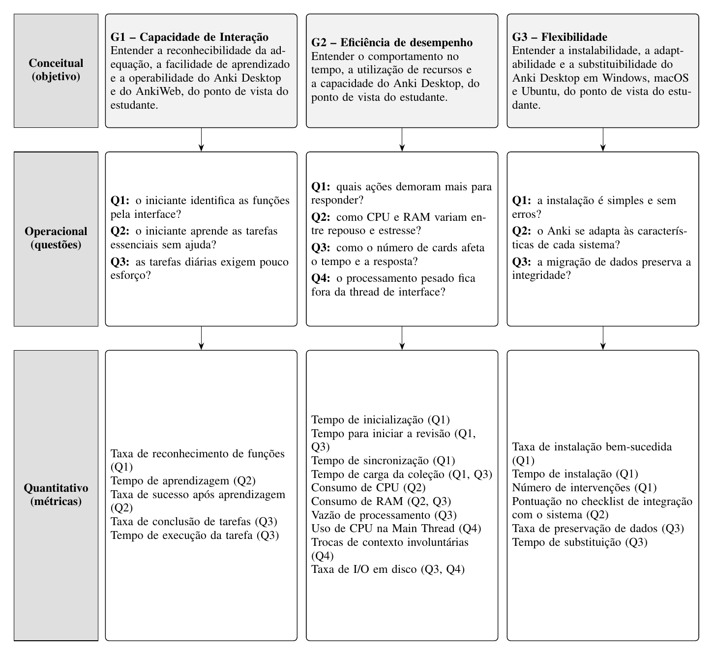

# Avaliação da Qualidade do Anki segundo a ISO/IEC 25010:2023

**Bryan Smith Rodrigues Cavalcante, Dante Fernandes Scarpati, Davi Severiano Freitas, Karolina Vieira Barbosa, Mateus de Siqueira Silva e Pedro Henrique Freire Rodrigues**

Faculdade de Ciências e Tecnologias em Engenharia (FCTE) / Faculdade UnB Gama (FGA), Universidade de Brasília (UnB), Brasília, DF, Brasil. Disciplina FGA0315 Qualidade de Software 1, Profa. Dra. Cristiane Ramos. Equipe Betty Snyder.

`{bryan.cavalcante, dante.scarpati, davi.freitas, karolina.barbosa, mateus.siqueira, pedro.rodrigues}@aluno.unb.br`

*Versão entregue na Entrega 1 (Fases 1 e 2), em 26/10/2026. Formato original: IEEE (conferência).*

---

**Abstract.** Anki is a free spaced-repetition study tool widely used by students, who must operate it on their own, on different computers and with collections that keep growing. This paper specifies the quality evaluation of Anki Desktop 26.09.3 and of the AnkiWeb account, login and synchronization flow, based on ISO/IEC 25010:2023 and on the product evaluation process. In Phase 1, the team defined the requester, the purpose of identifying improvement points from the student's point of view, a quality model adapted to the product components, and the scope, prioritizing Interaction Capability (emphasis 5), Performance Efficiency and Flexibility (emphasis 3). In Phase 2, the Goal-Question-Metric approach refined three measurement goals into ten questions with baseline hypotheses, metrics with definition, calculation and interpretation criterion, and four scoring levels (unsatisfactory, minimum, target and excellent), with judgment rules fixed before data collection. The resulting specification is the basis for the evaluation plan (Phase 3) and for the execution and improvement action (Phase 4).

**Resumo.** O Anki é uma ferramenta gratuita de estudo por repetição espaçada muito usada por estudantes, que precisam operá-la sozinhos, em computadores diferentes e com coleções que crescem. Este artigo especifica a avaliação da qualidade do Anki Desktop 26.09.3 e do fluxo de conta, login e sincronização do AnkiWeb, com base na ISO/IEC 25010:2023 e no processo de avaliação de produto. Na Fase 1, a equipe definiu o requisitante, o propósito de indicar pontos de melhoria do ponto de vista do estudante, o modelo de qualidade adaptado aos componentes do produto e o escopo, priorizando Capacidade de interação (ênfase 5), Eficiência de desempenho e Flexibilidade (ênfase 3). Na Fase 2, a abordagem GQM desdobrou três objetivos de medição em dez questões com hipóteses de baseline, métricas com definição, cálculo e critério de interpretação, e níveis de pontuação em quatro faixas (insatisfatório, mínimo, alvo e excelente), com regras de julgamento fixadas antes da coleta. A especificação resultante é a base do plano de avaliação (Fase 3) e da execução e da ação de melhoria (Fase 4).

---

## I. Introdução

O processo de garantia da qualidade de software consolidou-se como disciplina nuclear da Engenharia de Software moderna, estabelecendo critérios objetivos para que produtos atendam tanto às expectativas funcionais dos usuários quanto a restrições de engenharia e desempenho [1]. No contexto de ferramentas educacionais, o **Anki Desktop** ([github.com/ankitects/anki](https://github.com/ankitects/anki)) é uma plataforma de memorização ativa por repetição espaçada (*Spaced Repetition System*, SRS), construída com Python, Rust e a interface gráfica PyQt/QtWebEngine, que funciona em diferentes sistemas operacionais e armazena as coleções localmente em SQLite.

O presente trabalho, conduzido pela **Equipe Betty Snyder** na disciplina de Qualidade de Software 1 da Universidade de Brasília (FGA/FCTE-UnB), tem como objetivo avaliar a qualidade de produto do Anki Desktop (versão 26.09.3) e do fluxo de conta, login e sincronização do AnkiWeb, para indicar pontos de melhoria do ponto de vista do estudante. A avaliação segue a ISO/IEC 25010:2023 [2] e o processo de avaliação de produto [3].

## II. Fundamentação Teórica e Trabalhos Relacionados

### A. O Modelo de Qualidade de Produto ISO/IEC 25010:2023

A família de normas ISO/IEC 25000 (SQuaRE) estrutura a qualidade do produto de software em nove características principais [2]: adequação funcional, eficiência de desempenho, compatibilidade, capacidade de interação (antiga usabilidade), confiabilidade, segurança, manutenibilidade, flexibilidade (antiga portabilidade) e *safety* (segurança operacional). A **capacidade de interação** compreende reconhecibilidade da adequação, facilidade de aprendizado, operabilidade, proteção contra erro do usuário, engajamento do usuário, inclusividade, assistência ao usuário e autodescritividade; a **flexibilidade** compreende adaptabilidade, escalabilidade, instalabilidade e substituibilidade. No escopo deste projeto, foram selecionadas três características: **Capacidade de interação**, **Eficiência de desempenho** e **Flexibilidade**. As subcaracterísticas efetivamente avaliadas constam na Figura 1 e são detalhadas na Fase 2 (Seção IV).

### B. Processo de Avaliação de Produto

A ISO/IEC 25040 (SQuaRE) define o processo de avaliação de produtos de software com base no modelo da ISO/IEC 25010. Foram adotadas quatro de suas atividades centrais, que cobrem todo o caminho entre a definição do propósito da avaliação e o julgamento das medidas obtidas.

O processo de avaliação de produto de software é organizado em quatro fases. Na **Fase 1, estabelecer requisitos de avaliação**, definem-se o propósito da avaliação, o tipo de produto e o modelo de qualidade, com base no interesse do requisitante. Na **Fase 2, especificar a avaliação**, as subcaracterísticas são desdobradas em métricas, e definem-se níveis de pontuação e critérios de julgamento antes da coleta. Na **Fase 3, projetar a avaliação**, produz-se o plano de avaliação, com método, recursos e cronograma. Na **Fase 4, executar a avaliação**, obtêm-se as medidas, comparam-se com os critérios e julgam-se os resultados.

### C. Goal-Question-Metric (GQM)

A abordagem *Goal-Question-Metric* (GQM), proposta por Basili, Caldiera e Rombach [4], define medições a partir de objetivos, em três níveis. No **nível conceitual**, o objetivo descreve um objeto de medição, um foco de qualidade, um ponto de vista e um contexto, segundo o template: *Analisar* (o objeto) *para o propósito de* (entender, melhorar ou controlar) *com respeito a* (foco de qualidade) *do ponto de vista de* (ator interessado) *no contexto de* (ambiente). No **nível operacional**, o objetivo é desdobrado em questões, associadas a hipóteses. No **nível quantitativo**, cada questão recebe as métricas que a respondem. O processo compreende planejamento, definição, coleta de dados e interpretação; a definição ocorre de cima para baixo e a interpretação, de baixo para cima [4].

### D. Trabalhos Relacionados

Rojas et al. [5] mapeiam, em revisão sistemática, 68 métricas e 46 ferramentas de eficiência de desempenho na ISO/IEC 25010, com predominância de comportamento no tempo e utilização de recursos. Pereira et al. [6] medem vazão, tempo de resposta e consumo de CPU e RAM em cenários de estresse. Milichiewicz e Badurowicz [7] comparam a pegada de memória e a integração com o sistema operacional de aplicações multiplataforma, incluindo PyQt, base do Anki Desktop. Sukmandari e Sukardiyono [8] e Jayanto e Jati [9] aplicam a ISO/IEC 25010 com o *USE Questionnaire* [10] e os limiares de tempo de resposta de Hoxmeier e DiCesare [11].

## III. Fase 1 — Estabelecer os Requisitos de Avaliação

### A. Propósito da Avaliação e Uso Pretendido

A avaliação foi solicitada pela professora da disciplina de Qualidade de Software 1, que atua como requisitante. O objetivo da avaliação é indicar pontos de melhoria no produto, sob o ponto de vista do estudante, usuário final do Anki.

Os pontos de melhoria identificados serão usados pela professora para avaliar a capacidade da equipe de fundamentar tecnicamente uma avaliação de produto. Serão também registrados como recomendações priorizadas para dois públicos: os mantenedores do Anki, que podem usá-los para decidir correções, e os estudantes, que podem usá-los como orientação de uso. O ponto de melhoria mais relevante será a base da ação de melhoria da Entrega 2.

### B. Requisitante e Partes Interessadas

A Tabela I apresenta as partes interessadas, suas necessidades e a influência de cada uma nas escolhas da avaliação.

*Tabela I. Partes interessadas na avaliação*

| Parte interessada | Papel | Necessidade | Influência na avaliação |
|---|---|---|---|
| Professora da disciplina | Requisitante | Uma avaliação fundamentada e rastreável | Acordou as características avaliadas e define prazos e formato |
| Estudante | Usuário final (operador) | Usar o Anki sozinho, sem lentidão, em qualquer sistema | Define o ponto de vista, as tarefas dos testes e os critérios de julgamento |
| Mantenedores do Anki | Desenvolvedor e fornecedor | Problemas descritos de forma reproduzível e priorizada | Limitam o escopo ao que é observável e ao código aberto; o AnkiWeb é de código fechado |
| Equipe avaliadora | Avaliador | Um escopo viável no prazo | Define as plataformas e a profundidade da avaliação |

### C. Tipo de Produto e Descrição do Software

O produto avaliado é o Anki Desktop, versão 26.09.3, e o AnkiWeb, na versão em produção na data da avaliação, com a data de acesso registrada; o AnkiWeb é avaliado apenas na criação de conta, no login e na sincronização. O domínio é a educação, com estudo por repetição espaçada. Na classificação de Pressman, o Anki é um software de computador pessoal; na IEEE 1062, é um produto COTS, gratuito e de código aberto, e o AnkiWeb é um serviço gratuito de código fechado. Os principais usuários são estudantes universitários e autodidatas; o uso exige conhecimento básico de informática e nenhum conhecimento prévio de repetição espaçada. O uso é individual, em computador pessoal com Windows, macOS ou Ubuntu, sem treinamento formal nem suporte técnico; o estudo funciona sem internet, mas conta, login e sincronização exigem conexão.

O Anki Desktop possui oito funções principais: login na conta AnkiWeb; criação de baralhos; escrita de cards; revisão de cards, na qual o estudante avalia a própria resposta e o agendamento define quando o card volta; busca e edição no navegador de cards; importação e exportação; sincronização; e configuração das opções de estudo. A avaliação dedica-se principalmente à criação de baralhos, à escrita e à revisão de cards, ao login e à sincronização. A interface possui 16 janelas principais, como a janela principal, Adicionar, Navegador de cards, Opções do baralho, Importar, Exportar e Login de sincronização.

Há massa de dados de duas fontes: coleções sintéticas geradas com o pacote `anki` (por exemplo, 10 mil, 50 mil e 100 mil cards), para Eficiência de desempenho e Flexibilidade; e baralhos compartilhados no AnkiWeb, para os testes de Capacidade de interação. Os requisitos de software declarados pelo fabricante (apps.ankiweb.net e docs.ankiweb.net, consultados em 14/10/2026) são: Windows 10 versão 1703 ou posterior (x64) ou Windows 11 (ARM); macOS 13 ou posterior, em Apple Silicon ou Intel; distribuição Linux de 2022 ou posterior (x64, glibc 2.35+) ou de 2024 ou posterior (ARM, glibc 2.39+), com o pacote `zstd`; e, para o AnkiWeb, navegador atualizado e internet. Não há requisitos mínimos de memória ou processador.

### D. Modelo de Qualidade

O modelo de qualidade da ISO/IEC 25010:2023 foi adaptado ao Anki a partir dos componentes do produto submetidos à avaliação (Figura 1). A adaptação mapeia as características da norma, que são abstratas, para os componentes com os quais o estudante interage e restringe o escopo às subcaracterísticas mostradas na figura: a instalação e desinstalação, para a **Flexibilidade** (adaptabilidade, instalabilidade e substituibilidade); a interface gráfica e a revisão de cards, para a **Capacidade de interação** (reconhecibilidade da adequação, facilidade de aprendizado e operabilidade); a execução nos diferentes sistemas operacionais, para a **Eficiência de desempenho** e a **Flexibilidade**; e o fluxo de conta e sincronização do AnkiWeb, para as três características.

*Figura 1. Modelo de qualidade adaptado ao Anki Desktop e ao AnkiWeb, a partir da ISO/IEC 25010:2023 [2]. De cima para baixo: componentes avaliados, características e subcaracterísticas.*

### E. Seleção e Priorização das Características

A ênfase de cada característica foi definida pela combinação do impacto para o estudante (quanto uma falha atrapalha o uso) com a viabilidade de medição com os recursos e o prazo da equipe (Tabela II). A escolha de Capacidade de interação foi acordada com a requisitante, e as seis características não escolhidas ficam fora do escopo por acordo com ela.

*Tabela II. Priorização das características avaliadas*

| Característica | Impacto para o estudante | Viabilidade de medição | Ênfase |
|---|---|---|:---:|
| Capacidade de interação | Alto: todo estudante usa a interface sem treinamento | Média: exige testes com participantes | 5 |
| Eficiência de desempenho | Médio: notebooks variados e coleções que crescem | Alta: medições instrumentadas | 3 |
| Flexibilidade | Médio: estudantes usam sistemas diferentes e trocam de computador | Alta: instalação e migração controladas | 3 |

### F. Escopo, Profundidade e Objetos da Avaliação

**Objetos e abrangência.** Instalação e desinstalação, interface do usuário e execução do Anki Desktop 26.09.3, e criação de conta, login e sincronização no AnkiWeb; três características da ISO/IEC 25010:2023 (Capacidade de interação, Eficiência de desempenho e Flexibilidade), nas plataformas Windows, macOS e Ubuntu. As subcaracterísticas avaliadas são as da Figura 1: reconhecibilidade da adequação, facilidade de aprendizado e operabilidade; comportamento no tempo, utilização de recursos e capacidade; adaptabilidade, instalabilidade e substituibilidade.

**Profundidade.** Avaliação externa, do ponto de vista do estudante, baseada no comportamento observável, por meio de testes com usuários, medições instrumentadas e inspeção da interface. O código-fonte do Anki Desktop serve apenas como apoio; o AnkiWeb, de código fechado, é avaliado só pelo comportamento. Não se trata de certificação nem de laudo de conformidade.

**Relacionamento e restrições.** Avaliação independente, com a documentação oficial como referência; prazo até 18/11/2026, seis avaliadores, sem custo, apenas computadores da equipe e participantes com consentimento registrado.

**Fora do escopo.** AnkiDroid e AnkiMobile (produtos e bases de código separados); o algoritmo de agendamento (exigiria acompanhar usuários por semanas); as demais funções do AnkiWeb; as demais subcaracterísticas das três características escolhidas que não aparecem na Figura 1; e as seis características não escolhidas, por acordo com a requisitante.

### G. Relação com os Objetivos de Desenvolvimento Sustentável

A avaliação se relaciona ao ODS 4, Educação de Qualidade. Na **meta 4.3** (acesso igualitário à educação superior de qualidade, a preços acessíveis), o Anki Desktop é gratuito e apoia o estudo autônomo. Na **meta 4.4** (jovens e adultos com habilidades relevantes), o indicador 4.4.1, sobre habilidades em tecnologias da informação e comunicação, relaciona-se à facilidade de aprendizado avaliada em Capacidade de interação. Na **meta 4.5** (eliminar disparidades e garantir acesso a pessoas em situação de vulnerabilidade), relaciona-se à Flexibilidade e aos aspectos de inclusão da interface. Pontos de melhoria que reduzem barreiras de uso ampliam o alcance de uma ferramenta gratuita de estudo.

## IV. Fase 2 — Especificar a Avaliação

Esta seção especifica a avaliação por meio do GQM [4]. Para cada característica priorizada na Fase 1, apresentam-se o objetivo de medição, as questões e hipóteses, os fatores de variação, as métricas e os níveis de pontuação com os critérios de julgamento. Os níveis seguem quatro faixas comuns às três características: *insatisfatório*, *mínimo*, *alvo* e *excelente*. A Seção IV-D reúne a hierarquia GQM completa, e a Seção IV-E explicita a ligação entre as Fases 1 e 2.

### A. Capacidade de Interação

A equipe selecionou três subcaracterísticas: **reconhecibilidade da adequação**, porque o Anki usa conceitos próprios (nota, tipo de nota, card e baralho) e o estudante precisa perceber quais funções atendem ao que quer fazer; **facilidade de aprendizado**, porque a Fase 1 definiu o uso sem treinamento nem suporte; e **operabilidade**, porque quem já usa o Anki repete as mesmas tarefas diariamente. Os testes envolvem dois grupos definidos por triagem (Seção IV-A2): iniciantes (Grupo A), que respondem principalmente a Q1 e Q2, e usuários frequentes (Grupo B), que respondem a Q3 e servem de comparação em H3.

#### 1) Objetivo de Medição

O objetivo G1 segue o template do GQM [4] e as decisões comuns da equipe. O propósito de entender o produto serve para identificar pontos de melhoria, conforme o objetivo da avaliação definido na Fase 1.

| Template GQM | G1 — Capacidade de interação |
|---|---|
| **Analisar** | o Anki Desktop 26.09.3 e o fluxo de criação de conta, login e sincronização do AnkiWeb |
| **para o propósito de** | entender, identificando pontos de melhoria |
| **com respeito a** | reconhecibilidade da adequação, facilidade de aprendizado e operabilidade |
| **do ponto de vista do** | estudante, usuário final (iniciante e usuário frequente) |
| **no contexto de** | uso individual em computador pessoal, sem treinamento formal |

#### 2) Grupos de participantes e triagem

**Grupo A — Usuários iniciantes.** Participantes que nunca utilizaram o Anki antes do estudo. Não devem ter experiência prática anterior com as tarefas avaliadas no Anki Desktop ou no AnkiWeb. O uso de outros aplicativos de flashcards é registrado separadamente, pois pode influenciar a aprendizagem.

**Grupo B — Usuários frequentes.** Participantes que utilizaram o Anki regularmente durante as últimas quatro semanas, preferencialmente em pelo menos três dias por semana, e que já realizaram as tarefas centrais avaliadas: criar baralhos e cartões, revisar cartões e sincronizar com o AnkiWeb.

Antes da entrevista ou do preenchimento do formulário de avaliação, a pessoa responde ao formulário de triagem: (1) já utilizou o Anki (nunca / experimentou uma ou duas vezes / já utilizou regularmente); (2) nos últimos 7 dias, em quantos dias utilizou (nenhum / 1–2 / 3–4 / 5–7); (3) há quanto tempo utiliza regularmente (nunca / menos de 4 semanas / 4 semanas a 3 meses / mais de 3 meses); (4)–(6) já criou baralhos e cartões, já revisou e já sincronizou Desktop–AnkiWeb (sim/não); (7) já utilizou outros aplicativos de flashcards (sim/não); (8) familiaridade geral com informática (baixa/média/alta). A classificação no Grupo A ou B segue essas respostas.

#### 3) Questões e Hipóteses

*Tabela III. Questões e hipóteses de Capacidade de interação*

| Questão | Hipótese |
|---|---|
| **Q1** (Reconhecibilidade da adequação): um estudante que nunca usou o Anki consegue identificar, pela interface, quais funções usar para criar seus cards e estudar? | **H1:** no Grupo A, Trf das funções principais (criar baralho, adicionar cards e estudar) fica em *alvo* ou *excelente*; nota, tipo de nota e card ficam em *mínimo* ou *insatisfatório*. |
| **Q2** (Facilidade de aprendizado): um estudante iniciante consegue aprender, sem ajuda, a criar uma conta no AnkiWeb, criar um baralho, adicionar cards, revisá-los e sincronizar a coleção? | **H2:** no Grupo A, Tsa e Taprend em baralho, cards e revisão ficam em *alvo* ou *excelente*; conta e primeira sincronização ficam em *mínimo* ou *insatisfatório*. |
| **Q3** (Operabilidade): as tarefas do estudo diário podem ser executadas com pouco esforço por quem já usa o Anki? | **H3:** no Grupo B, Tct e Texec em revisar e adicionar cards ficam em *alvo* ou *excelente*; a diferença \|Δ\| entre Grupos A e B (médias de Tct e Texec) é maior em conta e sincronização do que em revisar e adicionar cards. |

#### 4) Fatores de Variação

Três fatores, obtidos na triagem e no perfil, podem influenciar os resultados: **familiaridade com informática** (ordinal: baixa, média ou alta) afeta H2 e H3 via tempos e ajudas em conta e sincronização; **experiência prévia com aplicativos de flashcards** (nominal) afeta H1 (reconhecimento de funções); e **sistema operacional** (nominal) afeta H2 e H3 via Texec.

#### 5) Métricas

A Tabela IV resume as cinco métricas do escopo (Plano de Medição, Aula 08). Todas são de escala de razão e coletadas em sessões observadas com consentimento registrado, nas tarefas da Fase 1 (criar baralho, adicionar cards, revisar, criar conta no AnkiWeb, login e sincronizar). Cada métrica indica a referência acadêmica de origem; Trf tem operacionalização própria, relacionada à referência citada.

*Tabela IV. Métricas de Capacidade de interação: definição, cálculo, referência e interpretação*

| Métrica | Q | Definição / cálculo | Referência de origem | Interpretação |
|---|:---:|---|---|---|
| Taxa de reconhecimento de funções (Trf) | Q1 | Porcentagem de iniciantes que indicam a função correta; Nreconh. / Npart. × 100% (operacionalização própria) | Adaptada de Sellier et al. [12] | Maior é melhor; 0–100% |
| Tempo de aprendizagem (Taprend) | Q2 | Média do tempo total do Grupo A no roteiro completo | Vogel et al. [13] | Menor é melhor; > 0 min |
| Taxa de sucesso após aprendizagem (Tsa) | Q2 | Tentativas concluídas com sucesso ÷ tentativas realizadas × 100% | Bird et al. [14] | Maior é melhor; 0–100% |
| Taxa de conclusão de tarefas (Tct) | Q3 | Porcentagem de tarefas concluídas por grupo; Nconcluídas / Npropostas × 100% | Bird et al. [14] | Maior é melhor; 0–100% |
| Tempo de execução da tarefa (Texec) | Q3 | Média do tempo da pessoa do recebimento da tarefa até o sucesso (também mediana), por tarefa e grupo | Bird et al. [14] | Menor é melhor; > 0 min |

#### 6) Níveis de Pontuação e Critérios de Julgamento

Os níveis da Tabela V foram fixados antes da coleta. Os limites de Texec medem o tempo da pessoa para concluir a tarefa e foram definidos por acordo da equipe (os limiares de 3, 9 e 12 s de Hoxmeier e DiCesare [11] aplicam-se ao tempo de resposta do sistema na Eficiência de desempenho, não a estas tarefas). Os demais limites também foram definidos por acordo da equipe, por falta de dados históricos do Anki.

*Tabela V. Níveis de pontuação das métricas de Capacidade de interação*

| Métrica | Insatisfatório | Mínimo | Alvo | Excelente |
|---|---|---|---|---|
| Trf (Q1) | Trf < 60% | 60% ≤ Trf < 75% | 75% ≤ Trf < 90% | Trf ≥ 90% |
| Taprend (Q2) | t > 40 min ou abandono | 25 ≤ t ≤ 40 min | 15 ≤ t < 25 min | t < 15 min |
| Tsa (Q2) | Tsa < 60% ou intervenção recorrente | 60% ≤ Tsa < 75% | 75% ≤ Tsa < 90% sem ajuda, ou Tsa ≥ 90% com uma ajuda | Tsa ≥ 90% sem ajuda |
| Tct, frequentes (Q3) | Tct < 80% ou abandono | 80% ≤ Tct < 90%, ou 100% com uma ajuda | 90% ≤ Tct < 100% sem ajuda | 100% sem ajuda |
| Texec (Q3) | t > 10 min ou falha | 5 ≤ t ≤ 10 min | 2 ≤ t < 5 min | t < 2 min |

**Regra de julgamento.** O julgamento procede de baixo para cima [4]: cada métrica é classificada em uma faixa, as faixas são agregadas por questão e as questões respondem ao G1. Uma questão é atendida quando suas métricas essenciais (Trf em Q1; Tsa e Taprend em Q2; Tct e Texec em Q3) estão no alvo ou acima; havendo divergência, prevalece a faixa mais baixa. H1–H3 são julgadas pelos valores esperados da Tabela III. Os fatores de variação não alteram os limites, mas são reportados na interpretação. As faixas mínimo e insatisfatório tornam-se recomendações priorizadas, e a mais relevante alimenta a ação de melhoria da Entrega 2.

### B. Eficiência de Desempenho

A equipe avalia as três subcaracterísticas de Eficiência de Desempenho da ISO/IEC 25010:2023: **comportamento no tempo**, para verificar a prontidão do aplicativo nas tarefas de estudo; **utilização de recursos**, para mensurar a pegada de CPU e memória em computadores pessoais modestos; e **capacidade**, para avaliar a estabilidade do sistema sob coleções volumosas (até 100 mil cards). A investigação da arquitetura concorrente (Q4) desdobra simultaneamente comportamento no tempo e utilização de recursos, analisando se o isolamento de tarefas intensivas no backend em Rust evita a degradação da interface gráfica em PyQt.

#### 1) Objetivo de Medição

O objetivo G2 segue o template do GQM [4] e as decisões comuns da equipe. O propósito de entender o produto serve para identificar pontos de melhoria, conforme o objetivo da avaliação definido na Fase 1:

| Template GQM | G2 — Eficiência de desempenho |
|---|---|
| **Analisar** | o Anki Desktop 26.09.3 e o fluxo de conta, login e sincronização do AnkiWeb |
| **para o propósito de** | entender |
| **com respeito a** | comportamento no tempo, utilização de recursos e capacidade |
| **do ponto de vista do** | estudante, usuário final (operador) |
| **no contexto de** | uso individual em computador pessoal com Windows, macOS ou Ubuntu |

#### 2) Questões e Hipóteses

As quatro questões e suas respectivas hipóteses de baseline constam na Tabela VI. As hipóteses expressam as expectativas quantitativas da equipe fundamentadas nas faixas de pontuação preestabelecidas.

*Tabela VI. Questões e hipóteses de Eficiência de desempenho*

| Questão | Hipótese |
|---|---|
| **Q1** (Comportamento no tempo): quais ações do estudante no Anki Desktop demandam maior tempo de resposta: inicialização, abertura da revisão, carregamento da coleção ou sincronização? | **H1:** o tempo de sincronização situa-se na faixa *alvo* (3 ≤ t < 9 s) devido à latência de rede; o tempo de inicialização (*cold start*) e o tempo para iniciar a revisão situam-se na faixa *excelente* (t < 3 s). |
| **Q2** (Utilização de recursos): como o consumo médio e de pico de CPU e de memória RAM varia entre o cenário de repouso e o cenário de estresse operacional? | **H2:** em repouso, o uso médio de CPU fica entre 2% e 5% e a RAM entre 150 e 250 MB (*alvo*); sob estresse operacional, o pico de CPU fica entre 40% e 70% e a RAM estabiliza-se entre 350 e 500 MB (*alvo*). |
| **Q3** (Capacidade): qual o impacto do aumento volumétrico da coleção (10k, 50k e 100k cards) sobre o tempo de processamento e a vazão do banco de dados SQLite? | **H3:** com 100 mil cards, a degradação temporal do carregamento situa-se entre 15% e 35% (*alvo*), com tempo total inferior a 9 s e vazão superior a 15.000 cards/min na verificação do banco. |
| **Q4** (Comportamento concorrente): durante operações intensivas de banco e sincronização, as *Worker Threads* em Rust isolam o processamento pesado sem reter a *Main Thread* (UI Qt)? | **H4:** as *Worker Threads* absorvem a sobrecarga de I/O, limitando o consumo de CPU da *Main Thread* entre 15% e 35% (*alvo*), com preempções involuntárias (`nvcswch/s`) < 10 e sem congelamento perceptível da interface gráfica. |

#### 3) Fatores de Variação

Antes da execução dos testes, registram-se as condições de controle: todas as aplicações concorrentes e navegadores devem ser encerrados, mantendo apenas os serviços essenciais do sistema operacional. Os fatores de variação identificados e seu mapeamento de impacto são:

- **Configuração de Hardware (CPU, núcleos e tipo de disco SSD/HDD):** afeta diretamente H1 (tempos de leitura), H2 (picos de CPU) e H3 (I/O do banco de dados).
- **Sistema Operacional e Servidor Gráfico (Windows 11, macOS, Ubuntu com X11 ou Wayland):** afeta H2 e H4 devido às diferenças no gerenciamento de memória do PyQt e escalonamento de threads [7].
- **Latência e Largura de Banda da Conexão:** afeta estritamente a sincronização em H1.
- **Volume da Coleção de Cards (10k, 50k e 100k cards sintéticos):** afeta a escala de degradação em H3 e consumo de RAM em H2.

#### 4) Métricas

As dez métricas de Eficiência de Desempenho estão detalhadas na Tabela VII. Por restrição das ferramentas instrumentadas de baixo nível (`pidstat` e `perf`), as métricas de análise granular por thread associadas à Q4 são coletadas prioritariamente no ambiente Ubuntu Linux; nos sistemas Windows e macOS, a observação concorrente apoia-se nos monitores nativos de desempenho (*Performance Monitor* e *Activity Monitor*).

*Tabela VII. Métricas de Eficiência de Desempenho: definição, cálculo, coleta e interpretação*

| Métrica | Q | Definição | Função de cálculo | Procedimento e meio de coleta | Critério de interpretação |
|---|:---:|---|---|---|---|
| Tempo de inicialização (Tini) | Q1 | Intervalo entre o comando de disparo e a renderização da tela inicial | tjanela pronta − texecução | Script automatizado (`time` / `perf stat`); média de 5 execuções frias (*cold*) | Menor é melhor; limiares baseados em Hoxmeier e DiCesare [11] |
| Tempo para iniciar revisão (Trev) | Q1, Q3 | Duração entre o clique em "Estudar Agora" e a exibição do primeiro card | tcard visível − tclique | Registro de eventos de UI e instrumentação via `perf trace` | Menor é melhor; tempo de resposta perceptivo do estudante |
| Tempo de sincronização (Tsinc) | Q1 | Tempo total de transferência e conciliação da coleção com o AnkiWeb | tfim sinc − tinício sinc | Cronometragem em rede controlada com coleção padronizada | Menor é melhor; depende da latência de rede |
| Tempo de carga da coleção (Tcarga) | Q1, Q3 | Tempo de leitura e indexação do banco SQLite (`.anki2`) | tbanco carregado − tabertura coleção | Medição instrumentada do encerramento das consultas de abertura | Menor é melhor; indicador direto de eficiência de armazenamento |
| Consumo de CPU (CPUmed, CPUpico) | Q2 | Percentual de utilização dos núcleos de processamento pelo processo do Anki | Média e valor máximo amostrados no intervalo | Amostragem em intervalos de 1 s via `pidstat -u 1` (Linux) ou equivalente no Windows/macOS | Menor é melhor; reflete a pegada computacional sobre a máquina |
| Consumo de RAM (RAMmed, RAMpico) | Q2, Q3 | Memória física residente (*Resident Set Size*, RSS) alocada | Média e pico de RSS (em MB) durante a sessão estabilizada | Amostragem com `pidstat -r 1` e biblioteca `psutil` após 5 min de uso | Menor é melhor; estabilidade sem vazamentos de memória (*leaks*) |
| Vazão de processamento (Vazproc) | Q3 | Quantidade de cards validados por unidade de tempo no banco de dados | Cards processados ÷ tempo de processamento (cards/min) | Script em Python utilizando o pacote oficial `anki` (*Check Database*) | Maior é melhor; capacidade de processamento em lote |
| Uso de CPU na Main Thread (CPUmain) | Q4 | Carga de processamento consumida pela thread de interface Qt | Percentual médio de CPU atribuído ao TID da thread principal | Coleta isolada via `pidstat -t -u 1` identificando a thread de UI | Menor é melhor; valores baixos asseguram ausência de travamentos |
| Trocas de contexto involuntárias (Ctxinvol) | Q4 | Frequência de preempções forçadas do escalonador nas threads | Taxa média de trocas de contexto involuntárias (`nvcswch/s`) | Amostragem por thread via `pidstat -t -w 1` no ambiente Ubuntu Linux | Menor é melhor; alta taxa indica disputa excessiva por recursos |
| Taxa de I/O em disco (IOdisco) | Q3, Q4 | Volume de leitura e escrita física no banco de dados SQLite | Taxa instantânea e média de transferência em kB/s (bytes ÷ tempo) | Monitoramento de descritores de arquivo e disco via `pidstat -t -d 1` | Menor em repouso é melhor; sob estresse, compatível com a taxa do disco |

#### 5) Níveis de Pontuação e Critérios de Julgamento

Os critérios de julgamento da Tabela VIII foram fixados antes da coleta. Os limiares de tempo de resposta apoiam-se no estudo experimental de Hoxmeier e DiCesare [11], validado na literatura de avaliação com a ISO/IEC 25010 [8], [9], delimitando faixas sem sobreposição de borda no formato a ≤ x < b. A escala de memória e CPU contempla o comportamento típico da interface PyQt/QtWebEngine sob computação heterogênea [7], [6].

*Tabela VIII. Níveis de pontuação das métricas de Eficiência de desempenho*

| Métrica / agrupamento | Insatisfatório | Mínimo | Alvo | Excelente |
|---|---|---|---|---|
| Tempos de resposta (Tini, Trev, Tsinc, Tcarga) | t ≥ 12 s ou falha | 9 ≤ t < 12 s | 3 ≤ t < 9 s | t < 3 s |
| Memória RAM em repouso (RAMrep) | RAM ≥ 400 MB | 250 ≤ RAM < 400 MB | 150 ≤ RAM < 250 MB | RAM < 150 MB |
| Memória RAM sob estresse (RAMestresse) | RAM ≥ 800 MB ou *leak* | 500 ≤ RAM < 800 MB | 350 ≤ RAM < 500 MB | RAM < 350 MB |
| CPU em repouso (CPUrep) | CPU ≥ 10% | 5% ≤ CPU < 10% | 2% ≤ CPU < 5% | CPU < 2% |
| Pico de CPU sob estresse (CPUpico) | CPU ≥ 90% sustentado | 70% ≤ CPU < 90% | 40% ≤ CPU < 70% | CPU < 40% |
| Degradação com 100k cards (Degcarga) | Δt ≥ 60% ou falha | 35% ≤ Δt < 60% | 15% ≤ Δt < 35% | Δt < 15% |
| Vazão de banco (Vazproc, cards/min) | Vaz < 5.000 | 5.000 ≤ Vaz < 10.000 | 10.000 ≤ Vaz < 20.000 | Vaz ≥ 20.000 |
| CPU da Main Thread (CPUmain) | CPU ≥ 60% ou trava > 1 s | 35% ≤ CPU < 60% | 15% ≤ CPU < 35% | CPU < 15% |
| Preempção involuntária (Ctxinvol, `nvcswch/s`) | Ctx ≥ 50 | 20 ≤ Ctx < 50 | 10 ≤ Ctx < 20 | Ctx < 10 |
| Taxa de I/O em disco em repouso (IOrep) | IO ≥ 500 kB/s | 100 ≤ IO < 500 kB/s | 10 ≤ IO < 100 kB/s | IO < 10 kB/s |

**Regra de julgamento e plano de medição.** A consolidação ocorre de forma ascendente: cada métrica coletada é enquadrada na respectiva faixa de pontuação, gerando o julgamento de cada questão (Q1–Q4) e respondendo ao objetivo G2. O plano de medição detalhado (responsáveis, cronograma exato de amostragem, massa de dados sintética e scripts de automação) e o plano de análise ficam postergados para o Plano de Avaliação (Fase 3, a ser entregue no Ponto de Controle 2).

### C. Flexibilidade (antiga Portabilidade)

A equipe avalia as três subcaracterísticas de Flexibilidade da ISO/IEC 25010:2023: **instalabilidade**, que mede o esforço e a taxa de sucesso da instalação nas três plataformas; **adaptabilidade**, que verifica a integração do aplicativo com atalhos, tema escuro, bandeja e associação de arquivos; e **substituibilidade**, que mede a preservação de dados e o tempo de migração entre máquinas. A desinstalação é verificada apenas qualitativamente durante os testes (o usuário deve conseguir remover o Anki pelos mecanismos padrão do sistema operacional), sem métrica própria.

#### 1) Objetivo de Medição

O objetivo G3 segue o template do GQM [4], com o ponto de vista definido na Fase 1 e as decisões comuns da equipe. O propósito é identificar pontos de melhoria, e o ponto de vista é o do estudante, usuário final.

| Template GQM | G3 — Flexibilidade |
|---|---|
| **Analisar** | o Anki Desktop 26.09.3 e o fluxo de conta, login e sincronização do AnkiWeb |
| **para o propósito de** | entender |
| **com respeito a** | adaptabilidade, instalabilidade e substituibilidade |
| **do ponto de vista do** | estudante, usuário final |
| **no contexto de** | uso individual em computador pessoal, nas plataformas Windows, macOS e Ubuntu |

#### 2) Questões e Hipóteses

A Tabela IX apresenta as questões e as hipóteses de baseline, com os valores esperados ligados às métricas e às faixas de pontuação da Tabela XI.

*Tabela IX. Questões e hipóteses de Flexibilidade*

| Questão | Hipótese |
|---|---|
| **Q1** (Instalabilidade): o processo de instalação do Anki Desktop ocorre de forma simples e livre de erros nas três plataformas? | **H1:** no Windows e no macOS, a instalação tem 100% de sucesso, nenhuma intervenção manual e menos de 2 min; no Ubuntu, leva de 2 a 5 min e exige pelo menos uma intervenção manual. |
| **Q2** (Adaptabilidade): o Anki Desktop se adapta às características nativas de cada sistema operacional (atalhos, tema escuro, bandeja)? | **H2:** o checklist de integração atinge 10/10 no macOS e 9/10 no Windows e no Ubuntu, com falha pontual de tema escuro ou de associação de arquivos `.apkg` no Ubuntu. |
| **Q3** (Substituibilidade): a migração de dados (exportação, importação e sincronização) preserva a integridade das informações ao trocar de máquina? | **H3:** a migração via arquivos `.apkg` e AnkiWeb preserva 100% dos dados, com tempo de substituição inferior a 1 min. |

#### 3) Fatores de Variação

São registrados três fatores que podem influenciar os resultados: o **sistema operacional** (Windows, macOS ou Ubuntu), com maior tempo esperado no Ubuntu por causa de dependências como o `zstd`, que afeta H1 (tempo e intervenções de instalação) e H2 (integração com o sistema); a **arquitetura do processador** (x64 ou ARM), que afeta H1 (tempo de instalação); e a **permissão de administrador** (sim ou não), cuja ausência pode inviabilizar a instalação ou exigir intervenções e, portanto, afeta H1.

#### 4) Métricas

A Tabela X detalha as seis métricas do escopo, cada uma ligada a uma questão de pesquisa. A integração com o sistema operacional usa o checklist de 10 critérios derivado de Milichiewicz e Badurowicz [7]: (1) ícone na bandeja do sistema; (2) atalhos globais de teclado; (3) associação de arquivos `.apkg`; (4) diálogos nativos de abrir e salvar; (5) tema escuro sincronizado com o SO; (6) notificações nativas; (7) integração com a área de transferência; (8) menu contextual nativo; (9) arrastar e soltar arquivos `.apkg`; e (10) compatibilidade com recursos de acessibilidade do SO. As demais métricas são de escala de razão.

*Tabela X. Métricas de Flexibilidade: questão, definição, cálculo e interpretação*

| Métrica | Q | Definição | Cálculo | Critério de interpretação |
|---|:---:|---|---|---|
| Taxa de instalação bem-sucedida (Tinst) | Q1 | Percentual de tentativas de instalação concluídas sem falha em cada plataforma | Nsucesso / Ntentativas × 100% | Maior é melhor; 0–100% |
| Tempo de instalação (Tinst_t) | Q1 | Tempo entre o início e a conclusão do processo de instalação | tfim − tinício (min) | Menor é melhor; > 0 min |
| Número de intervenções (Nint) | Q1 | Quantidade de ações manuais extras exigidas para concluir a instalação | Contagem inteira | Menor é melhor; inteiro ≥ 0 |
| Pontuação no checklist de integração (Pint) | Q2 | Soma dos critérios de integração com o SO atendidos (10 itens) | Soma de ci, com ci ∈ {0, 1}, para i = 1 a 10 | Maior é melhor; 0–10 |
| Taxa de preservação de dados (Tpd) | Q3 | Percentual de itens da coleção preservados após a migração | Npreservados / Ntotais × 100% | Maior é melhor; 0–100% |
| Tempo de substituição (Tsub) | Q3 | Tempo entre o início e a conclusão da migração com verificação de integridade | tfim − tinício (min) | Menor é melhor; > 0 min |

#### 5) Níveis de Pontuação e Critérios de Julgamento

Os níveis da Tabela XI foram definidos por acordo da equipe, com base nas metas de aceitação do projeto e nas referências da literatura. A faixa *Mínimo* da Substituibilidade foi preenchida com a exigência de intervenção manual, que separa a migração automática (alvo/excelente) da migração que exige correção.

*Tabela XI. Níveis de pontuação das métricas de Flexibilidade*

| Métrica | Insatisfatório | Mínimo | Alvo | Excelente |
|---|---|---|---|---|
| Taxa de instalação Tinst (Q1) | < 100% (falha) | 100% com uma intervenção manual | 100% sem intervenção | 100% sem intervenção e Tinst_t < 2 min |
| Tempo de instalação Tinst_t (Q1) | > 10 min | 5 a 10 min | 2 a 5 min | < 2 min |
| Número de intervenções Nint (Q1) | > 2 | 2 | 1 | 0 |
| Pontuação no checklist Pint (Q2) | < 6/10 | 6 ou 7/10 | 8 ou 9/10 | 10/10 |
| Taxa de preservação Tpd (Q3) | Perda de dados | 100% com intervenção manual | 100% automática em até 1 min | 100% automática em menos de 1 min |
| Tempo de substituição Tsub (Q3) | > 5 min | 2 a 5 min | 1 a 2 min | < 1 min |

**Regra de julgamento.** O julgamento procede de baixo para cima [4]: cada métrica é classificada em uma faixa, as faixas são agregadas por questão e as questões respondem ao G3. Uma questão é atendida quando suas métricas essenciais (Tinst e Tinst_t em Q1; Pint em Q2; Tpd e Tsub em Q3) estão no alvo ou acima; havendo divergência, prevalece a faixa mais baixa. As faixas mínimo e insatisfatório tornam-se recomendações priorizadas, e a mais relevante alimenta a ação de melhoria da Entrega 2. O plano de medição detalhado (quem coleta, quando e como), o número de participantes e o caminho mínimo das tarefas ficam para o plano de avaliação (Fase 3, PC2).

### D. Diagrama GQM

A Figura 2 apresenta a hierarquia GQM da avaliação: os três objetivos no nível conceitual, as questões no nível operacional e as métricas no nível quantitativo, cada uma acompanhada da questão que responde.

*Figura 2. Hierarquia GQM da avaliação: objetivos, questões e métricas de Capacidade de interação, Eficiência de desempenho e Flexibilidade.*

### E. Coerência entre as Fases 1 e 2

A Fase 1 delimitou o escopo, sob o ponto de vista do estudante, em quatro componentes: a interface do Anki Desktop, sua execução em Windows, macOS e Ubuntu, a instalação e o fluxo de conta e sincronização do AnkiWeb. A Fase 2 mantém nos três objetivos esse ponto de vista e a priorização da Fase 1 (Capacidade de interação com ênfase 5, as demais com 3): as questões de **Capacidade de interação** avaliam a interação com a interface e com o fluxo de conta e sincronização; as métricas de **Eficiência de desempenho** medem a execução e a fluidez do estudo; e as de **Flexibilidade** cobrem a instalação e a migração entre as três plataformas.

## V. Considerações Finais e Próximos Passos

Este artigo apresentou as Fases 1 e 2 da avaliação da qualidade do Anki Desktop e do AnkiWeb sob a perspectiva do estudante: os requisitos da avaliação e a especificação por meio do GQM, com métricas, níveis de pontuação e critérios de julgamento para Capacidade de interação, Eficiência de desempenho e Flexibilidade. Com o *feedback* do Ponto de Controle 1 (21/10/2026), os artefatos foram refinados para esta Entrega 1. Como próximos passos, o plano de avaliação (Fase 3) será apresentado no Ponto de Controle 2, e a execução, o julgamento e a ação de melhoria, na Entrega 2.

## Declaração de Uso de Inteligência Artificial

A equipe utilizou ferramentas de Inteligência Artificial (ChatGPT, Claude, Gemini e DeepSeek) como apoio durante a Entrega 1: na estruturação e formatação do código LaTeX no padrão IEEE; na revisão textual e na tradução de termos técnicos e de artigos científicos; na análise do repositório do Anki; na redação de rascunhos das seções da Fase 1 e dos objetivos GQM; e na produção das atas a partir das transcrições das reuniões. Todo o conteúdo gerado foi revisado pela equipe, em reunião ou de forma assíncrona, e conferido com os materiais da disciplina; as decisões de escopo, a escolha das métricas e os critérios de julgamento foram tomados pela equipe.

## Referências

[1] D. Galin, *Software Quality: Concepts and Practice*. New York, NY, USA: John Wiley & Sons / IEEE Press, 2018.

[2] *Systems and software engineering — Systems and software Quality Requirements and Evaluation (SQuaRE) — System and software quality models*, ISO/IEC 25010:2023, International Organization for Standardization, Geneva, Switzerland, 2023.

[3] *Systems and software engineering — Systems and software Quality Requirements and Evaluation (SQuaRE) — Evaluation process*, ISO/IEC 25040:2023, International Organization for Standardization, Geneva, Switzerland, 2023.

[4] V. R. Basili, G. Caldiera, and H. D. Rombach, "The Goal Question Metric approach," in *Encyclopedia of Software Engineering*, J. J. Marciniak, Ed. New York, NY, USA: John Wiley & Sons, 1994, pp. 528–532.

[5] H. Rojas, R. Renteria, and V. Martinez, "Understanding performance efficiency in ISO/IEC 25000: A systematic literature review," *Int. J. Informatics Visualization (JOIV)*, vol. 9, no. 6, pp. 2405–2417, 2025.

[6] D. S. Pereira, L. F. V. Bezerra, J. S. Nunes, I. M. Barroca Filho, and F. A. S. Lopes, "Performance efficiency evaluation based on ISO/IEC 25010:2011 applied to a case study on load balance and resilient," in *Anais do XXIV Workshop de Testes e Tolerância a Falhas (WTF)*. Porto Alegre, RS, Brasil: SBC, 2023, pp. 108–120, doi: 10.5753/wtf.2023.787.

[7] R. Milichiewicz and M. Badurowicz, "Comparative analysis of cross-platform application development tools in terms of operating system integration," *Journal of Computer Science Institute*, vol. 36, pp. 357–364, 2025.

[8] D. G. Sukmandari and T. Sukardiyono, "Analisis aplikasi jadwal perkuliahan berbasis android berdasarkan standar ISO 25010," *Elinvo (Electronics, Informatics, and Vocational Education)*, vol. 2, no. 1, pp. 80–84, 2017.

[9] R. D. Jayanto and H. Jati, "Evaluasi kualitas aplikasi mobile kamus istilah jaringan pada platform android dengan standar ISO/IEC 25010," *Elinvo (Electronics, Informatics, and Vocational Education)*, vol. 2, no. 2, pp. 178–183, 2017.

[10] A. M. Lund, "Measuring usability with the USE Questionnaire," *Usability Interface*, vol. 8, no. 2, pp. 3–6, 2001.

[11] J. A. Hoxmeier and C. DiCesare, "System response time and user satisfaction: An experimental study of browser-based applications," in *Proc. AMCIS 2000*, 2000, pp. 1–6.

[12] Q. Sellier, A. Sluÿters, J. Vanderdonckt, and I. Poncin, "Evaluating gesture user interfaces: Quantitative measures, qualitative scales, and method," *Int. J. Human-Computer Studies*, vol. 186, Art. no. 103245, 2024.

[13] M. Vogel, P. Knapik, M. Cohrs, B. Szyperrek, W. Pueschel, H. Etzel, D. Fiebig, A. Rausch, and M. Kuhrmann, "Metrics in automotive software development: A systematic literature review," *J. Softw.: Evol. Process*, vol. 33, no. 2, Art. no. e2296, 2021.

[14] M. Bird, N. Carter, A. Lim, N. Kazmie, C. Fajardo, S. Reaume, and M. H. McGillion, "A novel hospital-to-home system for children with medical complexities: Usability testing study," *JMIR Formative Research*, vol. 6, no. 8, Art. no. e34572, 2022.

## Apêndice A — Tabela de Contribuição da Equipe

*Tabela XII. Contribuição de cada integrante para a Entrega 1 (planilha de horas, registros de 07/10 a 26/10/2026; total de 63,04 horas)*

| Integrante | Dupla | Atividades realizadas | Esforço (%) |
|---|:---:|---|---:|
| Bryan Smith Rodrigues Cavalcante | C | Reuniões; tabela GQM, fatores de variação e detalhamento das métricas de Flexibilidade; atualização dos diagramas; correção das pendências para a Entrega 1 | 12,42 |
| Dante Fernandes Scarpati | C | Reuniões; diagramas do modelo de qualidade e do GQM; métricas de Flexibilidade; slides; revisão do artigo | 10,04 |
| Davi Severiano Freitas | A | Reuniões, atas e organização do trabalho; Fase 1; slides 1 a 5 e preparação do PC1; planejamento e distribuição das correções; revisão e finalização do artigo | 24,84 |
| Karolina Vieira Barbosa | B | Reuniões; estrutura e atualizações da GitPage; estudo de Desempenho dos Processos; ajustes no Overleaf; correção das pendências para a Entrega 1 | 18,94 |
| Mateus de Siqueira Silva | B | Reunião; layout e textos iniciais do artigo; estudo de Desempenho dos Processos; correções e revisão do GQM de Eficiência de desempenho | 14,28 |
| Pedro Henrique Freire Rodrigues | A | Reuniões; termo de consentimento; métricas e níveis de Capacidade de interação; slides 9 e 10; revisão do artigo frente às pendências da Dupla A | 19,48 |
| **Total** | | **63,04 horas registradas** | **100,00** |
