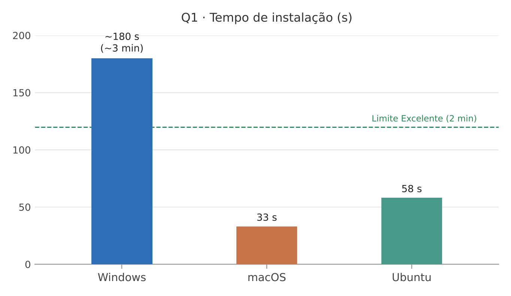
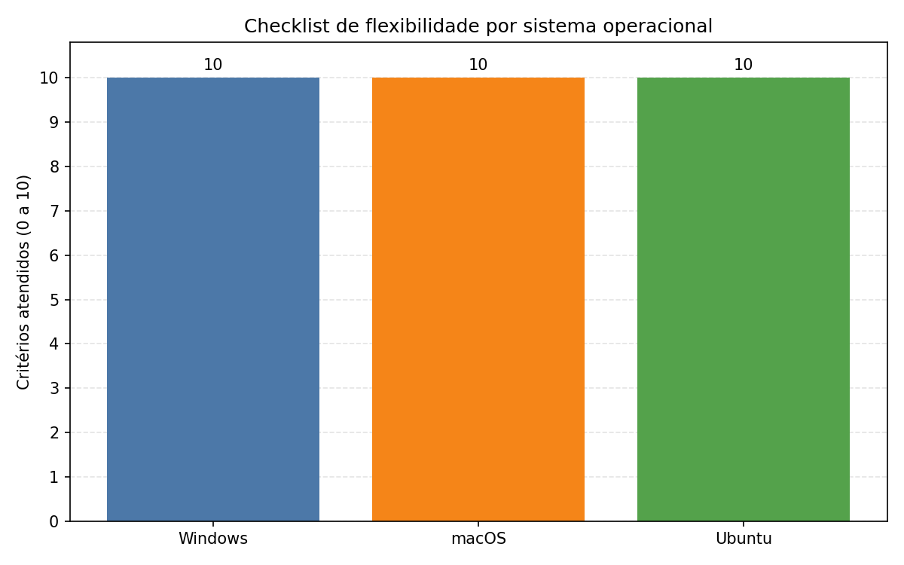

# Avaliação de Flexibilidade

Esta página reúne a **coleta**, os **resultados** e a **análise** de Flexibilidade na Fase 4, frente ao GQM da [Fase 2](../../fase2.md). Voltar à [Visão geral da Fase 4](../../fase4.md).

## Coleta

Os protocolos de [instalação](../protocolos/flexibilidade-instalacao.md), [checklist](../protocolos/flexibilidade-checklist.md) e [migração](../protocolos/flexibilidade-migracao.md) preveem, em laboratório (Dupla C), as métricas Tinst, Tinst_t, Nint, Pint, Tpd e Tsub nas máquinas de referência Windows, macOS e Ubuntu ([Ambiente](../protocolos/ambiente.md)).

Publicados em [`avaliacao/dados/flexibilidade/consolidado/`](https://github.com/FCTE-Qualidade-de-Software-1/2026-2_T01_BETTY_SNYDER/tree/main/avaliacao/dados/flexibilidade/consolidado): tempos de instalação, checklist de integração (Pint), migração M1/M2 (Tpd, Tsub) e dois gráficos. A pasta `bruto/` ainda não espelha os arquivos `diff_m*_rep*.csv` citados no consolidado.

## Resultados

Fontes: [`flexibilidade-instalacao-tempo.csv`](https://github.com/FCTE-Qualidade-de-Software-1/2026-2_T01_BETTY_SNYDER/blob/main/avaliacao/dados/flexibilidade/consolidado/flexibilidade-instalacao-tempo.csv), [`flexibilidade-checklist-registro.csv`](https://github.com/FCTE-Qualidade-de-Software-1/2026-2_T01_BETTY_SNYDER/blob/main/avaliacao/dados/flexibilidade/consolidado/flexibilidade-checklist-registro.csv) e [`flexibilidade-migracao.csv`](https://github.com/FCTE-Qualidade-de-Software-1/2026-2_T01_BETTY_SNYDER/blob/main/avaliacao/dados/flexibilidade/consolidado/flexibilidade-migracao.csv). Faixas da Tabela XI da [Fase 2](../../fase2.md).

| Sistema | Tinst | Tinst_t | Nint | Faixas (Tinst / Tinst_t / Nint) | Pint | Faixa Pint |
| --- | --- | --- | --- | --- | --- | --- |
| Windows 11 | 100% (1/1) | 3,82 min | 0 | Alvo / alvo / excelente | 10/10 | Excelente |
| macOS 27 (ARM) | 100% (1/1) | 0,55 min | 0 | Excelente / excelente / excelente | 10/10 | Excelente |
| Ubuntu 26.04.1 | 100% (1/1) | 0,97 min | 0 | Excelente / excelente / excelente | 10/10 | Excelente |

*Figura. Tempo de instalação (Tinst_t) em Windows, macOS e Ubuntu.*

*Figura. Pontuação do checklist de integração (Pint) por sistema operacional.*

**Migração (Q3).** Seis ensaios em 20/11/2026 (M1 `.apkg` e M2 AnkiWeb, três pares de SO cada): Tpd = 100% (0 diferenças em 10.000 cartões; sem intervenção); Tsub entre 2,33 e 2,66 min (média 2,51 min), faixa **mínimo**.

**Qualitativos (Parte C das entrevistas; complementam o laboratório).**

| Participante | Relato sobre instalação |
| --- | --- |
| PB01 (macOS) | Instalação “tranquila”; precisou autorizar a abertura do aplicativo baixado da internet (Gatekeeper). |
| PB02 (Windows) | Instalação “tranquila” e “intuitiva”; sem passo além do instalador. |
| PB03 (Windows) | Instalação “um pouco confusa” no site (extensões externas); precisou de passo além do instalador. |
| PA01 (Grupo A) | Anki já instalado pela equipe antes da sessão; perguntas de instalabilidade do Grupo B marcadas N/A. |

## Análise

| Questão / hipótese (Fase 2) | Situação nesta página |
| --- | --- |
| **Q1 / H1** (instalabilidade) | Atendida nos três sistemas (Tinst e Tinst_t no alvo ou excelente; Nint = 0). H1 parcial: no Ubuntu o tempo ficou abaixo de 2 min e sem intervenção, diferente da expectativa de 2 a 5 min com intervenção. |
| **Q2 / H2** (adaptabilidade) | Atendida: Pint = 10/10 nos três sistemas (faixa excelente). |
| **Q3 / H3** (substituibilidade) | Tpd = 100% (preservação confirmada); Tsub média 2,51 min (faixa mínimo). Q3 não atendida no alvo. H3 parcial: preservação sim; tempo &lt; 1 min não. |
| **Objetivo G (Flexibilidade)** | Q1 e Q2 atendidas; Q3 com evidência completa na faixa mínimo (tempo de migração). |

Arquivos opcionais remanescentes: espelhar `diff_m*_rep*.csv` em `avaliacao/dados/flexibilidade/bruto/migracao/`.

---

## Detalhamento e evidências

Esta página interpreta as medidas de Flexibilidade (Dupla C) frente ao GQM da [Fase 2](../../fase2.md) e aos protocolos da [Fase 3](../../fase3.md). Os valores vêm dos CSV publicados em `avaliacao/dados/flexibilidade/consolidado/`, incluindo a migração M1/M2 publicada por Bryan70897 em 23/11/2026.

## Escopo GQM

| Questão | Métricas (Fase 2) | Protocolo |
| --- | --- | --- |
| Q1 instalabilidade | Tinst (taxa de sucesso), Tinst_t (tempo), Nint (intervenções manuais extras) | [Instalação](../protocolos/flexibilidade-instalacao.md) |
| Q2 adaptabilidade | Pint (checklist de 10 critérios de integração com o sistema) | [Checklist](../protocolos/flexibilidade-checklist.md) |
| Q3 substituibilidade | Tpd, Tsub | [Migração](../protocolos/flexibilidade-migracao.md) |

Máquinas de referência: [Ambiente](../protocolos/ambiente.md) (Windows: Bryan; macOS: Davi; Ubuntu: Dante).

## Evidências no repositório

| Artefato | Situação em 23/11/2026 |
| --- | --- |
| Tempos de instalação | [`flexibilidade-instalacao-tempo.csv`](https://github.com/FCTE-Qualidade-de-Software-1/2026-2_T01_BETTY_SNYDER/blob/main/avaliacao/dados/flexibilidade/consolidado/flexibilidade-instalacao-tempo.csv) |
| Checklist Pint | [`flexibilidade-checklist-registro.csv`](https://github.com/FCTE-Qualidade-de-Software-1/2026-2_T01_BETTY_SNYDER/blob/main/avaliacao/dados/flexibilidade/consolidado/flexibilidade-checklist-registro.csv) |
| Migração (Tpd, Tsub) | [`flexibilidade-migracao.csv`](https://github.com/FCTE-Qualidade-de-Software-1/2026-2_T01_BETTY_SNYDER/blob/main/avaliacao/dados/flexibilidade/consolidado/flexibilidade-migracao.csv) (6 ensaios em 20/11/2026: M1 `.apkg` e M2 AnkiWeb, 3 repetições cada) |
| Gráficos | `grafico_flexibilidade_tempo_instalacao_3so.png`; `grafico-flexibilidade-checklist.png` (cópias em `docs/assets/` para a GitPage) |
| CSV bruto no padrão `<métrica>_<cenário>_<execução>` | Ainda não espelhados em `bruto/` (os nomes `diff_m*_rep*.csv` constam no consolidado) |
| Relatos qualitativos (Parte C) | Fichas PA01, PB01, PB02 e PB03; ver [Fase 4](../../fase4.md) |

## Resultados de instalação (Q1)

| Sistema | Sucesso | Tinst_t | Nint | Observação do avaliador |
| --- | --- | --- | --- | --- |
| Windows 11 (x64) | Sim | 3,82 min (229 s) | 0 | Instalador demorou mais de 1 min na etapa de status/extração |
| macOS 27 (ARM) | Sim | 0,55 min (33 s) | 0 | Instalação rápida via `.dmg` |
| Ubuntu 26.04.1 (x64, Wayland) | Sim | 0,97 min (58 s) | 0 | Instalação via terminal (`sudo ./install.sh`); desinstalação via `apt` |

Faixas (Tabela XI): nos três sistemas, Tinst = 100% sem intervenção. Em macOS e Ubuntu, Tinst_t &lt; 2 min (excelente) e, portanto, Tinst na faixa excelente. No Windows, Tinst_t entre 2 e 5 min (alvo); Tinst na faixa alvo. Nint = 0 (excelente) nos três.

## Resultados do checklist (Q2)

Pint = 10/10 em Windows, macOS e Ubuntu (critérios C1 a C10 todos atendidos). Faixa: **excelente**. Avaliadores: Bryan (Windows), Davi (macOS), Dante (Ubuntu); conferente Bryan.

## Resultados de migração (Q3)

Fonte: [`flexibilidade-migracao.csv`](https://github.com/FCTE-Qualidade-de-Software-1/2026-2_T01_BETTY_SNYDER/blob/main/avaliacao/dados/flexibilidade/consolidado/flexibilidade-migracao.csv). Coleção padrão de 10 mil cartões; verificação de integridade com `n_diferentes = 0` em todas as linhas; intervenções: nenhuma.

| Cenário | Repetições | Tpd | Tsub (min) | Faixa Tsub |
| --- | --- | --- | --- | --- |
| M1 (`.apkg`) | 3 (Win→Ubuntu, Ubuntu→macOS, macOS→Win) | 100% (0 diferenças / 10.000) | 2,33; 2,50; 2,66 (média 2,50) | Mínimo (2 a 5 min) |
| M2 (AnkiWeb) | 3 (mesmos pares de SO) | 100% (0 diferenças / 10.000) | 2,41; 2,50; 2,66 (média 2,52) | Mínimo (2 a 5 min) |
| **Agregado** | **6** | **100%** | **média 2,51 min** (mín. 2,33; máx. 2,66) | **Mínimo** |

**Leitura das faixas.** A definição de Tpd é a taxa de preservação (100% em todos os ensaios, sem perda e sem intervenção). Na Tabela XI, as faixas alvo e excelente de Tpd acoplam preservação a tempo ≤ 1 min; esse tempo não foi atingido. Tsub cai na faixa **mínimo** (2 a 5 min). Pela regra de julgamento (prevalece a faixa mais baixa), **Q3 não é atendida no alvo**.

## Julgamento

| Questão / hipótese | Julgamento quantitativo | Observação |
| --- | --- | --- |
| Q1 / H1 | Atendida (alvo ou excelente) | H1 parcial no Ubuntu: o tempo ficou abaixo de 2 min e sem intervenção, ao contrário da expectativa de 2 a 5 min com intervenção |
| Q2 / H2 | Atendida (excelente) | Pint = 10/10 nos três sistemas |
| Q3 / H3 | Q3 não atendida no alvo; H3 parcial | Preservação 100% confirmada (parte de H3); tempo de substituição &lt; 1 min **não** confirmado (Tsub média 2,51 min) |

**Impacto no objetivo G de Flexibilidade.** Q1 e Q2 recebem resposta numérica no alvo ou excelente. Q3 tem evidência completa, mas o tempo de migração fica na faixa mínimo: o estudante consegue trocar de máquina sem perda de dados, porém acima do limiar de 1 min da hipótese.

## Limitações e próximo passo da equipe

- Uma instalação por SO não permite desvio padrão de Tinst_t.
- Os arquivos `diff_m*_rep*.csv` citados no consolidado ainda não estão versionados em `bruto/migracao/`.
- A ação de melhoria (protótipo de “Criar baralho”) responde a Capacidade de interação, não a Flexibilidade.
- Encaminhamento opcional: reduzir Tsub (otimizar exportação/importação ou sincronização) se a equipe priorizar elevar Q3 ao alvo; espelhar os diffs em `bruto/`.
