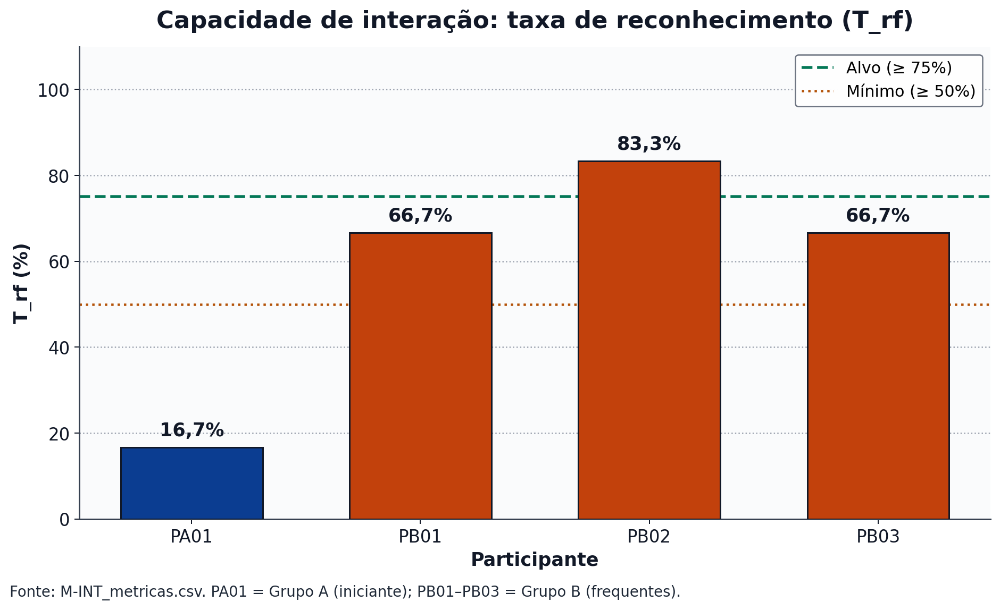

# Avaliação de Capacidade de interação

Esta página reúne a **coleta**, os **resultados** e a **análise** de Capacidade de interação na Fase 4, frente ao GQM da [Fase 2](../../fase2.md). O julgamento é **indicativo** (n = 4; um iniciante). Voltar à [Visão geral da Fase 4](../../fase4.md).

## Coleta

Quatro sessões com consentimento. A evidência pública no repositório são as fichas anonimizadas e as atas; as gravações de tela e áudio permanecem em diretório privado.

| Código | Data | Modalidade / SO | Grupo e etapas | Evidência |
| --- | --- | --- | --- | --- |
| PA01 | 14/11/2026 | Presencial, Windows 11 | A (iniciante): Etapas 1 a 3 e 5 | [ficha](https://github.com/FCTE-Qualidade-de-Software-1/2026-2_T01_BETTY_SNYDER/blob/main/avaliacao/dados/interacao/bruto/Entrevistas/PA01_2026-11-14.md); [ata](../atas/sessao-PA01_2026-11-14.md) |
| PB01 | 13/11/2026 | Online, macOS | B (frequente): Etapas 1, 4 e 5 | [ficha](https://github.com/FCTE-Qualidade-de-Software-1/2026-2_T01_BETTY_SNYDER/blob/main/avaliacao/dados/interacao/bruto/Entrevistas/PB01_2026-11-13.md); [ata](../atas/sessao-PB01_2026-11-13.md) |
| PB02 | 13/11/2026 | Online, Windows 10 | B (frequente / piloto): Etapas 1, 4 e 5 | [ficha](https://github.com/FCTE-Qualidade-de-Software-1/2026-2_T01_BETTY_SNYDER/blob/main/avaliacao/dados/interacao/bruto/Entrevistas/PB02_2026-11-13.md); [ata](../atas/sessao-PB02_2026-11-13.md) |
| PB03 | 21/11/2026 | Online, Windows 10 | B (frequente): Etapas 1, 4 e 5 | [ficha](https://github.com/FCTE-Qualidade-de-Software-1/2026-2_T01_BETTY_SNYDER/blob/main/avaliacao/dados/interacao/bruto/Entrevistas/PB03_2026-11-21.md); [ata](../atas/sessao-PB03_2026-11-21.md) |

**Notas de cálculo.** O Grupo A executa Etapas 1 a 3 e 5. O Grupo B não executa Etapas 2 e 3. A sessão **PB02** (piloto) permanece na avaliação geral como linha de base e dado consolidado.

## Resultados

| Métrica | PA01 | Faixa | PB01 | Faixa | PB02 | Faixa | PB03 | Faixa |
| --- | --- | --- | --- | --- | --- | --- | --- | --- |
| Trf | 16,7% (1/6) | Insatisfatório | 66,7% | Mínimo | 83,3% | Alvo | 66,7% | Mínimo |
| Taprend | 7 min 36 s (456,05 s) | Excelente | n/a | - | n/a | - | n/a | - |
| Tsa | 100% (4/4 sem ajuda) | Excelente | n/a | - | n/a | - | n/a | - |
| Tct | 80% para 100% (rodadas 1-2) | Mínimo para Excelente | 100% (Etapa 4) | Excelente | 100% (Etapa 4) | Excelente | 100% (4/4) | Excelente |
| Texec mediana | 50 s | Excelente | 39,31 s | Excelente | 25 s | Excelente | 27,285 s | Excelente |

**Agregados do Grupo B.** Média de Trf = 72,2% (faixa mínimo). Tct = 100% nos três frequentes. Mediana aproximada de Texec ≈ 30,5 s (faixa excelente).

{ .chart-readable }

*Figura. Trf por participante (fonte `M-INT_metricas.csv`). Linhas de referência: mínimo 50% e alvo 75%.*

{ .chart-readable }

*Figura. Tempo por tarefa alinhado semanticamente. Grupo A: PA01, rodada 1. Grupo B: média da Etapa 4 em PB01 a PB03 (fonte `M-INT_tarefas.csv`; B2 ausente em PB03). A faixa sombreada é o alvo da Fase 2 (2 a 5 min).*

## Análise

| Questão | Evidência | Resposta |
| --- | --- | --- |
| **Q1** (reconhecibilidade) | Trf de PA01 = 16,7%, abaixo de 75% (alvo) | Não atendida |
| **Q2** (aprendizagem) | Taprend = 7 min 36 s e Tsa = 100% em PA01, ambos na faixa excelente | Atendida em PA01 (n = 1 iniciante) |
| **Q3** (operabilidade) | Tct = 100% e Texec mediana &lt; 2 min em PB01, PB02 e PB03 | Atendida no escopo da Etapa 4 (com ressalvas) |

| Hipótese | Julgamento |
| --- | --- |
| **H1** | Rejeitada no iniciante (Trf 16,7%). PB02 só acertou R1 após três tentativas. PB03 errou R4 e R6. |
| **H2** | Sustentada em PA01 para o roteiro de aprendizagem. |
| **H3** | Sustentada no agregado de frequentes (Tct e Texec em alvo ou excelente), com remapeamento documental em PB01/PB02 e B2 não coletada em PB03. |

**Evidência qualitativa (Etapa 5).** PA01 falhou em localizar “Criar baralho” e pediu botões autoexplicativos. PB01 confundiu “nota” com “cartão” e pediu tutorial prático. PB02 descreveu “Criar baralho” como pouco intuitivo na parte inferior. PB03 apontou clareza dos botões iniciais, confusão em “nota” e desejo de interface e termos menos técnicos.

**Limitações.** Amostra de quatro participantes, com um único iniciante para Q1 e Q2. Em PB01/PB02, a Etapa 4 foi remapeada a partir de seções erradas da ficha. Em PB03, B2 Revisar não foi coletada. O julgamento preserva a ênfase 5 da Fase 1.

---

## Ação de melhoria

Prioridade: protótipo reposicionando **Criar baralho**, com validação Trf(R1) ≥ 75%. Ver [Fase 4 · Ação de melhoria](../../fase4.md#acao-de-melhoria) e [Protótipo](../../prototipo-acao-melhoria.md).
