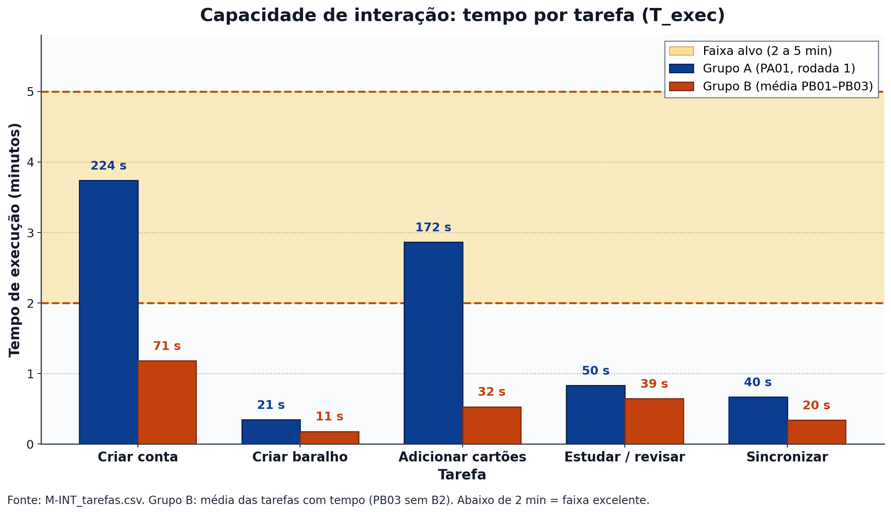

# Avaliação de Capacidade de interação

Esta página reúne a **coleta**, os **resultados** e a **análise** de Capacidade de interação na Fase 4, frente ao GQM da [Fase 2](../../fase2.md). O julgamento é **indicativo** (n = 4; um iniciante). Voltar à [Visão geral da Fase 4](../../fase4.md).

## Coleta

Quatro sessões com consentimento. A evidência pública no repositório são as fichas anonimizadas e as atas; as gravações de tela e áudio permanecem em diretório privado.

| Código | Data | Modalidade / SO | Grupo e etapas | Evidência |
| --- | --- | --- | --- | --- |
| PA01 | 14/11/2026 | Presencial, Windows 11 | A (iniciante): Etapas 1 a 3 e 5 | [ficha](https://github.com/FCTE-Qualidade-de-Software-1/2026-2_T01_BETTY_SNYDER/blob/main/avaliacao/dados/interacao/bruto/Entrevistas/PA01_2026-11-14.md); [ata](../atas/sessao-PA01_2026-11-14.md) |
| PB01 | 13/11/2026 | Online, macOS | B (frequente): Etapas 1, 4 e 5 | [ficha](https://github.com/FCTE-Qualidade-de-Software-1/2026-2_T01_BETTY_SNYDER/blob/main/avaliacao/dados/interacao/bruto/Entrevistas/PB01_2026-11-13.md); [ata](../atas/sessao-PB01_2026-11-13.md) |
| PB02 | 13/11/2026 | Online, Windows 10 | B (frequente / piloto): Etapas 1, 4 e 5 | [ficha](https://github.com/FCTE-Qualidade-de-Software-1/2026-2_T01_BETTY_SNYDER/blob/main/avaliacao/dados/interacao/bruto/Entrevistas/PB02_2026-11-13.md); [ata](../atas/sessao-PB02_2026-11-13.md) |
| PB03 | 21/11/2026 | Online, Windows 10 | B (frequente): Etapas 1, 4 e 5 | [ficha](https://github.com/FCTE-Qualidade-de-Software-1/2026-2_T01_BETTY_SNYDER/blob/main/avaliacao/dados/interacao/bruto/Entrevistas/PB03_2026-11-21.md); [ata](../atas/sessao-PB03_2026-11-21.md) |

**Notas de cálculo.** O Grupo A executa Etapas 1 a 3 e 5. O Grupo B não executa Etapas 2 e 3. A sessão **PB02** (piloto) permanece na avaliação geral como linha de base e dado consolidado.

## Resultados

| Métrica | PA01 | Faixa | PB01 | Faixa | PB02 | Faixa | PB03 | Faixa |
| --- | --- | --- | --- | --- | --- | --- | --- | --- |
| Trf | 16,7% (1/6) | Insatisfatório | 66,7% | Mínimo | 83,3% | Alvo | 66,7% | Mínimo |
| Taprend | 7 min 36 s (456,05 s) | Excelente | n/a | - | n/a | - | n/a | - |
| Tsa | 100% (4/4 sem ajuda) | Excelente | n/a | - | n/a | - | n/a | - |
| Tct | 80% para 100% (rodadas 1-2) | Mínimo para Excelente | 100% (Etapa 4) | Excelente | 100% (Etapa 4) | Excelente | 100% (4/4) | Excelente |
| Texec mediana | 50 s | Excelente | 39,31 s | Excelente | 25 s | Excelente | 27,285 s | Excelente |

{ .chart-readable }

*Figura. Trf por participante (fonte `M-INT_metricas.csv`). Linhas de referência da Tabela V da [Fase 2](../../fase2.md#interacao-niveis-pontuacao): mínimo 60% e alvo 75%.*

{ .chart-readable }

*Figura. Tempo por tarefa alinhado semanticamente. Grupo A: PA01, rodada 1. Grupo B: média da Etapa 4 em PB01 a PB03 (fonte `M-INT_tarefas.csv`; B2 ausente em PB03). A faixa sombreada é o alvo da Fase 2 (2 a 5 min).*

## Análise

A análise segue a regra de julgamento da [Fase 2](../../fase2.md#interacao-niveis-pontuacao): cada métrica entra em uma faixa da Tabela V; as faixas agregam-se por questão; as questões e as hipóteses da [Tabela III](../../fase2.md#interacao-questoes-hipoteses) respondem à Capacidade de interação. Os números abaixo vêm de `M-INT_metricas.csv` e de `M-INT-01_reconhecimento.csv`.

### Por métrica: resultado e porquê

#### Trf (taxa de reconhecimento de funções)

| Participante | Valor | Faixa | Porquê |
| --- | --- | --- | --- |
| PA01 | 16,7% (1/6) | Insatisfatório | Acertou só R2 (Adicionar). Em R1 apontou “Baralhos” em vez de **Criar baralho**. Errou R3 (Painel), R4 (Estatísticas) e os conceitos R5 e R6 (nível de estudo; cartão vs nota). |
| PB01 | 66,7% (4/6) | Mínimo | Acertou R1 a R3 e R5. Errou R4 e R6 ao tratar “nota” como “cartão” e ao não distinguir os conceitos. |
| PB02 | 83,3% (5/6) | Alvo | Acertou cinco itens; R6 ficou N. Em R1 acertou **Criar baralho** só após três tentativas (a ficha registra o acerto final). |
| PB03 | 66,7% (4/6) | Mínimo | Acertou R1 a R3 e R5. Em R4 (“não lembro”) e R6 (“não sei”) falhou nos conceitos nota/cartão. |

**Síntese.** A faixa insatisfatória do iniciante concentra-se na descoberta de **Criar baralho** e nos rótulos conceituais. Nos frequentes, as falhas repetem-se sobretudo em nota/tipo/cartão, não nas funções principais de criar, adicionar e estudar.

#### Taprend (tempo de aprendizagem)

| Participante | Valor | Faixa | Porquê |
| --- | --- | --- | --- |
| PA01 | 7 min 36 s (456,05 s) | Excelente | Tempo total da Etapa 2 (roteiro completo do Grupo A) abaixo de 15 min (limiar excelente da Tabela V). |
| PB01–PB03 | n/a | - | O protocolo do Grupo B não executa Etapas 2 e 3; a métrica não se aplica. |

#### Tsa (taxa de sucesso após aprendizagem)

| Participante | Valor | Faixa | Porquê |
| --- | --- | --- | --- |
| PA01 | 100% (4/4 sem ajuda) | Excelente | Na Etapa 3, as quatro tentativas pós-roteiro concluíram sem intervenção do facilitador. |
| PB01–PB03 | n/a | - | Grupo B não executa a etapa de sucesso após aprendizagem. |

#### Tct (taxa de conclusão de tarefas)

| Participante | Valor | Faixa | Porquê |
| --- | --- | --- | --- |
| PA01 | 80% (rodada 1) → 100% (rodada 2) | Mínimo → Excelente | Rodada 1: 4 de 5 com sucesso (A3 sem S). Rodada 2: 4 de 4, sem ajuda. |
| PB01 | 100% (Etapa 4) | Excelente | 5 de 5; tempos da seção Etapa 2 da ficha remapeados para Etapa 4. |
| PB02 | 100% (Etapa 4) | Excelente | 5 de 5; tempos da seção Etapa 3 da ficha remapeados para Etapa 4. |
| PB03 | 100% (4/4) | Excelente | Quatro tarefas com tempo; B2 Revisar não foi coletada e fica fora do denominador. |

#### Texec (tempo de execução; mediana)

| Participante | Valor | Faixa | Porquê |
| --- | --- | --- | --- |
| PA01 | 50 s (rodada 1) | Excelente | Mediana das tarefas da rodada 1 (&lt; 2 min). |
| PB01 | 39,31 s | Excelente | Mediana da Etapa 4 (após remapeamento documental). |
| PB02 | 25 s | Excelente | Mediana da Etapa 4. |
| PB03 | 27,285 s | Excelente | Mediana das quatro tarefas coletadas (sem B2). |

**Evidência qualitativa (Etapa 5).** PA01 pediu botões autoexplicativos após falhar em localizar “Criar baralho”. PB01 pediu tutorial prático e confundiu “nota” com “cartão”. PB02 descreveu “Criar baralho” como pouco intuitivo na parte inferior. PB03 apontou clareza dos botões iniciais, confusão em “nota” e desejo de interface e termos menos técnicos.

### Resultados agregados: iniciantes (PA) e frequentes (PB)

Com um único iniciante, a **média PA** coincide com PA01. A **média PB** agrega PB01, PB02 (piloto) e PB03, como nas linhas `AGG` de `M-INT_metricas.csv`. As faixas seguem a Tabela V da Fase 2.

| Grupo | Métrica | Média / valor | Faixa (Tabela V) |
| --- | --- | --- | --- |
| PA (iniciantes) | Trf | 16,7% (n = 1, PA01) | Insatisfatório |
| PA | Taprend | 7 min 36 s | Excelente |
| PA | Tsa | 100% | Excelente |
| PA | Tct (rodada 1 → 2) | 80% → 100% | Mínimo → Excelente |
| PA | Texec mediana (rodada 1) | 50 s | Excelente |
| PB (frequentes) | Trf | 72,2% | Mínimo |
| PB | Tct | 100% | Excelente |
| PB | Texec mediana | ≈ 30,5 s | Excelente |

**Leitura das faixas.** No Grupo A, a reconhecibilidade fica abaixo do mínimo (&lt; 60%); aprendizado e sucesso pós-roteiro ficam excelentes; a conclusão de tarefas sobe do mínimo ao excelente entre as rodadas. No Grupo B, a reconhecibilidade fica no mínimo (60% ≤ x &lt; 75%), abaixo do alvo de 75%; conclusão e tempo de execução ficam excelentes.

### Julgamento das hipóteses

Os enunciados abaixo reproduzem a [Tabela III da Fase 2](../../fase2.md#interacao-questoes-hipoteses) (Questões e hipóteses de Capacidade de interação). Para cada hipótese há um julgamento do Grupo A (PA) e um do Grupo B (PB), com base nas medições.

#### H1 (ligada a Q1: reconhecibilidade da adequação)

**Texto da hipótese.** *No Grupo A, Trf das funções principais (criar baralho, adicionar cards e estudar) fica em alvo ou excelente; nota, tipo de nota e card ficam em mínimo ou insatisfatório.* Fonte: [Fase 2 · Questões e hipóteses](../../fase2.md#interacao-questoes-hipoteses).

| Grupo | Julgamento | Base de medição |
| --- | --- | --- |
| **PA** | **Rejeitada.** | Trf = 16,7% (insatisfatório). A função principal R1 (criar baralho) falhou; só R2 (adicionar) acertou. Os conceitos R5 e R6 também falharam, o que é compatível com a parte “mínimo/insatisfatório” da H1, mas a expectativa de alvo/excelente nas funções principais não se confirma. |
| **PB** | **Não é o alvo formal de H1** (a hipótese fala do Grupo A). **Resultado comparativo:** Trf média = 72,2% (**mínimo**). | Funções principais em geral acertadas; falhas concentradas em R4/R6 (nota/cartão). Em PB02, R1 só após três tentativas. A média permanece abaixo do alvo (≥ 75%). |

#### H2 (ligada a Q2: facilidade de aprendizado)

**Texto da hipótese.** *No Grupo A, Tsa e Taprend em baralho, cards e revisão ficam em alvo ou excelente; conta e primeira sincronização ficam em mínimo ou insatisfatório.* Fonte: [Fase 2 · Questões e hipóteses](../../fase2.md#interacao-questoes-hipoteses).

| Grupo | Julgamento | Base de medição |
| --- | --- | --- |
| **PA** | **Sustentada** no roteiro medido. | Taprend = 7 min 36 s (excelente) e Tsa = 100% sem ajuda (excelente). A amostra (n = 1) não separa, nesta consolidação, o subconjunto “conta e primeira sincronização” em faixa mínima; o julgamento cobre o desempenho global do roteiro da Etapa 2–3. |
| **PB** | **Não aplicável.** | O Grupo B não executa Etapas 2 e 3; Taprend e Tsa não foram coletados. |

#### H3 (ligada a Q3: operabilidade)

**Texto da hipótese.** *No Grupo B, Tct e Texec em revisar e adicionar cards ficam em alvo ou excelente; a diferença \|Δ\| entre Grupos A e B (médias de Tct e Texec) é maior em conta e sincronização do que em revisar e adicionar cards.* Fonte: [Fase 2 · Questões e hipóteses](../../fase2.md#interacao-questoes-hipoteses).

| Grupo | Julgamento | Base de medição |
| --- | --- | --- |
| **PB** | **Sustentada** no agregado da Etapa 4, com ressalvas documentais. | Tct = 100% (excelente) e Texec mediana ≈ 30,5 s (excelente) em PB01–PB03. Remapeamento de seções em PB01/PB02; B2 Revisar ausente em PB03. |
| **PA** | **Comparativo / parcial.** | Na rodada 1, Texec já é excelente (50 s) e Tct está no mínimo (80%), subindo a excelente na rodada 2. O \|Δ\| formal em conta e sincronização versus revisar/adicionar permanece limitado pela amostra e pela granularidade publicada no consolidado; a leitura qualitativa reforça maior atrito no primeiro uso (reconhecimento) do que na execução cronometrada após o roteiro. |

### Avaliação geral de Capacidade de interação

Pela regra da Fase 2, uma questão é atendida quando suas métricas essenciais estão no **alvo ou acima**; havendo divergência, prevalece a faixa mais baixa.

| Perspectiva | Questões | Síntese |
| --- | --- | --- |
| **Iniciantes (PA)** | **Q1 não atendida** (Trf insatisfatório). **Q2 atendida** na amostra (Taprend e Tsa excelentes). | A Capacidade de interação para quem nunca usou o Anki fica limitada pela **reconhecibilidade** (ênfase 5 da Fase 1), não pela capacidade de completar o roteiro depois de orientado. |
| **Frequentes (PB)** | **Q3 atendida** no escopo da Etapa 4 (Tct e Texec excelentes). Reconhecibilidade auxiliar em faixa **mínimo**. | Quem já usa o Anki conclui o estudo diário com pouco esforço de tempo; ainda há lacuna lexical (nota/cartão) e descoberta ocasional de **Criar baralho**. |
| **Característica (síntese)** | Aprendizado e operabilidade fortes na amostra; reconhecibilidade fraca no iniciante e apenas mínima no agregado de frequentes. | O gap crítico é a **descoberta de funções e conceitos no primeiro uso**, o que fundamenta a ação de melhoria (lista de baralhos como home e destaque a **Criar baralho**). |

**Limitações.** Amostra de quatro participantes, com um único iniciante para Q1 e Q2. Em PB01/PB02, a Etapa 4 foi remapeada a partir de seções erradas da ficha. Em PB03, B2 Revisar não foi coletada. O julgamento é **indicativo** e preserva a ênfase 5 da Fase 1.

---

## Ação de melhoria

Prioridade: protótipo reposicionando **Criar baralho**, com validação Trf(R1) ≥ 75%. Ver [Fase 4 · Ação de melhoria](../../fase4.md#acao-de-melhoria) e [Protótipo](../../prototipo-acao-melhoria.md).
