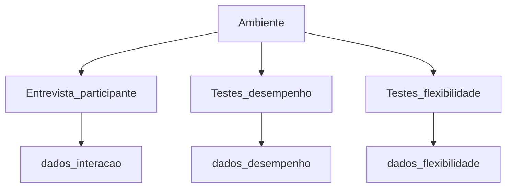

# Protocolos de avaliação

Esta seção documenta o plano de avaliação (Fase 3) do Anki Desktop 26.09.3 e do fluxo de conta, login e sincronização do AnkiWeb. Os procedimentos estão organizados em três frentes alinhadas ao GQM da [Fase 2](../../fase2.md) e à árvore descrita em [Dados](../../dados.md).

O formulário aplicado em cada sessão com participante é o [Pré-entrevista com participante](pre-entrevista-participante.md). As configurações de hardware e software das máquinas de referência estão em [Ambiente](ambiente.md).

A Dupla A conduz todas as entrevistas com participantes voluntários e aplica o formulário de pré-entrevista completo. A Dupla B executa os testes instrumentados de eficiência de desempenho. A Dupla C executa os testes de flexibilidade. Quando a pré-entrevista contém blocos elaborados pelas Duplas B ou C, a Dupla A os aplica na sessão, desde que tenham sido preenchidos previamente.

## As três frentes

| Frente | Quem executa | O que cobre | Páginas | GQM e dados |
| --- | --- | --- | --- | --- |
| Entrevista com participante voluntário | Dupla A (todas as sessões) | Termo de consentimento, triagem, etapas de capacidade de interação, eficiência percebida e campos de flexibilidade quando preenchidos | [Entrevista](entrevista.md), [Pré-entrevista](pre-entrevista-participante.md) | G1 e evidência qualitativa de G2; `avaliacao/dados/interacao/` |
| Testes de desempenho | Dupla B | Condições de controle e cenários instrumentados (inicialização a frio, repouso e estresse, capacidade, threads) | [Eficiência de desempenho](desempenho.md) | G2; `avaliacao/dados/desempenho/` |
| Testes de flexibilidade | Dupla C | Instalação, checklist de integração (Pint) e migração | [Instalação](flexibilidade-instalacao.md), [Checklist](flexibilidade-checklist.md), [Migração](flexibilidade-migracao.md) | G3; `avaliacao/dados/flexibilidade/` |

## Fluxo

## Estrutura comum das páginas de procedimento

As páginas de procedimento adotam a mesma organização editorial, para facilitar a leitura cruzada entre as frentes:

1. Definições específicas daquela frente (sem repetir o que já consta na Fase 2 ou nesta visão geral)
2. Pré-requisitos e condições de controle
3. Procedimento passo a passo
4. Registro de dados em `avaliacao/dados/...`, com o padrão `<métrica>_<cenário>_<execução>`
5. Critérios de invalidação ou encerramento
6. Relação com o [Pré-entrevista com participante](pre-entrevista-participante.md) e com a página [Dados](../../dados.md)
