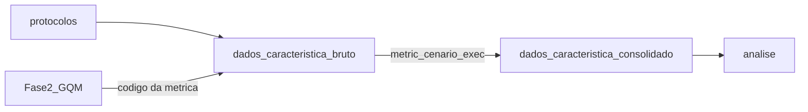

# Dados da avaliação

Esta página documenta a organização dos dados da avaliação do Anki Desktop 26.09.3 e do fluxo AnkiWeb no repositório, para satisfazer a **rastreabilidade entre dado bruto e métrica** (F4-C2; premissas 4 e 5 do enunciado) e a **proteção da identificação** dos participantes.

Os dados do **produto** ficam em [`avaliacao/`](https://github.com/FCTE-Qualidade-de-Software-1/2026-2_T01_BETTY_SNYDER/tree/main/avaliacao). Não confundir com [`gestao-psm/`](https://github.com/FCTE-Qualidade-de-Software-1/2026-2_T01_BETTY_SNYDER/tree/main/gestao-psm), que registra o andamento do projeto acadêmico (PSM).

## Árvore no repositório

```text
avaliacao/
  protocolos/     Instrumento unificado de sessão
  scripts/        Coletores e consolidados (quando existirem)
  dados/
    interacao/      {bruto, consolidado}   — Capacidade de interação (G1)
    desempenho/     {bruto, consolidado}   — Eficiência de desempenho (G2)
    flexibilidade/  {bruto, consolidado}   — Flexibilidade (G3)
  analise/        Julgamentos GQM e evidências derivadas
```

| Pasta | Link |
| --- | --- |
| Visão geral | [`avaliacao/`](https://github.com/FCTE-Qualidade-de-Software-1/2026-2_T01_BETTY_SNYDER/tree/main/avaliacao) |
| Protocolos | [`avaliacao/protocolos/`](https://github.com/FCTE-Qualidade-de-Software-1/2026-2_T01_BETTY_SNYDER/tree/main/avaliacao/protocolos) |
| Dados | [`avaliacao/dados/`](https://github.com/FCTE-Qualidade-de-Software-1/2026-2_T01_BETTY_SNYDER/tree/main/avaliacao/dados) |
| Análise | [`avaliacao/analise/`](https://github.com/FCTE-Qualidade-de-Software-1/2026-2_T01_BETTY_SNYDER/tree/main/avaliacao/analise) |

Protocolos (entrevista, desempenho e flexibilidade): [Protocolos](avaliacao/protocolos/index.md). Pré-entrevista com participante: [Pré-entrevista com participante](avaliacao/protocolos/pre-entrevista-participante.md). Métricas e faixas: [Fase 2](fase2.md).

## Fluxo de rastreabilidade



Cada métrica da Fase 2 tem caminho de origem em `dados/<caracteristica>/bruto/`. Arquivos em `consolidado/` e em `analise/` citam essas fontes.

## Padrão de nomes

Formato: **`<métrica>_<cenário>_<execução>`** (separador `_`).

| Peça | Conteúdo | Exemplos |
| --- | --- | --- |
| métrica | Código GQM | `M-INT-01`, `M-INT_tarefas`, `T_ini`, `T_inst` |
| cenário | Tarefa, rodada ou ambiente | `reconhecimento`, `A3`, `coldstart`, `win11` |
| execução | Participante ou repetição de lab | `PA01`, `PB02`, `01` |

Exemplos: `M-INT-01_reconhecimento_PA01.csv`; `ficha_PA01_2026-11-12.pdf`; `T_ini_coldstart_01.csv`.

Exceção: `gravacoes.csv` é o índice das gravações e não segue o trio.

## Rastreabilidade métrica → arquivo

| Objetivo | Métrica | Bruto (previsto) | Consolidado |
| --- | --- | --- | --- |
| G1 | Trf (M-INT-01) | `dados/interacao/bruto/M-INT-01_reconhecimento.csv` | `dados/interacao/consolidado/` |
| G1 | Taprend, Tsa, Tct, Texec | `dados/interacao/bruto/M-INT_tarefas.csv` | `dados/interacao/consolidado/` |
| G1 | Evidência de sessão | `dados/interacao/bruto/ficha_<código>_<data>.pdf` e índice `gravacoes.csv` | — |
| G2 | T_ini, T_rev, T_sinc, CPU, RAM, … | `dados/desempenho/bruto/<métrica>_<cenário>_<execução>.*` | `dados/desempenho/consolidado/` |
| G3 | T_inst, T_inst_t, N_int, P_int, T_pd, T_sub | `dados/flexibilidade/bruto/<métrica>_<cenário>_<execução>.*` | `dados/flexibilidade/consolidado/` |

Os CSV-esqueleto de interação já estão versionados em [`dados/interacao/bruto/`](https://github.com/FCTE-Qualidade-de-Software-1/2026-2_T01_BETTY_SNYDER/tree/main/avaliacao/dados/interacao/bruto) (somente cabeçalhos até a coleta).

## Participantes e anonimização

| Código | Grupo |
| --- | --- |
| PA01, PA02 | A — iniciantes |
| PB01, PB02, PB03 | B — usuários frequentes |

- No repositório e nesta GitPage aparecem **apenas códigos**.
- A tabela código → pessoa permanece **fora do repositório** (pasta privada da equipe).
- Termos de consentimento assinados ficam na pasta privada, separados dos CSVs.

## Gravações (leitura do TCLE)

O Termo de Consentimento Livre e Esclarecido estabelece que os registros ficam em **diretório privado**, com acesso restrito à professora e à equipe, até 14/12/2026, com anonimização antes da apresentação dos resultados.

**Decisão:** arquivos de tela e áudio das sessões **não** entram no repositório público. No Git fica somente o índice `avaliacao/dados/interacao/bruto/gravacoes.csv`, com colunas `participante,grupo,data,formato,arquivo_gravacao,observacoes`, onde `arquivo_gravacao` aponta para o caminho na pasta restrita.
