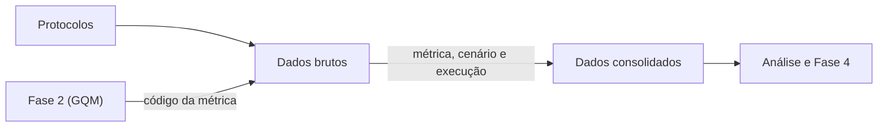

# Dados da avaliação (rascunho local)

> Uso interno da equipe. Esta página **não** entra no menu nem na publicação da GitPage (`exclude_docs` no `mkdocs.yml`). A versão pública da organização dos dados está na [Fase 4](fase4.md#organizacao-dos-dados).

Esta página explica, em linguagem acessível, onde ficam os arquivos da avaliação do Anki Desktop 26.09.3 e do fluxo AnkiWeb, como o nome de cada arquivo se relaciona com uma métrica (quantidade medida) e como a privacidade dos participantes é protegida.

Os dados do **produto** (resultados da avaliação do Anki) ficam em [`avaliacao/`](https://github.com/FCTE-Qualidade-de-Software-1/2026-2_T01_BETTY_SNYDER/tree/main/avaliacao). Não confundir com [`gestao-psm/`](https://github.com/FCTE-Qualidade-de-Software-1/2026-2_T01_BETTY_SNYDER/tree/main/gestao-psm), que registra o andamento do projeto acadêmico (PSM, o acompanhamento de esforço e progresso da equipe).

## O que está em cada pasta

```text
avaliacao/
  protocolos/     Como conduzir entrevistas e ensaios de laboratório
  scripts/        Programas que coletam ou consolidam medidas
  dados/
    interacao/      {bruto, consolidado}  Capacidade de interação (facilidade de uso)
    desempenho/     {bruto, consolidado}  Eficiência de desempenho (tempo e recursos)
    flexibilidade/  {bruto, consolidado}  Flexibilidade (instalação, integração e migração)
  analise/        Textos que interpretam as métricas frente ao GQM
```

| Pasta | Para que serve | Link |
| --- | --- | --- |
| Visão geral | Entrada da avaliação no repositório | [`avaliacao/`](https://github.com/FCTE-Qualidade-de-Software-1/2026-2_T01_BETTY_SNYDER/tree/main/avaliacao) |
| Protocolos | Passo a passo das coletas | [`avaliacao/protocolos/`](https://github.com/FCTE-Qualidade-de-Software-1/2026-2_T01_BETTY_SNYDER/tree/main/avaliacao/protocolos) |
| Dados | Planilhas e fichas (bruto e consolidado) | [`avaliacao/dados/`](https://github.com/FCTE-Qualidade-de-Software-1/2026-2_T01_BETTY_SNYDER/tree/main/avaliacao/dados) |
| Análise | Julgamento das questões e hipóteses | [`avaliacao/analise/`](https://github.com/FCTE-Qualidade-de-Software-1/2026-2_T01_BETTY_SNYDER/tree/main/avaliacao/analise) |

Protocolos: [Fase 3](fase3.md). Métricas e faixas (níveis insatisfatório, mínimo, alvo e excelente): [Fase 2](fase2.md). Execução e julgamento: [Fase 4](fase4.md).

## Do protocolo à métrica (rastreabilidade)

A rastreabilidade é a capacidade de seguir o caminho do arquivo bruto até o número publicado na análise. Em termos práticos: cada valor na Fase 4 deve apontar para um CSV ou ficha no repositório.



| Etapa | O que acontece |
| --- | --- |
| Protocolo | Define o que medir e como registrar |
| Bruto | Guarda a observação crua (tempo, acerto, checklist) |
| Consolidado | Resume por participante, sistema operacional ou grupo |
| Análise / Fase 4 | Classifica em faixas e responde às questões GQM |

## Como nomear arquivos

Formato preferido: **`<métrica>_<cenário>_<execução>`** (separador `_`).

| Peça | Significado em linguagem comum | Exemplos |
| --- | --- | --- |
| métrica | Qual quantidade está sendo medida | `M-INT-01`, `M-INT_tarefas`, `T_ini`, `T_inst` |
| cenário | Em que situação a medida foi tomada | `reconhecimento`, `coldstart`, `win11` |
| execução | Quem ou qual repetição gerou o arquivo | `PA01`, `PB03`, `01` |

Exemplos: `M-INT-01_reconhecimento.csv`; `T_ini_coldstart_ubuntu_01.csv`.

Exceção: `sessoes.csv` lista as entrevistas (data, formato e caminho da ata). Não aponta arquivo de mídia, porque as gravações ficam fora do repositório.

## De cada métrica ao arquivo

| Frente | Métricas principais | Onde está o bruto | Onde está o consolidado / análise |
| --- | --- | --- | --- |
| Capacidade de interação | T<sub>rf</sub> (reconhecimento) | [`M-INT-01_reconhecimento.csv`](https://github.com/FCTE-Qualidade-de-Software-1/2026-2_T01_BETTY_SNYDER/blob/main/avaliacao/dados/interacao/bruto/M-INT-01_reconhecimento.csv) | [`M-INT_metricas.csv`](https://github.com/FCTE-Qualidade-de-Software-1/2026-2_T01_BETTY_SNYDER/blob/main/avaliacao/dados/interacao/consolidado/M-INT_metricas.csv); [análise](avaliacao/analise/interacao.md) |
| Capacidade de interação | T<sub>aprend</sub>, T<sub>sa</sub>, T<sub>ct</sub>, T<sub>exec</sub> | [`M-INT_tarefas.csv`](https://github.com/FCTE-Qualidade-de-Software-1/2026-2_T01_BETTY_SNYDER/blob/main/avaliacao/dados/interacao/bruto/M-INT_tarefas.csv) | Idem |
| Capacidade de interação | Evidência de sessão | [`Entrevistas/`](https://github.com/FCTE-Qualidade-de-Software-1/2026-2_T01_BETTY_SNYDER/tree/main/avaliacao/dados/interacao/bruto/Entrevistas); atas; [`sessoes.csv`](https://github.com/FCTE-Qualidade-de-Software-1/2026-2_T01_BETTY_SNYDER/blob/main/avaliacao/dados/interacao/bruto/sessoes.csv) | [Fase 4](fase4.md) |
| Eficiência de desempenho | Cold start, CPU, RAM, threads, vazão | Preferência: `avaliacao/dados/desempenho/bruto/`; cópia usada na GitPage em `docs/avaliacao/dados/desempenho/bruto/` | [análise de desempenho](avaliacao/analise/desempenho.md) |
| Flexibilidade | T<sub>inst</sub>, T<sub>inst_t</sub>, N<sub>int</sub>, P<sub>int</sub>, T<sub>pd</sub>, T<sub>sub</sub> | Consolidados em [`flexibilidade/consolidado/`](https://github.com/FCTE-Qualidade-de-Software-1/2026-2_T01_BETTY_SNYDER/tree/main/avaliacao/dados/flexibilidade/consolidado) (instalação, checklist e migração M1/M2) | [análise de Flexibilidade](avaliacao/analise/flexibilidade.md) |

**Capacidade de interação (concluída na amostra atual):** fichas anonimizadas → CSV bruto → `M-INT_metricas.csv` → análise → Fase 4.

**Flexibilidade:** instalação, checklist e migração publicados; T<sub>pd</sub> = 100%; T<sub>sub</sub> média 2,51 min (faixa mínimo).

## Participantes e privacidade

| Código | Grupo | Situação na coleta |
| --- | --- | --- |
| PA01, PA02 | A: iniciantes (pessoas que nunca usaram o Anki) | Realizado: PA01 |
| PB01, PB02, PB03 | B: usuários frequentes | Realizados: PB01, PB02 (piloto), PB03 |

Regras práticas:

1. No repositório e na GitPage aparecem **somente códigos** (PA01, PB01, …).
2. A tabela que liga código ao nome da pessoa fica **fora do repositório**.
3. Os termos de consentimento assinados ficam em pasta privada, separados das planilhas.
4. Gravações de tela e áudio **não** são versionadas. A evidência pública da sessão são as [atas](avaliacao/atas/sessao-PA01_2026-11-14.md), as fichas em `Entrevistas/` e o índice `sessoes.csv`.
