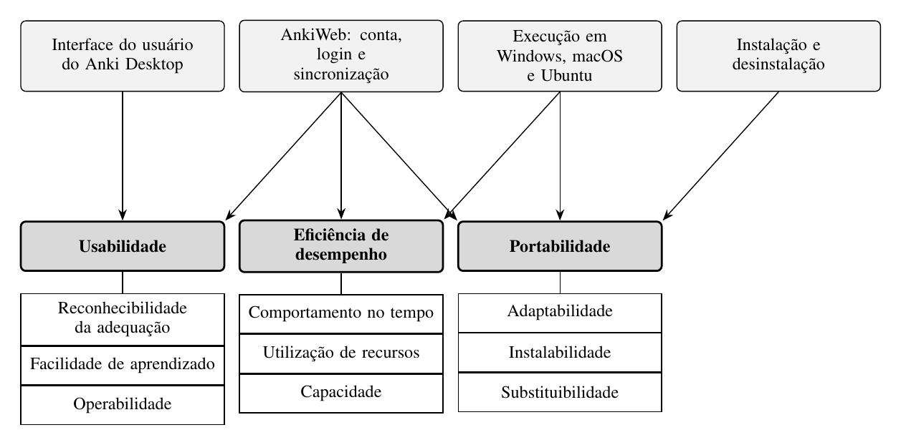

# Fase 1 — Estabelecer os requisitos de avaliação

Nesta fase, a equipe definiu para quem e para que a avaliação é feita, qual produto será avaliado, com qual modelo de qualidade e com que abrangência. As decisões foram tomadas principalmente na reunião de 14/10/2026 e estão registradas nas [atas](atas/reuniao-03-ata.md).

## Propósito da avaliação

| Item | Definição |
|---|---|
| Requisitante | Professora da disciplina de Qualidade de Software 1 |
| Objetivo da avaliação | Indicar pontos de melhoria no produto |
| Ponto de vista | Estudante, usuário final do Anki |

### Uso dos resultados

Os pontos de melhoria identificados serão usados pela professora para avaliar a capacidade da equipe de fundamentar tecnicamente uma avaliação de produto. Também serão registrados como recomendações priorizadas para dois públicos:

- **Mantenedores do Anki:** podem usar as recomendações para decidir correções.
- **Estudantes:** podem usá-las como orientação de uso.

O ponto de melhoria mais relevante será a base da ação de melhoria da Entrega 2.

## Partes interessadas

| Parte interessada | Papel | Necessidade | Critério de sucesso | Influência na avaliação |
|---|---|---|---|---|
| Professora da disciplina | Requisitante | Uma avaliação fundamentada e rastreável | Pontos de melhoria justificados por evidências coletadas | Acordou as características avaliadas e define prazos e formato |
| Estudante | Usuário final (operador) | Usar o Anki sozinho, sem lentidão, em qualquer sistema | Concluir as tarefas sem ajuda, sem demora perceptível e sem perder dados | Define o ponto de vista, as tarefas dos testes e os critérios de julgamento |
| Mantenedores do Anki | Desenvolvedor e fornecedor | Problemas descritos de forma reproduzível e priorizada | Cada ponto de melhoria acompanhado de evidência e passos para reproduzir | Limitam o escopo ao que é observável e ao código aberto; o AnkiWeb é de código fechado |
| Equipe avaliadora | Avaliador | Um escopo viável no prazo | Entregas no prazo, com dados rastreáveis | Define as plataformas disponíveis e a profundidade da avaliação |

## Tipo de produto e descrição do software

### Identificação

| Item | Definição |
|---|---|
| Produto | Anki Desktop e AnkiWeb |
| Versão | Anki Desktop 26.09.3 (commit `a13d8a6`, 06/10/2026); AnkiWeb na versão em produção na data da avaliação, com a data de acesso registrada |
| Escopo do AnkiWeb | Apenas criação de conta, login e sincronização com o Anki Desktop |
| Domínio | Educação, com estudo por repetição espaçada |
| Classificação (Pressman) | Software de computador pessoal |
| Tipo (IEEE 1062) | COTS, gratuito e de código aberto; o AnkiWeb é um serviço gratuito de código fechado |
| Principais usuários | Estudantes universitários e autodidatas |
| Conhecimento exigido | Informática básica; nenhum conhecimento prévio de repetição espaçada |

### Funções principais

O Anki Desktop possui oito funções principais:

1. Login na conta AnkiWeb para sincronização.
2. Criação de baralhos.
3. Escrita de cards.
4. Revisão de cards: o estudante avalia a própria resposta, e o agendamento define quando o card volta.
5. Busca e edição de cards no navegador de cards.
6. Importação e exportação de baralhos e coleções.
7. Sincronização da coleção com o AnkiWeb.
8. Configuração das opções de estudo do baralho.

As funções que recebem maior dedicação na avaliação são a criação de baralhos, a escrita e a revisão de cards, o login e a sincronização.

### Principais tarefas do estudante

- Instalar o Anki Desktop.
- Criar uma conta no site do AnkiWeb.
- Fazer login no Anki Desktop para sincronizar.
- Criar um baralho.
- Escrever cada card e sua resposta.
- Revisar os cards do dia, avaliando a própria resposta.
- Escolher outro baralho para revisar.
- Sincronizar a coleção com o AnkiWeb.
- Exportar a coleção e importá-la em outro computador.
- Fazer logout.

### Janelas de interação

O Anki Desktop possui 16 janelas principais:

- A janela principal, que reúne três telas: lista de baralhos, visão geral do baralho e revisão.
- Adicionar, Navegador de cards, Editar card atual e Estatísticas.
- Opções do baralho, Criar baralho filtrado e Preferências.
- Importar, Exportar e Login de sincronização.
- Gerenciar tipos de nota, Campos, Modelos de card, Perfis e Complementos.

### Ambiente de uso

- Uso individual, em computador pessoal com Windows, macOS ou Ubuntu.
- O estudo funciona sem internet; a criação de conta, o login e a sincronização exigem conexão.
- O estudante usa o Anki por conta própria, sem treinamento formal e sem suporte técnico.

### Massa de dados

- **Coleções sintéticas**, geradas com o pacote `anki` (biblioteca Python do próprio Anki, publicada no PyPI), em tamanhos controlados, por exemplo 10 mil, 50 mil e 100 mil cards, iguais em todos os ambientes. São usadas nos testes de Eficiência de desempenho e Portabilidade.
- **Baralhos compartilhados no AnkiWeb**, importados como dados realistas nos testes de Usabilidade.

### Requisitos de software

| Plataforma | Requisito |
|---|---|
| Windows | Windows 10 versão 1703 ou posterior (x64), ou Windows 11 (ARM) |
| macOS | macOS 13 ou posterior, em Apple Silicon ou Intel |
| Ubuntu | Distribuição Linux de 2022 ou posterior (x64, glibc 2.35 ou posterior) ou de 2024 ou posterior (ARM, glibc 2.39 ou posterior), com o pacote `zstd` e o script de instalação |
| AnkiWeb | Navegador atualizado e conexão com a internet |

A página de download e o manual não definem memória ou processador mínimos; os computadores usados pela equipe serão registrados no plano de avaliação. Fontes: página de download (`apps.ankiweb.net`) e manual de instalação (`docs.ankiweb.net`), consultados em 14/10/2026.

## Modelo de qualidade

O modelo de qualidade de produto da ISO/IEC 25010:2011 foi adaptado ao Anki a partir dos componentes avaliados. A adaptação liga as características da norma, que são abstratas, aos componentes com os quais o estudante interage:

| Componente avaliado | Características |
|---|---|
| Interface do usuário do Anki Desktop | Usabilidade |
| Criação de conta no AnkiWeb, login e sincronização | Usabilidade, Eficiência de desempenho e Portabilidade |
| Execução do Anki Desktop em Windows, macOS e Ubuntu | Eficiência de desempenho e Portabilidade |
| Instalação e desinstalação do Anki Desktop | Portabilidade |

*Figura 1. Modelo de qualidade adaptado. De cima para baixo: componentes avaliados, características e subcaracterísticas avaliadas na Fase 2.*

## Seleção e priorização das características

A ênfase de cada característica foi definida pela combinação de dois critérios: o impacto para o estudante (quanto uma falha atrapalha o uso) e a viabilidade de medição com os recursos e o prazo da equipe. A escolha de Usabilidade foi acordada com a requisitante.

| Característica (ISO/IEC 25010:2011) | Impacto para o estudante | Viabilidade de medição | Ênfase |
|---|---|---|---:|
| Usabilidade | Alto: todo estudante usa a interface sem treinamento | Média: exige testes com participantes | 5 |
| Eficiência de desempenho | Médio: notebooks variados e coleções que crescem | Alta: medições instrumentadas | 3 |
| Portabilidade | Médio: estudantes usam sistemas diferentes e trocam de computador | Alta: instalação e migração controladas | 3 |

As cinco características não escolhidas ficam fora do escopo por acordo com a requisitante.

## Escopo, profundidade e objetos da avaliação

### Objetos avaliados

Instalação e desinstalação, interface do usuário e execução do Anki Desktop 26.09.3; criação de conta, login e sincronização no AnkiWeb.

### Abrangência

- Três características da ISO/IEC 25010:2011: Usabilidade, Eficiência de desempenho e Portabilidade, com as subcaracterísticas escolhidas na [Fase 2](fase2.md).
- Plataformas: Windows, macOS e Ubuntu.
- No AnkiWeb, apenas criação de conta, login e sincronização.

### Profundidade

- Avaliação externa, do ponto de vista do estudante, baseada no comportamento observável do produto, por meio de testes com usuários, medições instrumentadas de tempo e de uso de recursos e inspeção da interface.
- O código-fonte do Anki Desktop serve apenas como apoio para entender o produto; o AnkiWeb, de código fechado, é avaliado só pelo comportamento.
- Não se trata de certificação nem de laudo de conformidade.

### Relacionamento com outras avaliações

É uma avaliação independente, sem vínculo com avaliações anteriores do Anki. A documentação oficial (manual e página de download) é usada como referência dos requisitos declarados pelo fabricante. Os pontos de melhoria identificados servem de base para a ação de melhoria da Entrega 2.

### Restrições

- Prazo até 18/11/2026.
- Seis avaliadores, sem custo de aquisição.
- Apenas computadores pessoais da equipe.
- Participantes de testes somente com consentimento registrado.

### Fora do escopo

| Item | Motivo |
|---|---|
| AnkiDroid e AnkiMobile | São produtos e bases de código separados, e o tempo da equipe não cobre mais plataformas |
| Algoritmo de agendamento | Sua eficácia para a memorização exigiria acompanhar usuários por semanas e não corresponde às características escolhidas |
| Demais funções do AnkiWeb | O estudo pelo navegador e os baralhos compartilhados não fazem parte do fluxo de sincronização definido |
| Cinco características não escolhidas | Ficam fora do escopo por acordo com a requisitante |

## Relação com os Objetivos de Desenvolvimento Sustentável

A avaliação se relaciona ao **ODS 4 — Educação de Qualidade**.

| Meta | Relação com a avaliação |
|---|---|
| 4.3 — acesso igualitário à educação superior de qualidade, a preços acessíveis | O Anki Desktop é gratuito e apoia o estudo autônomo de estudantes de graduação |
| 4.4 — jovens e adultos com habilidades relevantes | O indicador 4.4.1, sobre habilidades em tecnologias da informação e comunicação, se relaciona à facilidade de aprendizado avaliada em Usabilidade |
| 4.5 — eliminar disparidades e garantir acesso a pessoas em situação de vulnerabilidade, incluindo pessoas com deficiência | Relaciona-se à Portabilidade, que busca o funcionamento em diferentes sistemas e computadores, e aos aspectos de inclusão da interface |

Pontos de melhoria que reduzem barreiras de uso ampliam o alcance de uma ferramenta gratuita de estudo, o que contribui para essas metas.