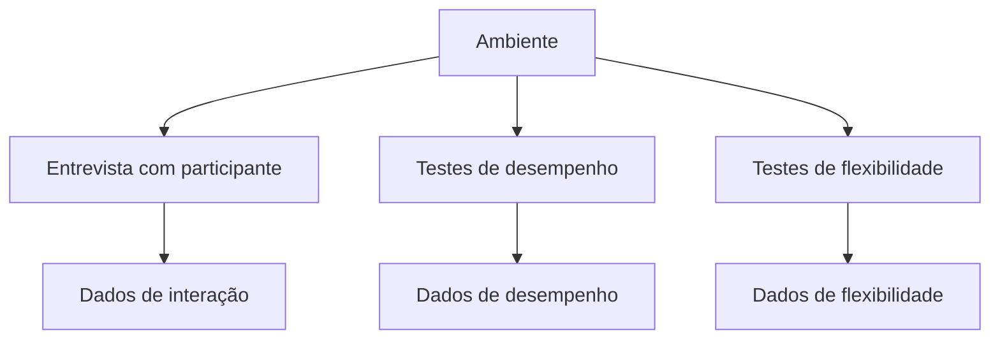

# Fase 3: Protocolos de avaliação

Esta seção documenta o plano de avaliação (Fase 3) do Anki Desktop 26.09.3 e do fluxo de conta, login e sincronização do AnkiWeb. Os procedimentos estão em três frentes que correspondem aos objetivos GQM da [Fase 2](fase2.md) e à árvore de pastas descrita em [Dados](dados.md).

O formulário aplicado em cada sessão com participante é o [Pré-entrevista com participante](avaliacao/protocolos/pre-entrevista-participante.md). As configurações de hardware e software das máquinas de referência estão em [Ambiente](avaliacao/protocolos/ambiente.md).

A Dupla A conduz todas as entrevistas com participantes voluntários e aplica o formulário de pré-entrevista completo. A Dupla B executa os testes instrumentados de eficiência de desempenho. A Dupla C executa os testes de flexibilidade. Quando a pré-entrevista contém blocos elaborados pelas Duplas B ou C, a Dupla A os aplica na sessão, desde que tenham sido preenchidos previamente.

## Coerência entre as Fases 2 e 3 (F3-C8)

O plano abaixo foi derivado das métricas, níveis e critérios de julgamento da Fase 2. A tabela resume a rastreabilidade método ↔ métrica:

| Objetivo GQM (Fase 2) | Questões | Método na Fase 3 | Onde as métricas são obtidas |
| --- | --- | --- | --- |
| Capacidade de interação | Q1–Q3 (Trf, Taprend, Tsa, Tct, Texec) | Entrevista com TCLE, gravação e ficha unificada | [Entrevista](avaliacao/protocolos/entrevista.md); dados em `avaliacao/dados/interacao/` |
| Eficiência de desempenho | Q1–Q4 (tempos, CPU, RAM, vazão, threads) | Coletores instrumentados; coleção sintética até 100k cards | [Desempenho](avaliacao/protocolos/desempenho.md); massa de dados justificada no [Ambiente](avaliacao/protocolos/ambiente.md) |
| Flexibilidade | Q1–Q3 (Tinst, Pint, Tpd, …) | Instalação, checklist de 10 itens e migração M1/M2 nas três plataformas | Protocolos de flexibilidade; dados previstos em `avaliacao/dados/flexibilidade/` |

Os níveis de pontuação da Fase 2 não são redefinidos aqui: a Fase 3 só descreve **como** coletar o que a Fase 2 já fixou. A execução e o julgamento estão na [Fase 4](fase4.md).

## 1. Método e instruções repetíveis

A execução segue o GQM da Fase 2 e o instrumento unificado, em três frentes:

| Frente | Quem executa | O que cobre | Páginas | Dados |
| --- | --- | --- | --- | --- |
| Entrevista com participante voluntário | Dupla A (todas as sessões) | Termo de consentimento, triagem, etapas de Capacidade de interação, eficiência percebida e campos de Flexibilidade quando preenchidos | [Entrevista](avaliacao/protocolos/entrevista.md), [Pré-entrevista](avaliacao/protocolos/pre-entrevista-participante.md) | Capacidade de interação e evidência qualitativa de Eficiência de desempenho; `avaliacao/dados/interacao/` |
| Testes de desempenho | Dupla B | Condições de controle e cenários instrumentados (inicialização a frio, repouso e estresse, capacidade, threads) | [Eficiência de desempenho](avaliacao/protocolos/desempenho.md) | Eficiência de desempenho; `avaliacao/dados/desempenho/` |
| Testes de flexibilidade | Dupla C, em laboratório nas máquinas de referência | Instalação e desinstalação, checklist de integração e migração da coleção padrão | [Instalação](avaliacao/protocolos/flexibilidade-instalacao.md), [Checklist](avaliacao/protocolos/flexibilidade-checklist.md), [Migração](avaliacao/protocolos/flexibilidade-migracao.md) | Flexibilidade; `avaliacao/dados/flexibilidade/` |

## 2. Recursos e ambiente

- **Software:** Anki Desktop 26.09.3; AnkiWeb na data da sessão; coletores em `avaliacao/scripts/` para Eficiência de desempenho.
- **Hardware e sistemas operacionais:** tabela em [Ambiente](avaliacao/protocolos/ambiente.md) (Windows, macOS e Ubuntu; máquinas de referência por característica).
- **Participantes (plano):** até 2 iniciantes (PA) e até 3 frequentes (PB); triagem conforme [Fase 2](fase2.md).
- **Realizado até a Entrega 2:** PA01 (Grupo A, 14/11/2026), PB01 e PB02 (Grupo B, 13/11/2026; PB02 piloto), PB03 (Grupo B, 21/11/2026). Evidência pública: fichas e atas de sessão. Ver [análise de Capacidade de interação](avaliacao/analise/interacao.md).

## 3. Cronograma de avaliação

| Atividade | Previsto | Status |
| --- | --- | --- |
| Protocolos e pré-entrevista publicados na GitPage | até 11/11/2026 | Páginas publicadas em `docs/avaliacao/protocolos/` |
| Entrevistas de Capacidade de interação (PB01 e PB02) | 13/11/2026 | Realizado: Grupo B, Etapas 1, 4 e 5; tempos da seção Etapa 2 (PB01) e Etapa 3 (PB02) da ficha contabilizados como Etapa 4 |
| Entrevista de Capacidade de interação (PA01) | 14/11/2026 | Realizado: Grupo A, Etapas 1 a 3 e 5 |
| Entrevista de Capacidade de interação (PB03) | 21/11/2026 | Realizado: Grupo B, Etapas 1, 4 e 5; B2 Revisar não coletada |
| Coletas de Eficiência de desempenho (Ubuntu, Windows e macOS) | PC2 até Entrega 2 | [Análise publicada](avaliacao/analise/desempenho.md); itens “refazer” e medições incompletas no Windows permanecem abertos |
| Coletas de Flexibilidade (instalação, integração e migração) | PC2 até Entrega 2 | Sem CSV nem gráficos; status documentado em [análise de Flexibilidade](avaliacao/analise/flexibilidade.md) |
| Cálculo das métricas a partir dos CSV e redação da análise de Capacidade de interação | 15/11/2026 a 16/11/2026 | `M-INT_metricas.csv` e [análise de Capacidade de interação](avaliacao/analise/interacao.md) publicados |
| Julgamento, sugestões e ação de melhoria | Entrega 2 | Publicado em [Fase 4](fase4.md); protótipo em [Protótipo](prototipo-acao-melhoria.md) |
| Cortes PSM | 08/11, 15/11 e 21/11/2026 | 08/11 e 15/11 publicados; 21/11 e Desempenho dos processos E2 ainda pendentes ([PSM](gestao-psm.md)) |

## Fluxo

## Seções comuns das páginas de procedimento

As páginas de procedimento repetem a mesma sequência de seções, para permitir leitura cruzada entre as frentes:

1. Definições específicas daquela frente (sem repetir o que já consta na Fase 2 ou nesta visão geral)
2. Pré-requisitos e condições de controle
3. Procedimento passo a passo
4. Registro de dados em `avaliacao/dados/...`, com o padrão `<métrica>_<cenário>_<execução>`
5. Critérios de invalidação ou encerramento
6. Relação com o [Pré-entrevista com participante](avaliacao/protocolos/pre-entrevista-participante.md) e com a página [Dados](dados.md)
