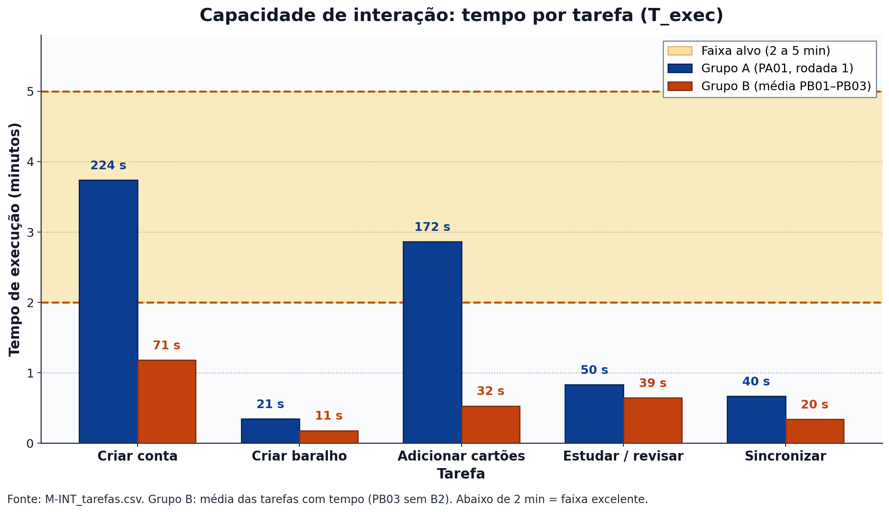
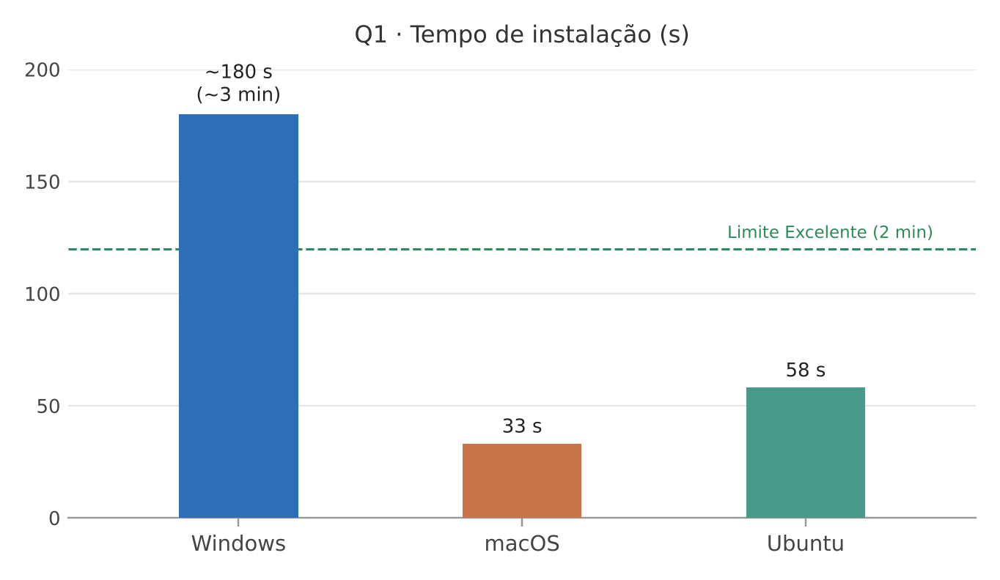
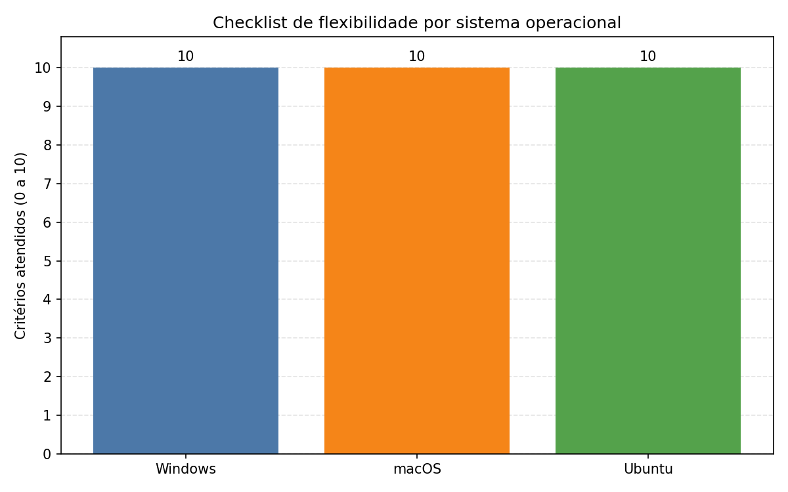

# Fase 4: Executar a avaliação e julgar

Esta página documenta a execução da avaliação do Anki Desktop 26.09.3 e do fluxo de conta, login e sincronização do AnkiWeb. Em sequência: a visão geral (organização dos dados e estado da coleta); a avaliação de cada característica frente ao GQM (Goal-Question-Metric: método que liga objetivos a perguntas e a medidas) da [Fase 2](fase2.md); o julgamento perante o propósito da [Fase 1](fase1.md); as relações entre características; as sugestões priorizadas; e a ação de melhoria. O detalhamento por característica está nas seções [Avaliação de Capacidade de interação](#avaliacao-capacidade-interacao), [Avaliação de Eficiência de desempenho](#avaliacao-eficiencia-desempenho) e [Avaliação de Flexibilidade](#avaliacao-flexibilidade), com páginas estendidas em [interacao.md](avaliacao/analise/interacao.md), [desempenho.md](avaliacao/analise/desempenho.md) e [flexibilidade.md](avaliacao/analise/flexibilidade.md).

## Visão geral

A Visão geral reúne apenas informações transversais: onde os dados ficam no repositório e qual é o estado objetivo de cada frente de coleta. Os números por métrica, as faixas e o julgamento por questão aparecem somente nas seções de avaliação de cada característica.

### Organização dos dados { #organizacao-dos-dados }

Os arquivos da avaliação do **produto** (o Anki) ficam em [`avaliacao/`](https://github.com/FCTE-Qualidade-de-Software-1/2026-2_T01_BETTY_SNYDER/tree/main/avaliacao). Essa pasta é distinta de [`gestao-psm/`](https://github.com/FCTE-Qualidade-de-Software-1/2026-2_T01_BETTY_SNYDER/tree/main/gestao-psm), que registra esforço, prazos e processos da **equipe** no projeto acadêmico. Misturar as duas fontes invalida a interpretação: um CSV em `avaliacao/` responde a uma métrica GQM do Anki; um CSV em `gestao-psm/` responde a um indicador PSM do trabalho da equipe.

Na prática, a pasta `avaliacao/` separa quatro papéis que se leem em cadeia:

1. **Protocolos** (`protocolos/`): o roteiro escrito de como coletar (entrevista, instrumentação, instalação, checklist, migração).
2. **Scripts** (`scripts/`): programas que geram ou consolidam medidas de desempenho e utilitários de verificação.
3. **Dados** (`dados/<frente>/{bruto,consolidado}/`): o registro bruto da sessão ou do ensaio e a tabela já calculada para publicação.
4. **Análise** (`analise/` e esta Fase 4): a interpretação frente às questões, hipóteses e faixas da Fase 2.

```text
avaliacao/
  protocolos/     Como conduzir entrevistas e ensaios
  scripts/        Programas de coleta e consolidação
  dados/
    interacao/      {bruto, consolidado}  Capacidade de interação
    desempenho/     {bruto, consolidado}  Eficiência de desempenho
    flexibilidade/  {bruto, consolidado}  Flexibilidade
  analise/        Interpretação das métricas frente ao GQM
```

**Rastreabilidade útil no dia a dia.** Para conferir um número da GitPage ou do artigo, percorra: protocolo > dado bruto > consolidado > análise nesta Fase 4. Os nomes preferenciais dos arquivos brutos seguem `<métrica>_<cenário>_<execução>` (exemplo: `T_ini_coldstart_ubuntu_01.csv`). A exceção deliberada é `sessoes.csv`, que indexa entrevistas (data, formato e ata) sem apontar mídia.

| Frente | O que procurar no bruto | Onde ler o consolidado e a avaliação |
| --- | --- | --- |
| Capacidade de interação | [`M-INT-01_reconhecimento.csv`](https://github.com/FCTE-Qualidade-de-Software-1/2026-2_T01_BETTY_SNYDER/blob/main/avaliacao/dados/interacao/bruto/M-INT-01_reconhecimento.csv), [`M-INT_tarefas.csv`](https://github.com/FCTE-Qualidade-de-Software-1/2026-2_T01_BETTY_SNYDER/blob/main/avaliacao/dados/interacao/bruto/M-INT_tarefas.csv), [`Entrevistas/`](https://github.com/FCTE-Qualidade-de-Software-1/2026-2_T01_BETTY_SNYDER/tree/main/avaliacao/dados/interacao/bruto/Entrevistas), [`sessoes.csv`](https://github.com/FCTE-Qualidade-de-Software-1/2026-2_T01_BETTY_SNYDER/blob/main/avaliacao/dados/interacao/bruto/sessoes.csv) | [`M-INT_metricas.csv`](https://github.com/FCTE-Qualidade-de-Software-1/2026-2_T01_BETTY_SNYDER/blob/main/avaliacao/dados/interacao/consolidado/M-INT_metricas.csv); [Avaliação de Capacidade de interação](#avaliacao-capacidade-interacao) |
| Eficiência de desempenho | CSV e gráficos em `docs/avaliacao/dados/desempenho/` (espelho usado na GitPage); canônico previsto em `avaliacao/dados/desempenho/` | [Avaliação de Eficiência de desempenho](#avaliacao-eficiencia-desempenho) |
| Flexibilidade | Consolidados em [`flexibilidade/consolidado/`](https://github.com/FCTE-Qualidade-de-Software-1/2026-2_T01_BETTY_SNYDER/tree/main/avaliacao/dados/flexibilidade/consolidado) (instalação, checklist e migração) | [Avaliação de Flexibilidade](#avaliacao-flexibilidade) |

**Participantes e privacidade.** Códigos públicos: PA01 (Grupo A, iniciante); PB01, PB02 (piloto) e PB03 (Grupo B, frequentes). A tabela código > pessoa e os termos de consentimento ficam fora do repositório. Gravações de tela e áudio não são versionadas; a evidência pública da sessão são as atas, as fichas anonimizadas e `sessoes.csv`.

### Visão geral da coleta { #visao-geral-da-coleta }

A coleta da Fase 4 materializa o plano da [Fase 3](fase3.md) em três frentes. O quadro abaixo indica apenas o método, o responsável e se a frente está concluída no repositório. Métricas, faixas e julgamento ficam nas seções de avaliação.

| Frente | Método e responsável | Estado da coleta | Onde aprofundar |
| --- | --- | --- | --- |
| Capacidade de interação | Entrevistas observadas (Dupla A), com TCLE (Termo de Consentimento Livre e Esclarecido) | Quatro sessões publicadas (PA01, PB01, PB02 piloto, PB03); consolidado `M-INT_metricas.csv` disponível | [Avaliação de Capacidade de interação](#avaliacao-capacidade-interacao) |
| Eficiência de desempenho | Instrumentação multiplataforma (Dupla B) | Ensaios em Ubuntu, Windows 11 e macOS publicados; ressalvas de plataforma documentadas | [Avaliação de Eficiência de desempenho](#avaliacao-eficiencia-desempenho) |
| Flexibilidade | Ensaios de laboratório (Dupla C): instalação, checklist e migração | Consolidados de instalação, checklist e migração M1/M2 publicados | [Avaliação de Flexibilidade](#avaliacao-flexibilidade) |

**Leitura prática.** Se a dúvida for sobre um participante, abra a ficha e a ata da sessão. Se for sobre um tempo ou uma taxa GQM, abra o consolidado da frente e a seção de avaliação correspondente. Se for sobre esforço da equipe (horas, ICP, defeitos de processo), use a [Gestão PSM](gestao-psm.md), não esta página.

---

## Avaliação de Capacidade de interação { #avaliacao-capacidade-interacao }

Página estendida: [Avaliação de Capacidade de interação](avaliacao/analise/interacao.md).

### Coleta

Quatro sessões com consentimento. A evidência pública no repositório são as fichas anonimizadas e as atas; as gravações de tela e áudio permanecem em diretório privado.

| Código | Data | Modalidade / SO | Grupo e etapas | Evidência |
| --- | --- | --- | --- | --- |
| PA01 | 14/11/2026 | Presencial, Windows 11 | A (iniciante): Etapas 1 a 3 e 5 | [ficha](https://github.com/FCTE-Qualidade-de-Software-1/2026-2_T01_BETTY_SNYDER/blob/main/avaliacao/dados/interacao/bruto/Entrevistas/PA01_2026-11-14.md); [ata](avaliacao/atas/sessao-PA01_2026-11-14.md) |
| PB01 | 13/11/2026 | Online, macOS | B (frequente): Etapas 1, 4 e 5 | [ficha](https://github.com/FCTE-Qualidade-de-Software-1/2026-2_T01_BETTY_SNYDER/blob/main/avaliacao/dados/interacao/bruto/Entrevistas/PB01_2026-11-13.md); [ata](avaliacao/atas/sessao-PB01_2026-11-13.md) |
| PB02 | 13/11/2026 | Online, Windows 10 | B (frequente / piloto): Etapas 1, 4 e 5 | [ficha](https://github.com/FCTE-Qualidade-de-Software-1/2026-2_T01_BETTY_SNYDER/blob/main/avaliacao/dados/interacao/bruto/Entrevistas/PB02_2026-11-13.md); [ata](avaliacao/atas/sessao-PB02_2026-11-13.md) |
| PB03 | 21/11/2026 | Online, Windows 10 | B (frequente): Etapas 1, 4 e 5 | [ficha](https://github.com/FCTE-Qualidade-de-Software-1/2026-2_T01_BETTY_SNYDER/blob/main/avaliacao/dados/interacao/bruto/Entrevistas/PB03_2026-11-21.md); [ata](avaliacao/atas/sessao-PB03_2026-11-21.md) |

**Notas de cálculo.** O Grupo A executa Etapas 1 a 3 e 5. O Grupo B não executa Etapas 2 e 3. Em PB01, os tempos da seção Etapa 2 da ficha foram contabilizados como Etapa 4. Em PB02, os tempos da seção Etapa 3 foram contabilizados como Etapa 4. Em PB03, quatro tarefas da Etapa 4 têm tempo; B2 Revisar não foi coletada. A sessão **PB02** (piloto) permanece na avaliação geral como linha de base e dado consolidado.

### Resultados

| Métrica | PA01 | Faixa | PB01 | Faixa | PB02 | Faixa | PB03 | Faixa |
| --- | --- | --- | --- | --- | --- | --- | --- | --- |
| T<sub>rf</sub> | 16,7% (1/6) | Insatisfatório | 66,7% | Mínimo | 83,3% | Alvo | 66,7% | Mínimo |
| T<sub>aprend</sub> | 7 min 36 s (456,05 s) | Excelente | n/a | - | n/a | - | n/a | - |
| T<sub>sa</sub> | 100% (4/4 sem ajuda) | Excelente | n/a | - | n/a | - | n/a | - |
| T<sub>ct</sub> | 80% para 100% (rodadas 1-2) | Mínimo para Excelente | 100% (Etapa 4) | Excelente | 100% (Etapa 4) | Excelente | 100% (4/4) | Excelente |
| T<sub>exec</sub> mediana | 50 s | Excelente | 39,31 s | Excelente | 25 s | Excelente | 27,285 s | Excelente |

**Agregados do Grupo B.** Média de T<sub>rf</sub> = 72,2% (faixa mínimo). T<sub>ct</sub> = 100% nos três frequentes. Mediana aproximada de T<sub>exec</sub> ≈ 30,5 s (faixa excelente).



*Figura. Tempo por tarefa alinhado semanticamente. Grupo A: PA01, rodada 1. Grupo B: Etapa 4 (fonte canônica `M-INT_tarefas.csv`, com PB03). A figura pode ainda mostrar a média anterior só de PB01 e PB02. A faixa sombreada é o alvo da Fase 2 (2 a 5 min).*

### Análise

| Questão | Evidência | Resposta |
| --- | --- | --- |
| **Q1** (reconhecibilidade) | T<sub>rf</sub> de PA01 = 16,7%, abaixo de 75% (alvo) | Não atendida |
| **Q2** (aprendizagem) | T<sub>aprend</sub> = 7 min 36 s e T<sub>sa</sub> = 100% em PA01, ambos na faixa excelente | Atendida em PA01 (n = 1 iniciante) |
| **Q3** (operabilidade) | T<sub>ct</sub> = 100% e T<sub>exec</sub> mediana &lt; 2 min em PB01, PB02 e PB03 | Atendida no escopo da Etapa 4 (com ressalvas) |

| Hipótese | Julgamento |
| --- | --- |
| **H1** | Rejeitada no iniciante (T<sub>rf</sub> 16,7%). PB02 só acertou R1 após três tentativas. PB03 errou R4 e R6. |
| **H2** | Sustentada em PA01 para o roteiro de aprendizagem. |
| **H3** | Sustentada no agregado de frequentes (T<sub>ct</sub> e T<sub>exec</sub> em alvo ou excelente), com remapeamento documental em PB01/PB02 e B2 não coletada em PB03. |

**Evidência qualitativa (Etapa 5).** PA01 falhou em localizar “Criar baralho” e pediu botões autoexplicativos. PB01 confundiu “nota” com “cartão” e pediu tutorial prático. PB02 descreveu “Criar baralho” como pouco intuitivo na parte inferior. PB03 apontou clareza dos botões iniciais, confusão em “nota” e desejo de interface e termos menos técnicos.

**Limitações.** Amostra de quatro participantes, com um único iniciante para Q1 e Q2. Em PB01/PB02, a Etapa 4 foi remapeada a partir de seções erradas da ficha. Em PB03, B2 Revisar não foi coletada. O julgamento preserva a ênfase 5 da Fase 1.

---

## Avaliação de Eficiência de desempenho { #avaliacao-eficiencia-desempenho }

Página estendida: [Avaliação de Eficiência de desempenho](avaliacao/analise/desempenho.md).

### Coleta

A Dupla B instrumentou o Anki Desktop 26.09.3 em três máquinas de referência ([Ambiente](avaliacao/protocolos/ambiente.md)):

| Avaliador | SO | Arquitetura | Hardware |
| --- | --- | --- | --- |
| Mateus de Siqueira | Ubuntu 24.04 LTS | x86_64 | Intel Core i7-1185G7, 8 GB RAM |
| Karolina Vieira | Windows 11 | x86_64 | Intel Core i7-1165G7, 16 GB RAM |
| Davi Severiano | macOS Sequoia | ARM64 | Apple Silicon M4, 16 GB unificada |

Os CSV e gráficos usados nesta página estão em `docs/avaliacao/dados/desempenho/bruto/` e `docs/avaliacao/dados/` (gráficos de threads). O diretório canônico `avaliacao/dados/desempenho/` contém apenas README e `.gitkeep` nesta entrega.

**Ressalvas de medição.** No Windows e no macOS, o cold start registrado é o tempo de criação do processo (*launcher*), não o tempo até a interface pronta (TTI, tempo até a tela ficar utilizável); no Ubuntu, o coletor mediu até a ativação dos subprocessos QtWebEngine (TTI ≈ 1,018 s). A RAM do Windows (73,40 MB em repouso; 26,35 MB no estresse) enumera só o processo pai, sem a árvore de renderizadores. T<sub>sinc</sub> foi retirado dos ensaios de laboratório (risco de *rate limit* no AnkiWeb e dependência de rede externa); a sincronização permanece nas entrevistas (Capacidade de interação) e no cenário M2 de migração (Flexibilidade).

### Resultados

Valores tomados da [Avaliação de Eficiência de desempenho](avaliacao/analise/desempenho.md). As faixas abaixo seguem a Tabela VIII da [Fase 2](fase2.md), salvo quando essa avaliação registra enquadramento próprio e isso é indicado no texto.

| Métrica | Ubuntu 24.04 | Windows 11 | macOS Sequoia | Enquadramento |
| --- | --- | --- | --- | --- |
| Cold start (Q1) | 1,018 s (TTI) | 0,152 s (*launcher*) | 0,021 s (*launcher*) | Excelente (&lt; 3 s) nos três |
| CPU em repouso (Q2) | 0,04% | 0,00% | 0,10% | Excelente |
| RAM em repouso (Q2) | 783,89 MB | 73,40 MB (só processo pai) | 950,77 MB | Insatisfatório em Ubuntu e macOS (≥ 400 MB; QtWebEngine) |
| Threads em repouso | 56 (6 filhos) | 13–16 (1 filho) | 85–88 (5 filhos) | Contagem observada |
| RAM pico 100k cards (Q2) | 1.328,13 MB (1,33 GB) | 26,35 MB (*stub*) | 1.512,06 MB (1,51 GB) | Insatisfatório em Ubuntu e macOS (≥ 800 MB) |
| CPU pico sob carga (Q2) | 100,6% (1 núcleo) | 98,4% (1 núcleo) | 100,8% (1 núcleo) | Um núcleo saturado; demais livres |
| Main thread sob estresse (Q4) | 2,35% | 98,44% (TID #0) | 1,30% | Excelente em Ubuntu e macOS; Windows: limitação controlada da API NT |
| Vazão Check Database 100k (Q3) | ≈ 2.000.000 cards/min (~3 s) | Ação manual sem timer | ≈ 3.000.000 cards/min (~2 s) | Excelente em Ubuntu e macOS |

### Análise

| Questão / hipótese | Evidência | Julgamento |
| --- | --- | --- |
| **Q1 / H1** (comportamento no tempo) | Cold start &lt; 1,5 s em todos os SOs; T<sub>sinc</sub> fora do laboratório | H1 confirmada para cold start (faixa excelente). T<sub>sinc</sub> não julgado nestes ensaios. |
| **Q2 / H2** (CPU) | CPU em repouso ≤ 0,10% | H2 para CPU superada (faixa excelente; abaixo do alvo 2–5% previsto). |
| **Q2 / H2** (RAM) | 783,89 MB e 950,77 MB em repouso; 1,33 GB e 1,51 GB sob 100k cards | H2 para RAM refutada: faixa insatisfatório (Tabela VIII: ≥ 400 MB repouso / ≥ 800 MB estresse). Pegada do QtWebEngine/Chromium e índices SQLite sob 100k cards. |
| **Q3 / H3** (capacidade e vazão) | Check Database em ~2–3 s; vazão ≫ 15.000 cards/min | H3 confirmada e superada (faixa excelente). |
| **Q4 / H4** (threads / UI) | Main thread 2,35% (Ubuntu) e 1,30% (macOS); Windows 98,44% no TID #0 | H4 confirmada em Unix (faixa excelente). No Windows, o pico no índice #0 é registrado como limitação controlada da API NT (ausência de garantia de ordem cronológica em `proc.threads()`). |

**Limitação controlada de plataforma (Windows 11).** A triangulação multiplataforma, destacada positivamente no [feedback do PC2](avaliacao/atas/feedback-PC2_2026-11-16.md), evidencia que, sem privilégios elevados no Windows NT, a biblioteca `psutil` isola apenas o processo raiz (`anki.exe`, omitindo os renderizadores `QtWebEngineProcess`) e não garante que o índice `#0` de `proc.threads()` corresponda à thread de interface gráfica. Da mesma forma, o disparo de *cold start* no Windows e no macOS registra o *process creation time* (*launcher*), enquanto no Ubuntu registra o *Time-to-Interactive* completo (1,018 s). Por rigor metodológico, o julgamento quantitativo comparável 1:1 de Q2 (árvore completa de RAM), Q3 (vazão cronometrada) e Q4 (isolamento determinístico de *Main Thread*) adota Ubuntu 24.04 e macOS Sequoia como linha de base primária, preservando os registros brutos do Windows 11 para transparência da avaliação.

---

## Avaliação de Flexibilidade { #avaliacao-flexibilidade }

Página estendida: [Avaliação de Flexibilidade](avaliacao/analise/flexibilidade.md).

### Coleta

Os protocolos de [instalação](avaliacao/protocolos/flexibilidade-instalacao.md), [checklist](avaliacao/protocolos/flexibilidade-checklist.md) e [migração](avaliacao/protocolos/flexibilidade-migracao.md) preveem, em laboratório (Dupla C), as métricas T<sub>inst</sub>, T<sub>inst_t</sub>, N<sub>int</sub>, P<sub>int</sub>, T<sub>pd</sub> e T<sub>sub</sub> nas máquinas de referência Windows, macOS e Ubuntu ([Ambiente](avaliacao/protocolos/ambiente.md)).

Publicados em [`avaliacao/dados/flexibilidade/consolidado/`](https://github.com/FCTE-Qualidade-de-Software-1/2026-2_T01_BETTY_SNYDER/tree/main/avaliacao/dados/flexibilidade/consolidado): tempos de instalação, checklist de integração (P<sub>int</sub>), migração M1/M2 (T<sub>pd</sub>, T<sub>sub</sub>) e dois gráficos. A pasta `bruto/` ainda não espelha os arquivos `diff_m*_rep*.csv` citados no consolidado.

### Resultados

Fontes: [`flexibilidade-instalacao-tempo.csv`](https://github.com/FCTE-Qualidade-de-Software-1/2026-2_T01_BETTY_SNYDER/blob/main/avaliacao/dados/flexibilidade/consolidado/flexibilidade-instalacao-tempo.csv), [`flexibilidade-checklist-registro.csv`](https://github.com/FCTE-Qualidade-de-Software-1/2026-2_T01_BETTY_SNYDER/blob/main/avaliacao/dados/flexibilidade/consolidado/flexibilidade-checklist-registro.csv) e [`flexibilidade-migracao.csv`](https://github.com/FCTE-Qualidade-de-Software-1/2026-2_T01_BETTY_SNYDER/blob/main/avaliacao/dados/flexibilidade/consolidado/flexibilidade-migracao.csv). Faixas da Tabela XI da [Fase 2](fase2.md).

| Sistema | T<sub>inst</sub> | T<sub>inst_t</sub> | N<sub>int</sub> | Faixas (T<sub>inst</sub> / T<sub>inst_t</sub> / N<sub>int</sub>) | P<sub>int</sub> | Faixa P<sub>int</sub> |
| --- | --- | --- | --- | --- | --- | --- |
| Windows 11 | 100% (1/1) | 3,82 min | 0 | Alvo / alvo / excelente | 10/10 | Excelente |
| macOS 27 (ARM) | 100% (1/1) | 0,55 min | 0 | Excelente / excelente / excelente | 10/10 | Excelente |
| Ubuntu 26.04.1 | 100% (1/1) | 0,97 min | 0 | Excelente / excelente / excelente | 10/10 | Excelente |



*Figura. Tempo de instalação (T<sub>inst_t</sub>) em Windows, macOS e Ubuntu.*



*Figura. Pontuação do checklist de integração (P<sub>int</sub>) por sistema operacional.*

**Migração (Q3).** Seis ensaios em 20/11/2026 (M1 `.apkg` e M2 AnkiWeb, três pares de SO cada): T<sub>pd</sub> = 100% (0 diferenças em 10.000 cartões; sem intervenção); T<sub>sub</sub> entre 2,33 e 2,66 min (média 2,51 min), faixa **mínimo**.

**Qualitativos (Parte C das entrevistas; complementam o laboratório).**

| Participante | Relato sobre instalação |
| --- | --- |
| PB01 (macOS) | Instalação “tranquila”; precisou autorizar a abertura do aplicativo baixado da internet (Gatekeeper). |
| PB02 (Windows) | Instalação “tranquila” e “intuitiva”; sem passo além do instalador. |
| PB03 (Windows) | Instalação “um pouco confusa” no site (extensões externas); precisou de passo além do instalador. |
| PA01 (Grupo A) | Anki já instalado pela equipe antes da sessão; perguntas de instalabilidade do Grupo B marcadas N/A. |

### Análise

| Questão / hipótese (Fase 2) | Situação nesta página |
| --- | --- |
| **Q1 / H1** (instalabilidade) | Atendida nos três sistemas (T<sub>inst</sub> e T<sub>inst_t</sub> no alvo ou excelente; N<sub>int</sub> = 0). H1 parcial: no Ubuntu o tempo ficou abaixo de 2 min e sem intervenção, diferente da expectativa de 2 a 5 min com intervenção. |
| **Q2 / H2** (adaptabilidade) | Atendida: P<sub>int</sub> = 10/10 nos três sistemas (faixa excelente). |
| **Q3 / H3** (substituibilidade) | T<sub>pd</sub> = 100% (preservação confirmada); T<sub>sub</sub> média 2,51 min (faixa mínimo). Q3 não atendida no alvo. H3 parcial: preservação sim; tempo &lt; 1 min não. |
| **Objetivo G (Flexibilidade)** | Q1 e Q2 atendidas; Q3 com evidência completa na faixa mínimo (tempo de migração). |

Arquivos opcionais remanescentes: espelhar `diff_m*_rep*.csv` em `avaliacao/dados/flexibilidade/bruto/migracao/`.

---

## Julgamento e coerência com a Fase 1 { #julgamento-e-coerencia }

O [propósito da avaliação](fase1.md#propósito-da-avaliação-e-uso-pretendido) é **indicar pontos de melhoria** no Anki, sob o ponto de vista do estudante, para a requisitante (professora), com recomendações priorizadas para mantenedores e estudantes.

| Expectativa da Fase 1 | Resultado da Fase 4 | Atende? |
| --- | --- | --- |
| Identificar barreiras de uso na interface (ênfase 5) | Q1 de Capacidade de interação não atendida (T<sub>rf</sub> do iniciante 16,7%); Q2 e Q3 atendidas no escopo amostral | Sim, com limitação de n = 4 (1 iniciante) |
| Informar comportamento de desempenho em estudo prolongado | Cold start e vazão excelentes; RAM na faixa insatisfatório em Unix; Windows parcial | Parcial |
| Informar instalabilidade e migração entre SO | Instalação, checklist e migração publicados; T<sub>sub</sub> na faixa mínimo | Sim, com ressalva de tempo de migração acima de 1 min |
| Fundamentar uma ação de melhoria | Protótipo de alta fidelidade para “Criar baralho” | Sim |

O julgamento cumpre o uso pretendido na característica priorizada (Capacidade de interação), cobre instalabilidade, adaptabilidade e migração com dados de laboratório, e deixa explícitas a faixa mínimo de T<sub>sub</sub> e a incompletude de desempenho no Windows.

## Relações entre características { #relacoes-entre-caracteristicas }

- **Capacidade de interação × Eficiência de desempenho.** Falhas de reconhecibilidade (T<sub>rf</sub> de PA01 = 16,7%; R1 falhou) elevam o esforço cognitivo na primeira sessão, mesmo com cold start e vazão de banco na faixa excelente. Evidência: [interacao.md](avaliacao/analise/interacao.md) e [desempenho.md](avaliacao/analise/desempenho.md).
- **Eficiência de desempenho × uso em notebook.** RAM em repouso na faixa insatisfatório (≈ 780–950 MB em Ubuntu e macOS) e picos de 1,33–1,51 GB sob 100k cards podem afetar a fluidez percebida em máquinas de 8 GB (perfil Ubuntu da avaliação). Limitação: RAM do Windows ainda incompleta (só processo pai).
- **Flexibilidade × Capacidade de interação.** Com T<sub>inst_t</sub> excelente ou alvo e N<sub>int</sub> = 0 nos três sistemas, a barreira de primeiro uso observada nas entrevistas concentra-se na interface (vocabulário e “Criar baralho”), não no tempo de instalação em laboratório. A migração preserva 100% dos dados, mas leva em média 2,51 min (faixa mínimo), o que ainda pode somar esforço no primeiro uso ao trocar de máquina. Evidência: [flexibilidade.md](avaliacao/analise/flexibilidade.md).

Onde os dados não permitem relação: afirmação causal entre o tempo de migração M1/M2 e T<sub>exec</sub> das sessões de entrevista (amostras e contextos distintos).

## Sugestões priorizadas { #sugestoes-priorizadas }

| Prioridade | Sugestão (ação concreta) | Base |
| --- | --- | --- |
| 1 | Destacar **Criar baralho** na tela inicial (lista de baralhos como home) | T<sub>rf</sub> R1; PA01 e PB02 |
| 2 | Incluir glossário ou tooltips para nota, tipo de nota e cartão | Q1; respostas da Etapa 5 |
| 3 | Revisar footprint de memória do QtWebEngine sob coleções grandes | RAM na faixa insatisfatório (Ubuntu 1,33 GB; macOS 1,51 GB com 100k cards) |
| 4 | Reduzir o tempo de migração (T<sub>sub</sub> hoje ≈ 2,5 min) e fechar itens “refazer” no Windows | Q3 na faixa mínimo; desempenho parcial no Windows |

## Ação de melhoria { #acao-de-melhoria }

**Problema.** “Criar baralho” não é reconhecido de imediato (T<sub>rf</sub> do iniciante 16,7%; PB02 só após três tentativas).

**Justificativa.** Prioridade 1 da tabela acima; ênfase 5 da Fase 1; evidência direta de Q1/H1.

**Ação.** Protótipo de alta fidelidade com a lista de baralhos como tela inicial e destaque para **Criar Baralho**, além de tutorial introdutório guiado. Artefato: [Protótipo da ação de melhoria](prototipo-acao-melhoria.md) ([abrir interativo](prototipo-interativo/index.html)).

**Validação.** Sessão de verificação com PA01 no protótipo: R1 correto na 1ª tentativa, funções principais 3/3, conceitos 3/3 e tempo até **Criar baralho** de 5 s (critério ≤ 10 s). Ata: [sessao-PA01-verificacao-prototipo_2026-11-22.md](avaliacao/atas/sessao-PA01-verificacao-prototipo_2026-11-22.md).

**O que a ação não cobre.** Não reduz T<sub>sub</sub> da migração (Q3 de Flexibilidade) nem fecha as medições de desempenho no Windows.
