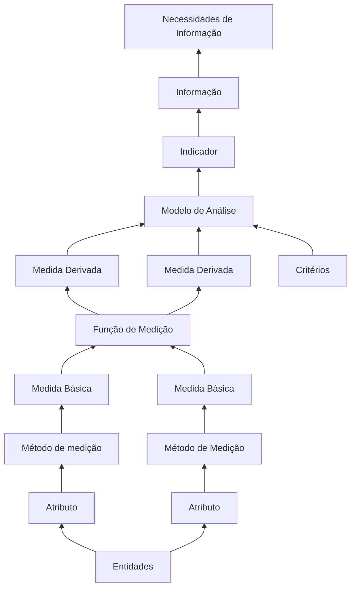
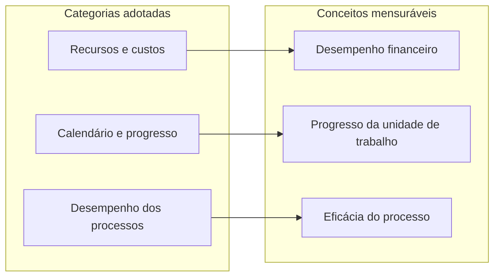

# Gestão do projeto (PSM)

Esta seção apresenta o plano e o rastreamento de medição do **projeto acadêmico** da equipe Betty Snyder, segundo a abordagem *Practical Software and System Measurement* (PSM). O objeto de medição é a execução do trabalho da equipe (esforço, prazos, progresso e eficácia dos processos internos). **Não** se mede, neste espaço, a qualidade do produto Anki: essa avaliação pertence ao GQM da Fase 2.

O PSM caracteriza-se como abordagem dirigida por informações (*information-driven*): mede-se apenas o necessário para responder a necessidades de informação dos gestores do projeto e para fundamentar decisões (RAMOS, 2026). A documentação segue o *Measurement Information Model*, as recomendações da Aula 09 (RAMOS, 2026) e o mapeamento estrutural da equipe (necessidades de informação, categorias, conceitos mensuráveis, medidas básicas e derivadas), alinhado ao *Continuous Iterative Development Measurement Framework* — CID (JONES et al., 2021a; JONES et al., 2021b).

Após o Ponto de Controle 1, o rastreamento PSM deixou de constar do artigo científico por orientação da disciplina. Os registros permanentes ficam nesta documentação MkDocs e nos arquivos da pasta [`gestao-psm/`](https://github.com/FCTE-Qualidade-de-Software-1/2026-2_T01_BETTY_SNYDER/tree/main/gestao-psm) do repositório.

!!! note "Delimitação: PSM do projeto versus GQM do produto"
    As métricas GQM da Fase 2 (capacidade de interação, eficiência de desempenho e flexibilidade) avaliam o **Anki**. O template de issue `02 - Registro de Medição` registra observações dessas métricas de produto. O PSM, nesta seção, registra o **andamento e a gestão do projeto**. Misturar as duas fontes invalida a interpretação dos indicadores.

## Modelo de informação

O modelo de informação do PSM define a cadeia lógica que liga uma necessidade de decisão a um indicador interpretável (RAMOS, 2026). A Figura 1 reproduz o diagrama da Aula 09. Cada elemento tem função específica:

| Elemento | Função |
|---|---|
| Necessidades de informação | Perguntas gerenciais motivadas por riscos, problemas ou ausência de dados |
| Entidades | Objetos do projeto sobre os quais se mede (integrante, tarefa, revisão, marco) |
| Atributos | Propriedades relevantes das entidades para a necessidade (horas, prazo, status, defeito) |
| Método de medição | Operação que quantifica o atributo e atribui escala (contagem, soma, registro temporal) |
| Medida básica | Quantificação de um único atributo por um método específico |
| Função de medição | Algoritmo que combina duas ou mais medidas |
| Medida derivada | Quantidade definida como função de medidas básicas (ou de outras derivadas) |
| Critérios | Limites, faixas ou valores esperados usados na comparação |
| Modelo de análise | Algoritmo que combina medidas e critérios para produzir o indicador |
| Indicador | Estimativa ou avaliação que fundamenta a tomada de decisão |
| Informação | Resultado interpretado na linguagem do requisitante, respondendo à necessidade |

*Figura 1. Modelo de Informação do PSM (RAMOS, 2026).*

A operacionalização desse modelo no projeto segue duas partes do CID. A Parte 1 define **o que medir**: identificação de necessidades, escolha de categorias e conceitos mensuráveis e consulta à tabela ICM para medidas candidatas (JONES et al., 2021a). A Parte 2 define **como medir**: procedimentos de coleta, cálculo e análise, construção de indicadores e interpretação (JONES et al., 2021b).

O PSM prevê três tipos de análise (RAMOS, 2026):

1. **Estimativa** — projeta tamanho, esforço, calendário ou custo com base em dados históricos e atuais.
2. **Viabilidade** — avalia se planos e metas são conjuntamente realizáveis e identifica riscos de desequilíbrio.
3. **Desempenho (*performance*)** — compara o realizado ao planejado durante a execução.

Na Entrega 1, a equipe aplicou predominantemente a **análise de desempenho**, por meio de cortes semanais com indicador, interpretação e decisão registrada.

## Categorias e conceitos mensuráveis

O PSM lista sete categorias de informação. A equipe selecionou **três**, por relevância às decisões recorrentes do projeto acadêmico (distribuição de esforço, cumprimento de prazos e eficácia do processo de produção documental) e por viabilidade de coleta com as fontes já em uso (RAMOS, 2026; JONES et al., 2021a). As demais categorias (tamanho e estabilidade do produto, qualidade do produto Anki, efetividade de tecnologias, satisfação do cliente) ficam fora do escopo do PSM deste projeto; parte delas é tratada, quando couber, pelo GQM de produto.

A Tabela I resume o mapeamento adotado. Cada linha corresponde a um *construto* detalhado em página própria: necessidades de informação, medidas básicas e derivadas, indicadores, critérios, procedimentos aplicados e lacunas.

*Tabela I. Categorias de informação PSM adotadas pela equipe*

| Categoria de informação | Conceito mensurável | Necessidades (síntese) | Página |
|---|---|---|---|
| Recursos e custos | Desempenho financeiro (esforço da equipe) | Custo e cronograma estimados; precisão e viabilidade das estimativas | [Recursos e custos](gestao-psm/recursos-e-custos.md) |
| Calendário e progresso | Progresso da unidade de trabalho | Entrega conforme o compromisso; risco de atraso; fluxo, vazão e filas | [Calendário e progresso](gestao-psm/calendario-e-progresso.md) |
| Desempenho dos processos | Eficácia do processo | Status do marco; trabalho restante; tendência plano versus execução | [Desempenho dos processos](gestao-psm/desempenho-dos-processos.md) |

*Figura 2. Relação entre categorias de informação e conceitos mensuráveis no escopo da equipe.*

O inventário completo do estado de cada métrica (aplicada, parcial ou insuficiente), com artefato de referência e próximo procedimento mínimo, consta em [Procedimentos e lacunas](gestao-psm/procedimentos-e-lacunas.md). A configuração de Project, milestones, labels e issues como infraestrutura de coleta e rastreamento consta em [Organização no GitHub](gestao-psm/github-organizacao.md).

## Processo de medição na Entrega 1

O processo de medição na Entrega 1 foi organizado por categoria, com responsabilidades e artefatos fixos:

| Papel | Atribuição |
|---|---|
| Coletor | Obtém os dados brutos e persiste o corte em CSV na pasta `gestao-psm/` do repositório |
| Redator / analista | Calcula o indicador, interpreta o resultado à luz dos critérios e registra a decisão gerencial |

Cortes documentados: **11/10/2026**, **18/10/2026** e **25/10/2026**. Não houve reunião formal de medição em 18/10 nem em 21/10; nesses intervalos, a consolidação apoiou-se em planilha, atas e documento de pendências.

**Fontes na Entrega 1.** A equipe decidiu não utilizar issues do GitHub como fonte primária, por prazo insuficiente para implantar o fluxo completo. As fontes adotadas foram:

- planilha de horas (esforço planejado e real);
- atas e mensagens de planejamento (compromissos e prazos);
- documento de pendências da Entrega 1;
- contagens de revisão do artigo (defeitos confirmados e correções).

**Transição após o Ponto de Controle 1.** As tarefas do calendário foram materializadas em 46 issues e em milestones (`PC1`, `F1`, `F2`, `E2`). O Project (Projects V2) com campos PSM/CID permanece pendente de autorização OAuth, conforme [Organização no GitHub](gestao-psm/github-organizacao.md). Essa transição amplia a rastreabilidade para Calendário e progresso, mas **não substitui**, até a ativação do Project, a necessidade de timestamps de estado para *Cycle Time*, *Throughput* e WIP.

Nenhum valor de indicador deve ser estimado ou inventado: cada medida aponta para arquivo, data de corte e evidência.

## Série histórica de medições

A Tabela II consolida, por categoria e por corte (ou revisão), o indicador calculado, a decisão tomada e o arquivo de dados brutos. A leitura deve ser feita em conjunto com as páginas de categoria, onde constam definição, fórmula, critério de decisão e análise de lacunas.

Interpretação objetiva dos indicadores da série:

| Indicador | Significado operacional |
|---|---|
| Desvio percentual | \((H_r - H_p) / H_p \times 100\); esforço real frente ao planejado (negativo indica subutilização agregada) |
| Participação mínima | Menor \(H_r\) relativo de um integrante sobre o esforço total da equipe |
| ICP | \(T_c / T_p\); fração das tarefas com prazo no corte que foram concluídas no prazo |
| \(D_1\) e taxa de correção | Densidade de defeitos na revisão documental e proporção de defeitos já corrigidos |

*Tabela II. Série de medições PSM — Entrega 1*

| Categoria | Corte | Indicador | Decisão | Arquivo |
|---|---|---|---|---|
| Recursos e custos | 11/10 | Desvio −42,0%; participação mínima 2,8% | Redistribuir (participação); julgamento retrospectivo | [`2026-10-11_recursos-custos.csv`](https://github.com/FCTE-Qualidade-de-Software-1/2026-2_T01_BETTY_SNYDER/blob/main/gestao-psm/2026-10-11_recursos-custos.csv) |
| Recursos e custos | 18/10 | Desvio −20,0%; participação mínima 11,0% | Manter carga; acompanhar desvios individuais | [`2026-10-18_recursos-custos.csv`](https://github.com/FCTE-Qualidade-de-Software-1/2026-2_T01_BETTY_SNYDER/blob/main/gestao-psm/2026-10-18_recursos-custos.csv) |
| Recursos e custos | 25/10 | Desvio −46,0%; participação mínima 10,3% | Sem sobrecarga da equipe (+30%); acompanhar subutilização | [`2026-10-25_recursos-custos.csv`](https://github.com/FCTE-Qualidade-de-Software-1/2026-2_T01_BETTY_SNYDER/blob/main/gestao-psm/2026-10-25_recursos-custos.csv) |
| Desempenho dos processos | Rev. 1 | \(D_1 = 1{,}44\); correção 61,5% | Revisão 2 com dados reais | Contagem da Revisão 1 |
| Calendário e progresso | 11/10 | ICP 56,3% (\(T_p = 16\), \(T_c = 9\)) | Redistribuir | [`calendario-progresso.csv`](https://github.com/FCTE-Qualidade-de-Software-1/2026-2_T01_BETTY_SNYDER/blob/main/gestao-psm/calendario-progresso.csv) |
| Calendário e progresso | 18/10 | ICP 21,4% | Redistribuir | idem |
| Calendário e progresso | 25/10 | ICP 40,0% (\(T_c = 6\): B1, A1–A5) | Redistribuir 9 restantes | idem |

Os dados brutos permanecem na pasta [`gestao-psm/`](https://github.com/FCTE-Qualidade-de-Software-1/2026-2_T01_BETTY_SNYDER/tree/main/gestao-psm). A [Retrospectiva E1](retrospectiva-e1.md) vincula ações corretivas a limiares explícitos: participação inferior a 10% e ICP inferior a 70%.

## Referências

JONES, Cheryl L. et al. (ed.). **Practical software and systems measurement continuous iterative development measurement framework**: part 1: concepts, definitions, principles, and measures. Version 2.1. [S. l.]: Practical Software & Systems Measurement; National Defense Industrial Association; International Council on Systems Engineering, 15 abr. 2021a. Product No. PSM-2021-03-001; INCOSE-TP-2020-001-06.

JONES, Cheryl L. et al. (ed.). **Practical software and systems measurement continuous iterative development measurement framework**: part 2: measurement specifications and enterprise measures. Version 2.1. [S. l.]: Practical Software & Systems Measurement; National Defense Industrial Association; International Council on Systems Engineering, 15 abr. 2021b. Product No. PSM-2021-03-001; INCOSE-TP-2020-001-06.

RAMOS, Cristiane Soares. **Medição prática de software e sistemas**: PSM – Practical Software and System Measurement. Notas de aula. Brasília: Faculdade do Gama, Universidade de Brasília, 2026. Material didático da disciplina Qualidade de Software 1 (FGA0315).
