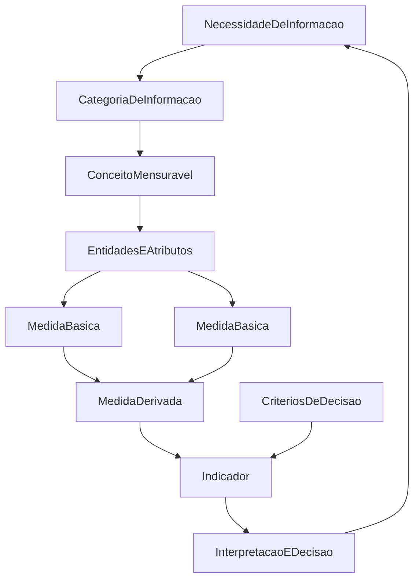
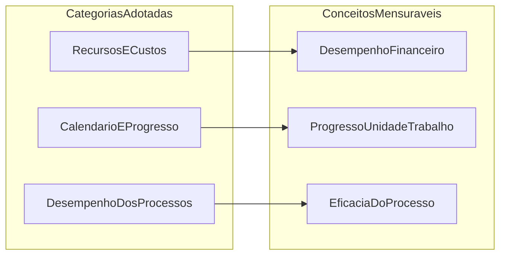

# Gestão do projeto (PSM)

Esta seção documenta a medição prática de software e sistemas (*Practical Software and System Measurement* — PSM) aplicada ao **projeto da equipe Betty Snyder**, e não ao produto Anki. O PSM é uma abordagem dirigida por informações (*information-driven*): as medições existem para atender a necessidades de informação dos tomadores de decisão, com forte ligação à gestão do projeto (RAMOS, 2026).

Após o Ponto de Controle 1, o rastreamento PSM deixou de figurar no artigo científico por orientação da disciplina; os registros permanentes concentram-se nesta documentação e nos arquivos da pasta [`gestao-psm/`](https://github.com/FCTE-Qualidade-de-Software-1/2026-2_T01_BETTY_SNYDER/tree/main/gestao-psm) do repositório. A estrutura apresentada a seguir segue o *Measurement Information Model* e as recomendações da Aula 09 (RAMOS, 2026), bem como o mapeamento estrutural adotado pela equipe (necessidades de informação, categorias, conceitos mensuráveis, medidas básicas e derivadas), alinhado ao *Continuous Iterative Development Measurement Framework* (JONES et al., 2021a; JONES et al., 2021b).

!!! note "PSM versus GQM do produto"
    As métricas GQM da Fase 2 (capacidade de interação, eficiência de desempenho e flexibilidade) avaliam o **Anki**. O template de issue `02 - Registro de Medição` documenta observações dessas métricas de produto. O PSM, nesta seção, mede o **andamento e a gestão do projeto acadêmico**.

## Modelo de informação

O modelo de informação do PSM organiza o caminho desde a necessidade de decisão até o indicador interpretável (RAMOS, 2026). A Figura 1 resume essa hierarquia: atributos de entidades relevantes são quantificados por métodos de medição (medidas básicas); funções de medição combinam essas medidas em derivadas; o indicador confronta o resultado com critérios de decisão e alimenta a interpretação na linguagem do requisitante.

*Figura 1. Modelo de informação do PSM: da necessidade de informação ao indicador e à decisão. Adaptado de Ramos (2026).*

No processo de medição, a Parte 1 do *Continuous Iterative Development Measurement Framework* orienta **o que medir** — necessidades, categorias, conceitos e medidas candidatas (JONES et al., 2021a). A Parte 2 orienta **como medir**: procedimentos de coleta, cálculo e análise, construção de indicadores e apoio à decisão (JONES et al., 2021b). Os tipos de análise previstos pelo PSM — estimativa, viabilidade e desempenho (*performance*) — são empregados nesta equipe sobretudo na forma de **análise de desempenho** nos cortes semanais (RAMOS, 2026).

## Categorias e conceitos mensuráveis

A equipe adotou três das sete categorias de informação do PSM (RAMOS, 2026), alinhadas ao mapeamento estrutural do projeto e à tabela ICM do *framework* CID (JONES et al., 2021a). A Tabela I relaciona cada categoria ao conceito mensurável correspondente e às páginas desta documentação.

*Tabela I. Categorias de informação PSM adotadas pela equipe*

| Categoria de informação | Conceito mensurável | Necessidades (síntese) | Página |
|---|---|---|---|
| Recursos e custos | Desempenho financeiro (esforço da equipe) | Custo/cronograma estimados; precisão das estimativas | [Recursos e custos](gestao-psm/recursos-e-custos.md) |
| Calendário e progresso | Progresso da unidade de trabalho | Entrega conforme compromisso; fluxo, vazão e filas | [Calendário e progresso](gestao-psm/calendario-e-progresso.md) |
| Desempenho dos processos | Eficácia do processo | Status da iteração; trabalho restante; tendências plano × execução | [Desempenho dos processos](gestao-psm/desempenho-dos-processos.md) |

A síntese do status de coleta, cálculo e análise de cada métrica — o que já está operacional e o que permanece insuficiente — encontra-se em [Procedimentos e lacunas](gestao-psm/procedimentos-e-lacunas.md).

*Figura 2. Relação entre categorias de informação e conceitos mensuráveis no escopo da equipe.*

## Processo de medição na Entrega 1

Em cada categoria há um coletor (persistência em CSV na pasta `gestao-psm/`) e a interpretação do indicador com decisão gerencial. Os cortes documentados são 11/10/2026, 18/10/2026 e 25/10/2026. Não houve reunião formal de medição em 18/10 nem em 21/10.

Na Entrega 1, a decisão metodológica foi **não utilizar issues do GitHub como fonte primária** de medição, por prazo insuficiente para adotar o fluxo completo. As fontes foram a planilha de horas, as atas e os documentos de planejamento e pendências. Após o Ponto de Controle 1, a equipe passou a organizar tarefas em issues e milestones; o Project (Projects V2) com campos PSM/CID permanece pendente de autorização OAuth, conforme [Organização no GitHub](github-organizacao.md). Essa transição afeta sobretudo a categoria Calendário e progresso e é analisada nas páginas específicas.

## Série histórica de medições

A Tabela II consolida os indicadores já calculados e as decisões tomadas. Os valores detalhados, fórmulas e lacunas constam nas páginas de cada categoria.

*Tabela II. Série de medições PSM — Entrega 1*

| Categoria | Corte | Indicador | Decisão | Arquivo |
|---|---|---|---|---|
| Recursos e custos | 11/10 | Desvio −42,0%; participação mínima 2,8% | Redistribuir (participação); julgamento retrospectivo | [`2026-10-11_recursos-custos.csv`](https://github.com/FCTE-Qualidade-de-Software-1/2026-2_T01_BETTY_SNYDER/blob/main/gestao-psm/2026-10-11_recursos-custos.csv) |
| Recursos e custos | 18/10 | Desvio −20,0%; participação mínima 11,0% | Manter carga; acompanhar desvios individuais | [`2026-10-18_recursos-custos.csv`](https://github.com/FCTE-Qualidade-de-Software-1/2026-2_T01_BETTY_SNYDER/blob/main/gestao-psm/2026-10-18_recursos-custos.csv) |
| Recursos e custos | 25/10 | Desvio −46,0%; participação mínima 10,3% | Sem sobrecarga da equipe (+30%); acompanhar subutilização | [`2026-10-25_recursos-custos.csv`](https://github.com/FCTE-Qualidade-de-Software-1/2026-2_T01_BETTY_SNYDER/blob/main/gestao-psm/2026-10-25_recursos-custos.csv) |
| Desempenho dos processos | Rev. 1 | \(D_1 = 1{,}44\); correção 61,5% | Revisão 2 com dados reais | Contagem da Revisão 1 |
| Calendário e progresso | 11/10 | ICP 56,3% (\(T_p = 16\), \(T_c = 9\)) | Redistribuir | [`calendario-progresso.csv`](https://github.com/FCTE-Qualidade-de-Software-1/2026-2_T01_BETTY_SNYDER/blob/main/gestao-psm/calendario-progresso.csv) |
| Calendário e progresso | 18/10 | ICP 21,4% | Redistribuir | idem |
| Calendário e progresso | 25/10 | ICP 40,0% (\(T_c = 6\): B1, A1–A5) | Redistribuir 9 restantes | idem |

Os dados brutos de cada corte estão na pasta [`gestao-psm/`](https://github.com/FCTE-Qualidade-de-Software-1/2026-2_T01_BETTY_SNYDER/tree/main/gestao-psm) do repositório. A retrospectiva da Entrega 1 vincula ações corretivas a limiares PSM (participação inferior a 10%; ICP inferior a 70%), conforme [Retrospectiva E1](retrospectiva-e1.md).

## Referências

JONES, Cheryl L. et al. (ed.). **Practical software and systems measurement continuous iterative development measurement framework**: part 1: concepts, definitions, principles, and measures. Version 2.1. [S. l.]: Practical Software & Systems Measurement; National Defense Industrial Association; International Council on Systems Engineering, 15 abr. 2021a. Product No. PSM-2021-03-001; INCOSE-TP-2020-001-06.

JONES, Cheryl L. et al. (ed.). **Practical software and systems measurement continuous iterative development measurement framework**: part 2: measurement specifications and enterprise measures. Version 2.1. [S. l.]: Practical Software & Systems Measurement; National Defense Industrial Association; International Council on Systems Engineering, 15 abr. 2021b. Product No. PSM-2021-03-001; INCOSE-TP-2020-001-06.

RAMOS, Cristiane Soares. **Medição prática de software e sistemas**: PSM – Practical Software and System Measurement. Notas de aula. Brasília: Faculdade do Gama, Universidade de Brasília, 2026. Material didático da disciplina Qualidade de Software 1 (FGA0315).
