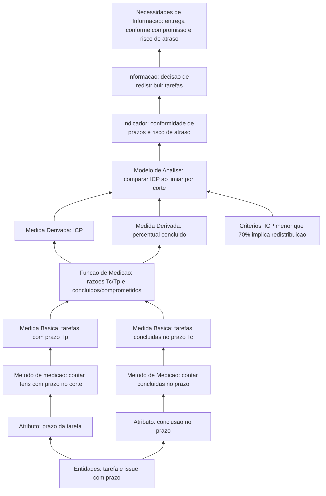
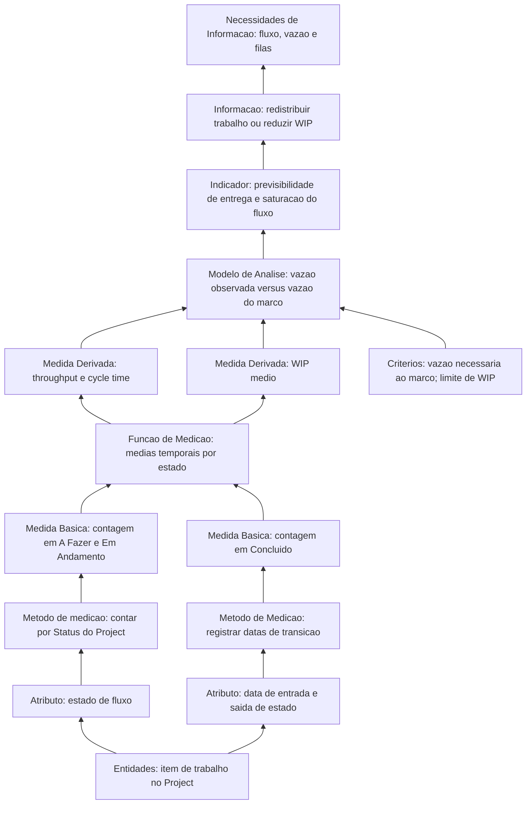

# 2. Calendário e progresso

**Categoria de informação:** Calendário e progresso  
**Conceito mensurável:** Progresso da unidade de trabalho  
**Responsável na Entrega 1:** Dupla C  

Esta página especifica o *measurement construct* da categoria Calendário e progresso, conforme o modelo de informação do PSM (RAMOS, 2026), o mapeamento estrutural da equipe e as especificações CID de *Committed vs Completed*, fluxo cumulativo, *Cycle Time* / *Lead Time* e vazão (JONES et al., 2021a; JONES et al., 2021b).

Na Entrega 1, a medida operacional central foi o **Índice de Conformidade de Prazos (ICP)**. Após o Ponto de Controle 1, as tarefas do CSV foram materializadas em 46 issues e vinculadas ao Project `Anki Quality Assessment: PSM/CID`, com Status de fluxo (A Fazer, Em Andamento, Concluído) e campos de data, o que habilita a coleta sistemática das medidas de fluxo nos cortes seguintes.

## Necessidade 1: Entrega conforme o compromisso e risco de atraso

**Necessidade de informação.** As histórias, funcionalidades ou capacidades estão sendo entregues conforme o compromisso estabelecido? Quais itens correm o risco de não serem concluídos dentro do cronograma?

A necessidade exige quantificar o compromisso com prazo, a conclusão tempestiva e o residual em atraso, como análise de desempenho do calendário do projeto.

### Instância do modelo de informação

A Figura 1 particulariza o modelo genérico da Aula 09 para o construto de conformidade de prazos e de percentual de conclusão.

*Figura 1. Instância do Modelo de Informação do PSM para Calendário e progresso: compromisso e conformidade de prazos (estrutura conforme RAMOS, 2026).*

### Medidas básicas

#### Tarefas com prazo (\(T_p\)) e concluídas no prazo (\(T_c\))

| Elemento | Descrição |
|---|---|
| Definição | \(T_p\): quantidade de itens com prazo até a data do corte. \(T_c\): quantidade desses itens com `concluida_no_prazo = sim`. |
| Escala | Inteiro ≥ 0. |
| Coleta | [`gestao-psm/calendario-progresso.csv`](https://github.com/FCTE-Qualidade-de-Software-1/2026-2_T01_BETTY_SNYDER/blob/main/gestao-psm/calendario-progresso.csv) (e cópia `2026-10-25_calendario-progresso.csv`). Campos: `data_corte`, `tarefa_id`, `prazo`, `status`, `concluida_no_prazo`, `evidencia_planilha_ou_ata`, `fonte_planejamento`. |
| Cálculo | Filtrar pelo `data_corte`; contar \(T_p\) e \(T_c\). |
| Análise | Base do ICP; identificação de itens em risco (`status` pendente/parcial ou `concluida_no_prazo = nao`). |
| Observação metodológica | Na E1 a consolidação foi retrospectiva (atas e planilha). Após 25/10, as issues e o Project passam a ser fonte viva; o CSV permanece a série histórica dos cortes documentados. |

#### Work items comprometidos e concluídos (iteração e release)

| Elemento | Descrição |
|---|---|
| Definição | Contagens inteiras de itens comprometidos e concluídos por iteração e por release, conforme o CID (JONES et al., 2021a; JONES et al., 2021b). |
| Status | Parcial. |
| Situação | Cortes por `data_corte` aproximam iterações semanais; milestones `PC1`, `F1`, `F2` e `E2` aproximam releases. O campo `status` permite contar concluídos; não há, ainda, story points nem campos distintos *committed each iteration* versus *committed each release*. |
| Encaminhamento | Marcar explicitamente o conjunto comprometido de cada corte; contar concluídos por milestone. |

### Medidas derivadas

#### Índice de Conformidade de Prazos (ICP)

\[
\mathrm{ICP} = \frac{T_c}{T_p} \times 100
\]

em que:

- \(T_c\): número de tarefas concluídas no prazo até a data do corte;
- \(T_p\): número de tarefas com prazo definido até a data do corte.

| Elemento | Descrição |
|---|---|
| Status | Aplicada. |
| Resultados | 11/10: 56,3% (\(T_p = 16\), \(T_c = 9\)); 18/10: 21,4%; 25/10: 40,0% (\(T_c = 6\)). |
| Critério | ICP inferior a 70% associado às ações C2 e C4 da Retrospectiva E1. |

#### Percentual de work items concluídos

\[
\text{Percentual concluído} = \frac{\sum \text{itens concluídos}}{\sum \text{itens comprometidos}} \times 100
\]

em que:

- \(\sum \text{itens concluídos}\): quantidade de *work items* concluídos no recorte;
- \(\sum \text{itens comprometidos}\): quantidade de *work items* assumidos como compromisso no mesmo recorte.

| Elemento | Descrição |
|---|---|
| Status | Parcial. |
| Distinção em relação ao ICP | O percentual concluído responde “quanto do comprometido foi entregue”; o ICP responde “quanto foi entregue no prazo”. A série E1 privilegia o ICP. |

### Indicadores e decisões

| Corte | Indicador | Decisão |
|---|---|---|
| 11/10 | ICP 56,3% | Redistribuir |
| 18/10 | ICP 21,4% | Redistribuir |
| 25/10 | ICP 40,0% | Redistribuir 9 restantes |

## Necessidade 2: Fluxo, vazão e filas

**Necessidades de informação.**

1. O fluxo de trabalho avança ao longo da cadeia de valor?
2. A vazão (*throughput*) é previsível?
3. Existem filas ou atrasos que impedem otimizar a vazão?

### Instância do modelo de informação

A Figura 2 aplica a mesma topologia do modelo da Aula 09 aos atributos de estado de fluxo. Os estados adotados são A Fazer (*To Do*), Em Andamento (*In Progress*) e Concluído (*Done*); Implantado (*Deployed*) permanece fora de escopo, conforme o mapeamento.

*Figura 2. Instância do Modelo de Informação do PSM para fluxo, vazão e filas (estrutura conforme RAMOS, 2026).*

### Medidas derivadas de fluxo

| Medida | Definição | Situação |
|---|---|---|
| Contagem por estado | Número de itens em A Fazer, Em Andamento e Concluído | Habilitada pelo Status do Project; série E1 ainda baseada no CSV |
| Tempo de ciclo médio aproximado | Duração média do conjunto de itens concluídos no período | Coleta via Planned/Actual e histórico de Status |
| Vazão (*Throughput*) | Média de itens concluídos por unidade de tempo | Idem |
| Trabalho em andamento (WIP) | Média de itens Em Andamento por unidade de tempo | Idem |

**Procedimento de coleta, cálculo e análise.** Em cada corte semanal: (1) contar itens por estado no Project; (2) calcular *Throughput*, WIP médio e *Cycle Time* aproximado, ou aplicar a especificação individual de *Cycle Time* / *Lead Time* do CID quando houver durações por item (JONES et al., 2021b); (3) interpretar acúmulo em A Fazer ou Em Andamento como fila e confrontar a vazão com a demanda do marco (F2, E2).

Na Entrega 1, a necessidade de fluxo foi atendida de forma indireta (ICP e lista de pendências). Com o Project constituído, os cortes seguintes combinam ICP com contagens por estado, *Throughput*, WIP e *Cycle Time*.

## Fontes no repositório

| Artefato | Papel |
|---|---|
| `gestao-psm/calendario-progresso.csv` | Série histórica dos cortes ICP |
| Issues e milestones | Materialização pós-PC1 das tarefas |
| [Organização no GitHub](github-organizacao.md) | Project, labels e vínculos CSV → issues |
| [Retrospectiva E1](../retrospectiva-e1.md) | Limiar ICP inferior a 70%; ação C4 |

## Referências

JONES, Cheryl L. et al. (ed.). **Practical software and systems measurement continuous iterative development measurement framework**: part 1: concepts, definitions, principles, and measures. Version 2.1. [S. l.]: Practical Software & Systems Measurement; National Defense Industrial Association; International Council on Systems Engineering, 15 abr. 2021a. Product No. PSM-2021-03-001; INCOSE-TP-2020-001-06.

JONES, Cheryl L. et al. (ed.). **Practical software and systems measurement continuous iterative development measurement framework**: part 2: measurement specifications and enterprise measures. Version 2.1. [S. l.]: Practical Software & Systems Measurement; National Defense Industrial Association; International Council on Systems Engineering, 15 abr. 2021b. Product No. PSM-2021-03-001; INCOSE-TP-2020-001-06.

RAMOS, Cristiane Soares. **Medição prática de software e sistemas**: PSM: Practical Software and System Measurement. Notas de aula. Brasília: Faculdade do Gama, Universidade de Brasília, 2026. Material didático da disciplina Qualidade de Software 1 (FGA0315).

Voltar à [visão geral do PSM](../gestao-psm.md).
