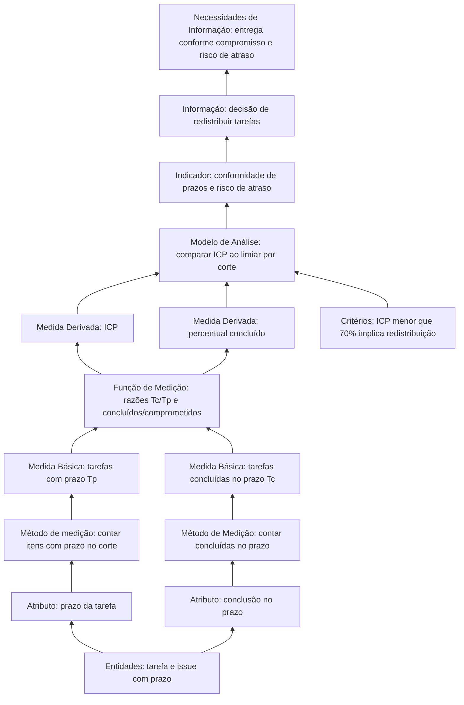
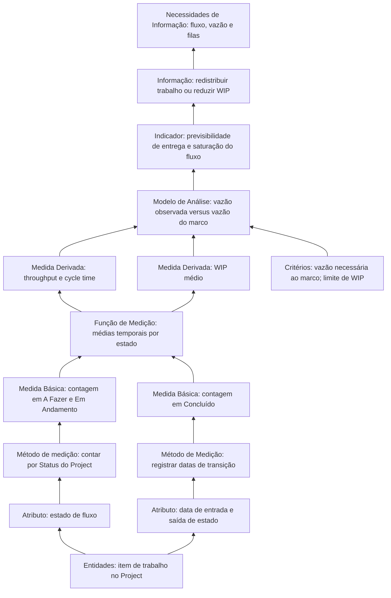

# 2. Calendário e progresso

**Categoria de informação:** Calendário e progresso  
**Conceito mensurável:** Progresso da unidade de trabalho  
**Responsável na Entrega 1:** Dupla C  

Esta página especifica o *measurement construct* da categoria Calendário e progresso, conforme o modelo de informação do PSM (RAMOS, 2026), o mapeamento estrutural da equipe e as especificações CID de *Committed vs Completed*, fluxo cumulativo, *Cycle Time* / *Lead Time* e vazão (JONES et al., 2021a; JONES et al., 2021b).

Na Entrega 1, a medida operacional central foi o **Índice de Conformidade de Prazos (ICP)**. Após o Ponto de Controle 1, as tarefas do CSV foram materializadas em 46 issues. Em 04/11/2026, as 46 Issues estavam vinculadas ao Project `BETTY SNYDER` (#40), conforme o provisionamento descrito em [Organização no GitHub](github-organizacao.md). Data fim planejada e Data fim real sustentam o ICP; as transições de Status registram início e conclusão reais para medidas de fluxo como *Cycle Time* e *Throughput*.

## Necessidade 1: Entrega conforme o compromisso e risco de atraso

**Necessidade de informação.** As histórias, funcionalidades ou capacidades estão sendo entregues conforme o compromisso estabelecido? Quais itens correm o risco de não serem concluídos dentro do cronograma?

A necessidade exige quantificar o compromisso com prazo, a conclusão tempestiva e o residual em atraso, como análise de desempenho do calendário do projeto.

### Instância do modelo de informação

A Figura 1 particulariza o modelo genérico da Aula 09 para o construto de conformidade de prazos e de percentual de conclusão.

*Figura 1. Instância do Modelo de Informação do PSM para Calendário e progresso: compromisso e conformidade de prazos (estrutura conforme RAMOS, 2026).*

### Medidas básicas

#### Tarefas com prazo (\(T_p\)) e concluídas no prazo (\(T_c\))

| Elemento | Descrição |
|---|---|
| Definição | \(T_p\): quantidade de itens com prazo até a data do corte. \(T_c\): quantidade desses itens com `concluida_no_prazo = sim`. |
| Escala | Inteiro ≥ 0. |
| Coleta | [`gestao-psm/calendario-progresso.csv`](https://github.com/FCTE-Qualidade-de-Software-1/2026-2_T01_BETTY_SNYDER/blob/main/gestao-psm/calendario-progresso.csv) (e cópia `2026-10-25_calendario-progresso.csv`). Campos: `data_corte`, `tarefa_id`, `prazo`, `status`, `concluida_no_prazo`, `evidencia_planilha_ou_ata`, `fonte_planejamento`. |
| Cálculo | Filtrar pelo `data_corte`; contar \(T_p\) e \(T_c\). |
| Análise | Base do ICP; identificação de itens em risco (`status` pendente/parcial ou `concluida_no_prazo = nao`). |
| Observação metodológica | Na E1 a consolidação foi retrospectiva (atas e planilha). Após 25/10, as issues e o Project passam a ser fonte viva; o CSV permanece a série histórica dos cortes documentados. |

#### Work items comprometidos e concluídos (iteração e release)

| Elemento | Descrição |
|---|---|
| Definição | Contagens inteiras de itens comprometidos e concluídos por iteração e por release, conforme o CID (JONES et al., 2021a; JONES et al., 2021b). |
| Status | Parcial. |
| Situação | Cortes por `data_corte` aproximam iterações semanais; milestones `PC1`, `F1`, `F2` e `E2` aproximam releases. O campo `status` permite contar concluídos; não há, ainda, story points nem campos distintos *committed each iteration* versus *committed each release*. |
| Encaminhamento | Marcar explicitamente o conjunto comprometido de cada corte; contar concluídos por milestone. |

### Medidas derivadas

#### Índice de Conformidade de Prazos (ICP)

\[
\mathrm{ICP} = \frac{T_c}{T_p} \times 100
\]

em que: - \(T_c\): número de tarefas concluídas no prazo até a data do corte;
- \(T_p\): número de tarefas com prazo definido até a data do corte.

| Elemento | Descrição |
|---|---|
| Status | Aplicada. |
| Resultados | 11/10-56,3% (\(T_c/T_p = 9/16\)); 18/10-21,4% (\(3/14\)); 19/10 (PC1): 100% (\(1/1\)); 25/10-40,0% (\(6/15\)). |
| Critério | ICP inferior a 70% associado às ações C2 e C4 da Retrospectiva E1. |

#### Percentual de work items concluídos

\[
\text{Percentual concluído} = \frac{\sum \text{itens concluídos}}{\sum \text{itens comprometidos}} \times 100
\]

em que: - \(\sum \text{itens concluídos}\): quantidade de *work items* concluídos no recorte;
- \(\sum \text{itens comprometidos}\): quantidade de *work items* assumidos como compromisso no mesmo recorte.

| Elemento | Descrição |
|---|---|
| Status | Parcial. |
| Distinção em relação ao ICP | O percentual concluído responde “quanto do comprometido foi entregue”; o ICP responde “quanto foi entregue no prazo”. A série E1 privilegia o ICP. |

### Indicadores e decisões

| Corte | Indicador | Decisão |
|---|---|---|
| 11/10 | ICP 56,3% (9/16) | Redistribuir |
| 18/10 | ICP 21,4% (3/14) | Redistribuir |
| 19/10 (PC1) | ICP 100% (1/1) | Apresentação realizada; amostra de um item |
| 25/10 | ICP 40,0% (6/15) | Redistribuir 9 restantes |
| 08/11 (E2) | ICP 0% (0/14); *throughput* 0 por semana; WIP 1 | Ver [Corte de 08/11](#corte-0811) |
| 15/11 (E2) | ICP 42,9% (6/14 F3 fechadas até 15/11); 0 no prazo original | Ver [Corte de 15/11](#corte-1511) |

### Corte de 08/11 (E2) { #corte-0811 }

Primeiro corte da E2 (issue E2-P2). Fonte: Project `BETTY SNYDER` (#40), com os prazos do campo Data fim planejada, e a situação de cada issue no GitHub. Arquivo: [`gestao-psm/2026-11-08_calendario-progresso.csv`](https://github.com/FCTE-Qualidade-de-Software-1/2026-2_T01_BETTY_SNYDER/blob/main/gestao-psm/2026-11-08_calendario-progresso.csv).

| Medida | Valor | Como foi obtida |
|---|---|---|
| \(T_p\) | 14 | Issues da E2 com prazo de 05/11 a 08/11 (E2-00 a E2-40, milestone F3) |
| \(T_c\) | 0 | Nenhuma dessas issues estava fechada em 08/11 |
| ICP | 0% | \(T_c / T_p\) |
| *Throughput* | 0 issue por semana | Issues da E2 fechadas entre 02/11 e 08/11 |
| WIP | 1 (E2-02) | Issues em "Em andamento" no Project; contagem feita em 09/11 à noite, porque o Project não guarda o histórico de status. Valor aproximado para 08/11 |
| Esforço planejado em atraso | 55,5 h | Soma do esforço planejado das 14 issues |

**Interpretação.** O marco F3 (plano de avaliação, 08/11) previa concluir 14 issues na semana, e nenhuma foi fechada até o prazo. O ICP de 0% aciona o critério de 70%. A vazão observada (0) está muito abaixo da vazão do marco (14 issues), e o WIP baixo (1) mostra que o atraso não vem de trabalho acumulado em andamento, e sim de tarefas que não foram iniciadas ou não foram registradas no Project. Parte do trabalho pode ter sido feita sem atualização das issues, o que o próximo corte deve verificar.

**Issues em risco no próximo corte (15/11).** A coleta depende da preparação atrasada: E2-70 (instalações, prazo 11/11) depende da E2-30; E2-71 (checklist e migrações, 12/11) depende da E2-31 e da E2-32; E2-60 (medições de desempenho, 12/11) depende das E2-20 a E2-22; E2-50 e E2-51 (sessões, 13/11) dependem das E2-10 a E2-12; e E2-72 (consolidação de Flexibilidade, 13/11) depende das E2-70 e E2-71.

**Decisão de gestão registrada.** Na Reunião 04 (07/11), a equipe transferiu as tarefas atrasadas para 09/11 à noite e marcou os pilotos para 10/11. No cálculo, os prazos originais são mantidos, para que o indicador continue mostrando o atraso em relação ao planejado.

**Proposta de redistribuição (Dupla C).**

1. Priorizar as issues que bloqueiam a coleta: E2-03 (estrutura de dados), E2-20 (coleção padrão, usada também na migração) e E2-11 (recrutamento).
2. A Dupla C apoia o recrutamento e a observação das sessões da Dupla A, como o planejamento da E2 já prevê.
3. Se a coleta não couber até 13/11, levar à Reunião 05 (12/11) a decisão de cortes de escopo, conforme a seção de riscos do planejamento.
4. Cada responsável move a issue para "Em andamento" ao começar, para que o WIP do próximo corte seja medido no dia.

### Corte de 15/11 (E2) { #corte-1511 }

Segundo corte da E2 (issue E2-P2). Fonte: issues do milestone F3 no GitHub, cruzadas com os prazos de [`2026-11-08_calendario-progresso.csv`](https://github.com/FCTE-Qualidade-de-Software-1/2026-2_T01_BETTY_SNYDER/blob/main/gestao-psm/2026-11-08_calendario-progresso.csv). Arquivo: [`gestao-psm/2026-11-15_calendario-progresso.csv`](https://github.com/FCTE-Qualidade-de-Software-1/2026-2_T01_BETTY_SNYDER/blob/main/gestao-psm/2026-11-15_calendario-progresso.csv).

| Medida | Valor | Como foi obtida |
|---|---|---|
| \(T_p\) | 14 | Mesmas issues do marco F3 (E2-00 a E2-40) |
| \(T_c\) (fechadas até 15/11) | 6 | Issues `#48`, `#50`, `#51`, `#58`, `#59` e `#60` fechadas até 15/11 |
| ICP (fechadas / comprometidas) | 42,9% | \(T_c / T_p\); nenhuma das 6 fechadas cumpriu o prazo original de 05 a 08/11 |
| ICP no prazo original | 0% (0/14) | `concluida_no_prazo_original = nao` em todas as linhas do CSV |
| Escopo F3+F2+PC2 até 15/11 | 23,1% (6/26) | Seis fechadas até 15/11 entre 26 issues desses milestones |

**Interpretação.** Em relação a 08/11 (ICP 0%), seis issues do plano F3 foram fechadas até 15/11, elevando o indicador de fechamento para 42,9%. O atraso em relação aos prazos originais permanece: o ICP no prazo original continua 0%. Em 16/11, a maior parte das issues de F3 e F2 foi fechada no GitHub, o que deve aparecer no próximo corte (21/11), não neste.

**Decisão de gestão.** Sem replanejamento formal dos prazos originais. Priorizar o fechamento da E2-40 (`#61`) e da consolidação de Flexibilidade (E2-72, `#69`), ainda abertas no milestone, e publicar os cortes PSM nas issues E2-P1 a E2-P3.

### Gráfico: conformidade de prazos por recorte { #grafico-icp }

<figure class="psm-chart">
<svg viewBox="0 0 960 380" role="img" aria-labelledby="calendario-chart-title calendario-chart-desc">
  <title id="calendario-chart-title">Índice de Conformidade de Prazos por recorte</title>
  <desc id="calendario-chart-desc">ICP por recorte: 56,3% (9/16) em 11/10; 21,4% (3/14) em 18/10; 100% (1/1) no PC1 em 19/10; 40% (6/15) em 25/10; 0% (0/14) em 08/11; 42,9% (6/14) em 15/11. Critério: 70%.</desc>
  <g class="chart-grid">
    <line x1="90" y1="295" x2="920" y2="295" />
    <line x1="90" y1="238.75" x2="920" y2="238.75" />
    <line x1="90" y1="182.5" x2="920" y2="182.5" />
    <line x1="90" y1="126.25" x2="920" y2="126.25" />
    <line x1="90" y1="70" x2="920" y2="70" />
  </g>
  <g class="chart-axis">
    <line x1="90" y1="70" x2="90" y2="295" />
    <line x1="90" y1="295" x2="920" y2="295" />
  </g>
  <line class="threshold" x1="90" y1="137.50" x2="920" y2="137.50" />
  <g text-anchor="end">
    <text x="80" y="299">0%</text>
    <text x="80" y="243">25%</text>
    <text x="80" y="187">50%</text>
    <text x="80" y="131">75%</text>
    <text x="80" y="74">100%</text>
  </g>
  <text x="19" y="195" transform="rotate(-90 19 195)">ICP</text>
  <path class="line-icp" d="M 176.67 168.33 L 310.00 246.85 L 443.33 70.00 L 576.67 205.00 L 710.00 295.00 L 843.33 198.48" />
  <g>
    <circle class="point-icp" cx="176.67" cy="168.33" r="6" />
    <circle class="point-icp" cx="310.00" cy="246.85" r="6" />
    <circle class="point-icp" cx="443.33" cy="70.00" r="6" />
    <circle class="point-icp" cx="576.67" cy="205.00" r="6" />
    <circle class="point-icp" cx="710.00" cy="295.00" r="6" />
    <circle class="point-icp" cx="843.33" cy="198.48" r="6" />
  </g>
  <g class="chart-value" text-anchor="middle">
    <text x="176.67" y="154.33">56.3% (9/16)</text>
    <text x="310.00" y="232.85">21.4% (3/14)</text>
    <text x="443.33" y="56.00">100% (1/1)</text>
    <text x="576.67" y="191.00">40.0% (6/15)</text>
    <text x="710.00" y="281.00">0% (0/14)</text>
    <text x="843.33" y="184.48">42.9% (6/14)</text>
  </g>
  <g text-anchor="middle">
    <text x="176.67" y="321">11/10</text>
    <text x="310.00" y="321">18/10</text>
    <text x="443.33" y="321">19/10 · PC1</text>
    <text x="576.67" y="321">25/10</text>
    <text x="710.00" y="321">08/11</text>
    <text x="843.33" y="321">15/11</text>
  </g>
  <line class="threshold" x1="430" y1="357" x2="470" y2="357" />
  <text x="480" y="362">Critério: 70%</text>
</svg>
<figcaption>Outubro: <code>calendario-progresso.csv</code>. Novembro: issues do milestone F3 em <code>2026-11-08_calendario-progresso.csv</code> e <code>2026-11-15_calendario-progresso.csv</code> (fechadas até a data do corte / 14 comprometidas). Em 15/11, nenhuma das 6 fechadas cumpriu o prazo original de 05–08/11.</figcaption>
</figure>

## Necessidade 2: Fluxo, vazão e filas

**Necessidades de informação.**

1. O fluxo de trabalho avança ao longo da cadeia de valor?
2. A vazão (*throughput*) é previsível?
3. Existem filas ou atrasos que impedem otimizar a vazão?

### Instância do modelo de informação

A Figura 2 aplica a mesma topologia do modelo da Aula 09 aos atributos de estado de fluxo. Os estados adotados são A Fazer (*To Do*), Em Andamento (*In Progress*) e Concluído (*Done*); Implantado (*Deployed*) permanece fora de escopo, conforme o mapeamento.

*Figura 2. Instância do Modelo de Informação do PSM para fluxo, vazão e filas (estrutura conforme RAMOS, 2026).*

### Medidas derivadas de fluxo

| Medida | Definição | Situação |
|---|---|---|
| Contagem por estado | Número de itens em A Fazer, Em Andamento e Concluído | Habilitada pelo Status do Project; série E1 ainda baseada no CSV |
| Tempo de ciclo médio aproximado | Duração média do conjunto de itens concluídos no período | Coleta via Planned/Actual e histórico de Status |
| Vazão (*Throughput*) | Média de itens concluídos por unidade de tempo | Idem |
| Trabalho em andamento (WIP) | Média de itens Em Andamento por unidade de tempo | Idem |

**Procedimento de coleta, cálculo e análise.** Em cada corte semanal: (1) contar itens por estado no Project; (2) calcular *Throughput*, WIP médio e *Cycle Time* aproximado, ou aplicar a especificação individual de *Cycle Time* / *Lead Time* do CID quando houver durações por item (JONES et al., 2021b); (3) interpretar acúmulo em A Fazer ou Em Andamento como fila e confrontar a vazão com a demanda do marco (F2, E2).

Na Entrega 1, a necessidade de fluxo foi atendida de forma indireta (ICP e lista de pendências). Com o Project constituído, os cortes seguintes combinam ICP com contagens por estado, *Throughput*, WIP e *Cycle Time*.

## Fontes no repositório

| Artefato | Papel |
|---|---|
| `gestao-psm/calendario-progresso.csv` | Série histórica dos cortes ICP |
| Issues e milestones | Materialização pós-PC1 das tarefas |
| [Organização no GitHub](github-organizacao.md) | Project, labels e vínculos CSV → issues |
| [Retrospectiva E1](../retrospectiva-e1.md) | Limiar ICP inferior a 70%; ação C4 |

## Referências

JONES, Cheryl L. et al. (ed.). **Practical software and systems measurement continuous iterative development measurement framework**: part 1: concepts, definitions, principles, and measures. Version 2.1. [S. l.]: Practical Software & Systems Measurement; National Defense Industrial Association; International Council on Systems Engineering, 15 abr. 2021a. Product No. PSM-2021-03-001; INCOSE-TP-2020-001-06.

JONES, Cheryl L. et al. (ed.). **Practical software and systems measurement continuous iterative development measurement framework**: part 2: measurement specifications and enterprise measures. Version 2.1. [S. l.]: Practical Software & Systems Measurement; National Defense Industrial Association; International Council on Systems Engineering, 15 abr. 2021b. Product No. PSM-2021-03-001; INCOSE-TP-2020-001-06.

RAMOS, Cristiane Soares. **Medição prática de software e sistemas**: PSM: Practical Software and System Measurement. Notas de aula. Brasília: Faculdade do Gama, Universidade de Brasília, 2026. Material didático da disciplina Qualidade de Software 1 (FGA0315).

Voltar à [visão geral do PSM](../gestao-psm.md).
