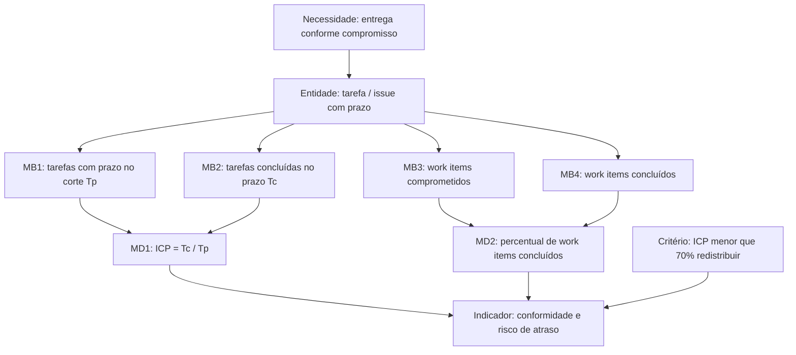

# 2. Calendário e progresso

**Categoria de informação:** Calendário e progresso  
**Conceito mensurável:** Progresso da unidade de trabalho  
**Responsável na Entrega 1:** Dupla C  

Esta página descreve o construto PSM para calendário e progresso, conforme o mapeamento estrutural (compromisso de entrega, percentuais de conclusão e métricas de fluxo) e as especificações CID de *Committed vs Completed*, fluxo cumulativo, *Cycle Time* / *Lead Time* e vazão (JONES et al., 2021a; JONES et al., 2021b), organizadas segundo o modelo de informação apresentado por Ramos (2026). Na Entrega 1, a medida operacional adotada foi o **Índice de Conformidade de Prazos (ICP)**. Após o Ponto de Controle 1, as tarefas do CSV foram materializadas em **46 issues** no GitHub; o Project V2 com estados de fluxo ainda não está operacional.

## Necessidade 1 — Entrega conforme o compromisso e risco de atraso

**Necessidade de informação.** As histórias, funcionalidades ou capacidades estão sendo entregues conforme o compromisso estabelecido? Quais itens correm o risco de não serem concluídos dentro do cronograma?

### Construto de medição

*Figura 1. Construto PSM de Calendário e progresso — compromisso, conformidade e percentual concluído.*

### Medidas básicas

#### Tarefas com prazo no corte (\(T_p\)) e concluídas no prazo (\(T_c\))

| Elemento | Descrição |
|---|---|
| Definição | \(T_p\): quantidade de itens de trabalho com prazo até a data do corte. \(T_c\): quantidade desses itens com `concluida_no_prazo = sim`. |
| Escala | Inteiro ≥ 0. |
| Coleta aplicada | Arquivo [`gestao-psm/calendario-progresso.csv`](https://github.com/FCTE-Qualidade-de-Software-1/2026-2_T01_BETTY_SNYDER/blob/main/gestao-psm/calendario-progresso.csv) (e cópia datada `2026-10-25_calendario-progresso.csv`). Campos: `data_corte`, `tarefa_id`, `prazo`, `status`, `concluida_no_prazo`, `evidencia_planilha_ou_ata`, `fonte_planejamento`. Fontes de planejamento: mensagens pós-reunião, Plano da Fase 2, documento de pendências. |
| Cálculo aplicado | Filtrar linhas pelo `data_corte`; contar \(T_p\) e \(T_c\). |
| Análise aplicada | Base do ICP; identificação dos itens em risco (`status` pendente/parcial ou `concluida_no_prazo = nao`). |
| Insuficiências | Na E1 a coleta foi retrospectiva (atas e planilha), não o fluxo vivo de issues. Após 25/10, as issues existem, mas o CSV permanece a fonte canônica documentada para os cortes. |

#### Work Items Committed / Completed (iteração e release)

| Elemento | Descrição |
|---|---|
| Definição (mapeamento) | Contagem inteira de itens comprometidos e concluídos por iteração (ex.: stories) e por release (ex.: features/capacidades), conforme as medidas base do CID (JONES et al., 2021a) e a especificação *Committed vs Completed* (JONES et al., 2021b). |
| Status | **Parcial.** |
| Situação no repositório | Os cortes agrupam tarefas por `data_corte` (aproximação de “iteração” semanal). Milestones `PC1`, `F1`, `F2` e `E2` aproximam “releases”/marcos ([organização GitHub](github-organizacao.md)). O `status` (`concluida`, `parcial`, `pendente`) permite contar concluídos, mas não há campos distintos *committed each iteration* versus *committed each release* nem story points. |
| Procedimento mínimo viável | Em cada planejamento semanal, marcar explicitamente o conjunto comprometido do corte; ao fechar o marco, contar concluídos por milestone; opcionalmente introduzir pontos ou pesos. |

### Medidas derivadas

#### Índice de Conformidade de Prazos (ICP)

\[
\mathrm{ICP} = \frac{T_c}{T_p} \times 100
\]

| Elemento | Descrição |
|---|---|
| Status | **Aplicada.** |
| Cálculo / análise | 11/10: 56,3% (\(T_p = 16\), \(T_c = 9\)); 18/10: 21,4%; 25/10: 40,0% (\(T_c = 6\): B1, A1–A5). Decisão recorrente: redistribuir tarefas quando o ICP fica abaixo do limiar. |
| Critério de decisão | Retrospectiva E1: ICP inferior a 70% associada às ações C2 (reporte de status) e C4 (organização em issues). |

#### Percent Work Items Completed

\[
\%\text{ concluído} = \frac{\sum \text{Work Items Completed}}{\sum \text{Work Items Committed}} \times 100
\]

| Elemento | Descrição |
|---|---|
| Status | **Parcial.** |
| Situação | Pode ser aproximado no CSV pela razão entre itens com `status = concluida` e o total do corte, independentemente de `concluida_no_prazo`. Isso responde “quanto do comprometido foi entregue”, enquanto o ICP responde “quanto foi entregue *no prazo*”. A equipe documentou prioritariamente o ICP. |
| Procedimento mínimo viável | Publicar, em cada corte, as duas razões lado a lado (conclusão absoluta e conformidade temporal). |

### Indicadores e decisões (Necessidade 1)

| Corte | Indicador | Decisão |
|---|---|---|
| 11/10 | ICP 56,3% | Redistribuir |
| 18/10 | ICP 21,4% | Redistribuir |
| 25/10 | ICP 40,0% | Redistribuir 9 restantes |

## Necessidade 2 — Fluxo, vazão e filas

**Necessidades de informação.**

1. O fluxo de trabalho avança ao longo da cadeia de valor (estágios do processo)?
2. A vazão (*throughput*) é previsível?
3. Existem filas ou atrasos que impedem otimizar a vazão?

### Construto pretendido (CID / mapeamento)

*Figura 2. Estados de fluxo adotados no mapeamento (Implantado/Deployed fora de escopo), alinhados às especificações de fluxo cumulativo e de tempo de ciclo do CID (JONES et al., 2021b).*

O mapeamento define medidas básicas como a contagem (ou o tempo acumulado) de itens em cada estado e as derivadas (JONES et al., 2021a; JONES et al., 2021b):

| Medida | Definição | Status |
|---|---|---|
| Contagem por estado (1..N) | Número de itens em A Fazer, Em Andamento e Concluído | **Insuficiente** |
| Tempo de ciclo médio aproximado | Duração média do conjunto de itens concluídos no período | **Insuficiente** |
| Vazão (*Throughput*) | Média de itens concluídos por unidade de tempo | **Insuficiente** |
| Trabalho em andamento (*WIP*) | Média de itens em andamento por unidade de tempo | **Insuficiente** |

### Situação no repositório e configurações atuais

| Recurso | Evidência | Lacuna |
|---|---|---|
| CSV de calendário | `status` ∈ {concluida, parcial, pendente}; sem timestamps de transição | Não modela To Do / In Progress / Done com datas de entrada/saída |
| Issues GitHub | 46 issues criadas a partir do CSV; labels `status:on-time`, `status:late`, `status:partial`, `status:pending` | Labels refletem conformidade, não o estágio do fluxo |
| Project V2 | Previsto (`Anki Quality Assessment — PSM/CID`) com campo Status e datas Planned/Actual; script `scripts/setup-github-project.ps1` | Criação bloqueada por escopo OAuth `project` |
| CFD | Não há geração de Diagrama de Fluxo Cumulativo | Depende de série temporal por estado |

### Procedimentos mínimos viáveis (ainda não suficientes)

1. **Coleta.** Adotar no Project (ou no corpo das issues) os estados A Fazer, Em Andamento e Concluído; registrar data de cada transição (ou usar o histórico de eventos do Projects V2).
2. **Cálculo.** Em cada corte semanal: contar itens por estado; *Throughput* = concluídos na semana; *WIP* médio = média diária de itens Em Andamento; *Cycle Time* aproximado = (soma dos tempos de itens concluídos) / (quantidade concluída), ou usar a especificação individual de *Cycle Time* / *Lead Time* do CID (JONES et al., 2021b) quando houver durações por item.
3. **Análise.** Interpretar acúmulo em A Fazer ou Em Andamento como fila; confrontar vazão observada com a vazão necessária ao marco (F2, E2); decidir redistribuição ou redução de *WIP*.

Enquanto esses procedimentos não existirem, a equipe responde à necessidade de fluxo apenas de forma **indireta**, via ICP e lista de pendências — o que é insuficiente para previsibilidade de vazão e diagnóstico de filas.

## Fontes no repositório

| Artefato | Papel |
|---|---|
| `gestao-psm/calendario-progresso.csv` | Fonte canônica dos cortes ICP |
| Issues e milestones do repositório | Materialização pós-PC1 das tarefas |
| [Organização GitHub](github-organizacao.md) | Estado do Project, labels e vínculos CSV → issues |
| [Retrospectiva E1](../retrospectiva-e1.md) | Limiar ICP &lt; 70%; ação C4 (issues) |

## Referências

JONES, Cheryl L. et al. (ed.). **Practical software and systems measurement continuous iterative development measurement framework**: part 1: concepts, definitions, principles, and measures. Version 2.1. [S. l.]: Practical Software & Systems Measurement; National Defense Industrial Association; International Council on Systems Engineering, 15 abr. 2021a. Product No. PSM-2021-03-001; INCOSE-TP-2020-001-06.

JONES, Cheryl L. et al. (ed.). **Practical software and systems measurement continuous iterative development measurement framework**: part 2: measurement specifications and enterprise measures. Version 2.1. [S. l.]: Practical Software & Systems Measurement; National Defense Industrial Association; International Council on Systems Engineering, 15 abr. 2021b. Product No. PSM-2021-03-001; INCOSE-TP-2020-001-06.

RAMOS, Cristiane Soares. **Medição prática de software e sistemas**: PSM – Practical Software and System Measurement. Notas de aula. Brasília: Faculdade do Gama, Universidade de Brasília, 2026. Material didático da disciplina Qualidade de Software 1 (FGA0315).

Voltar à [visão geral do PSM](../gestao-psm.md).
