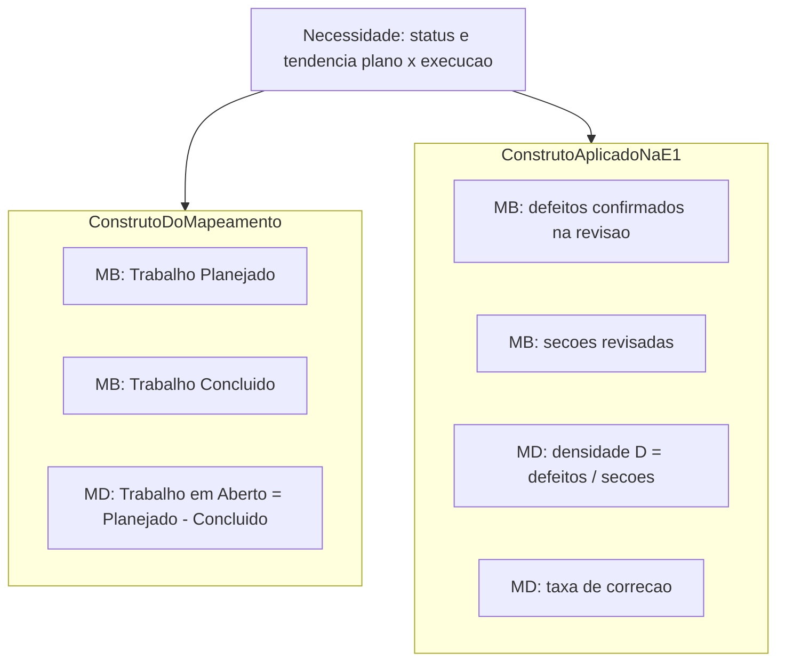
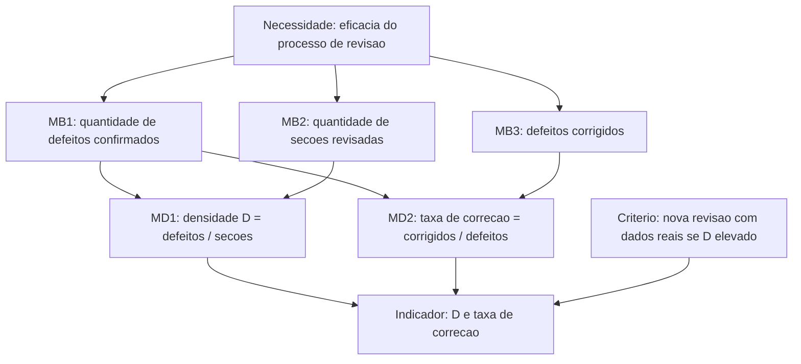

# 3. Desempenho dos processos

**Categoria de informação:** Desempenho dos processos  
**Conceito mensurável (mapeamento):** Eficácia do processo  
**Responsável na Entrega 1:** Dupla B  

O mapeamento estrutural associa esta categoria à necessidade de conhecer o status da iteração ou do marco, o trabalho restante comprometido e as tendências de execução em relação ao plano, com medidas de **Trabalho Planejado**, **Trabalho Concluído** e **Trabalho em Aberto** (JONES et al., 2021a). Na Entrega 1, a equipe operacionalizou a eficácia do processo de elaboração do artigo por meio da **densidade de defeitos em revisão** e da **taxa de correção**, alinháveis às especificações de detecção e resolução de defeitos do CID (JONES et al., 2021b) e ao modelo de indicadores do PSM (RAMOS, 2026), decisão registrada no Plano da Fase 2. Esta página documenta ambos os eixos: o construto efetivamente aplicado e o construto do mapeamento ainda incompleto.

## Necessidade — Status da iteração, trabalho restante e tendência plano × execução

**Necessidade de informação.** Qual é o status da iteração, do lançamento ou da capacidade? Todo o trabalho restante assumido como compromisso será concluído conforme o planejado? Quais funcionalidades correm risco de atraso? Quais são as tendências de execução em relação ao plano?

### Relação entre o mapeamento e a decisão da Entrega 1

*Figura 1. Dois desdobramentos da mesma necessidade: progresso quantitativo do trabalho (mapeamento) e eficácia do processo de revisão documental (E1).*

A densidade de defeitos informa a **qualidade do processo de produção do artefato** (eficácia em evitar ou remover defeitos antes da entrega). O Trabalho em Aberto informa a **capacidade de cumprir o plano de escopo**. Ambos apoiam a necessidade, porém com atributos distintos; a equipe deve tratá-los como complementares, não como substitutos.

---

## Eixo A — Construto aplicado na Entrega 1 (defeitos de revisão)

### Definição operacional adotada

| Elemento | Definição da equipe |
|---|---|
| Defeito | Informação incorreta ou sem fonte; divergência com decisão da equipe; item exigido pela rubrica que está ausente. Conta apenas defeito **confirmado** pela equipe (inclusive apontamentos com apoio de IA). |
| Fonte | Revisões do artigo registradas em ata / planilha de contagem; CSV `gestao-psm/desempenho-processos.csv`. |

### Construto

*Figura 2. Construto PSM aplicado — densidade de defeitos e taxa de correção.*

### Medidas básicas

#### Defeitos confirmados e seções revisadas

| Elemento | Descrição |
|---|---|
| Coleta aplicada | Contagem na Revisão 1 (indicador publicado na visão geral: \(D_1 = 1{,}44\); correção 61,5%). Revisão 2 persistida em [`gestao-psm/desempenho-processos.csv`](https://github.com/FCTE-Qualidade-de-Software-1/2026-2_T01_BETTY_SNYDER/blob/main/gestao-psm/desempenho-processos.csv) com campos `identificador`, `revisão`, `seção`, `tipo`, `descrição`, `quem apontou`, `confirmado`, `corrigido`. |
| Cálculo aplicado | Densidade \(D = N_{\text{defeitos}} / N_{\text{seções}}\); taxa de correção = corrigidos / confirmados. |
| Análise aplicada | Rev. 1 → decisão de realizar Revisão 2 com dados reais. Rev. 2 lista 11 itens (tipos: erro de conteúdo, informação ausente, inconsistência entre seções), majoritariamente marcados como confirmados e corrigidos no CSV. |
| Insuficiências | A Revisão 1 não possui CSV versionado equivalente ao da Rev. 2 (apenas o resumo na GitPage). O arquivo `docs/gestao-psm/defeitos.csv` está **vazio** (somente cabeçalho), não servindo como fonte. Não há série contínua de densidade por corte semanal alinhada a 11/10, 18/10 e 25/10. |

#### Taxa de correção

| Elemento | Descrição |
|---|---|
| Status | **Aplicada** (Rev. 1 com valor publicado; Rev. 2 verificável no CSV via `corrigido`). |
| Análise | Indica eficácia do ciclo encontrar–corrigir antes da entrega. |
| Insuficiências | Ausência de critério numérico estável publicado (além da decisão qualitativa de nova revisão). |

---

## Eixo B — Construto do mapeamento (trabalho planejado, concluído e em aberto)

### Medidas

#### Trabalho Planejado (medida básica)

| Elemento | Descrição |
|---|---|
| Definição | Quantidade inteira de trabalho assumido no plano (story points, funcionalidades, capacidades ou, no projeto, tarefas/itens do marco). |
| Status | **Parcial.** |
| Situação | O conjunto de tarefas por corte em `calendario-progresso.csv` e os milestones F1/F2/E2 fornecem o planejado, porém a série não está publicada como indicador próprio desta categoria (foi absorvida pelo ICP em Calendário e progresso). |
| Procedimento mínimo viável | Em cada corte, registrar \(W_p\) = número (ou peso) de itens do compromisso do marco vigente. |

#### Trabalho Concluído (medida básica)

| Elemento | Descrição |
|---|---|
| Definição | Quantidade inteira de trabalho efetivamente concluído no mesmo recorte. |
| Status | **Parcial.** |
| Situação | Derivável de `status = concluida` no CSV / issues fechadas; não há painel PSM dedicado nem histórico de tendência planejado × concluído nesta categoria. |
| Procedimento mínimo viável | Registrar \(W_c\) no mesmo corte e na mesma unidade de \(W_p\). |

#### Trabalho em Aberto (medida derivada)

\[
W_a = W_p - W_c
\]

| Elemento | Descrição |
|---|---|
| Status | **Insuficiente como série formal.** |
| Situação | O valor pontual de pendências é conhecido qualitativamente (ex.: nove itens restantes no corte 25/10 no calendário), mas não há indicador nomeado \(W_a\), gráfico de tendência nem critério de decisão específico sob Desempenho dos processos, embora a medida derivada conste do mapeamento e do *framework* CID (JONES et al., 2021a). |
| Análise pretendida | Tendência de \(W_a\) ao longo dos cortes; risco de não concluir o marco se a vazão observada for inferior a \(W_a / \text{tempo restante}\) — análise de desempenho no sentido de Ramos (2026). |
| Procedimento mínimo viável | Publicar, junto ao ICP, a trinca \(W_p\), \(W_c\), \(W_a\) por corte e a projeção de conclusão do marco. |

### Sobreposição com Calendário e progresso

Trabalho Planejado/Concluído/Aberto e Work Items Committed/Completed compartilham a mesma entidade (item de trabalho). A distinção recomendada na documentação da equipe é:

- **Calendário e progresso:** ênfase em prazo, conformidade (ICP) e fluxo (estados, vazão, WIP).
- **Desempenho dos processos:** ênfase em eficácia — se o processo produz o trabalho planejado com qualidade (defeitos) e se a tendência \(W_a\) é compatível com o plano.

Evita-se, assim, duplicar o mesmo indicador em duas categorias sem interpretação distinta.

## Indicadores e decisões já registrados

| Corte / revisão | Indicador | Decisão |
|---|---|---|
| Revisão 1 | \(D_1 = 1{,}44\); correção 61,5% | Conduzir Revisão 2 com dados reais |
| Revisão 2 | 11 apontamentos no CSV; correções registradas em `corrigido` | Consolidar correções no artigo / GitPage |

## Fontes no repositório

| Artefato | Papel |
|---|---|
| `gestao-psm/desempenho-processos.csv` | Defeitos da Revisão 2 |
| `docs/gestao-psm/defeitos.csv` | Cabeçalho sem dados (lacuna) |
| `gestao-psm/calendario-progresso.csv` | Proxy para \(W_p\) / \(W_c\) |
| Plano da Fase 2 (pasta `PSM/` do projeto acadêmico) | Definição de defeito e escolha da medida |

## Referências

JONES, Cheryl L. et al. (ed.). **Practical software and systems measurement continuous iterative development measurement framework**: part 1: concepts, definitions, principles, and measures. Version 2.1. [S. l.]: Practical Software & Systems Measurement; National Defense Industrial Association; International Council on Systems Engineering, 15 abr. 2021a. Product No. PSM-2021-03-001; INCOSE-TP-2020-001-06.

JONES, Cheryl L. et al. (ed.). **Practical software and systems measurement continuous iterative development measurement framework**: part 2: measurement specifications and enterprise measures. Version 2.1. [S. l.]: Practical Software & Systems Measurement; National Defense Industrial Association; International Council on Systems Engineering, 15 abr. 2021b. Product No. PSM-2021-03-001; INCOSE-TP-2020-001-06.

RAMOS, Cristiane Soares. **Medição prática de software e sistemas**: PSM – Practical Software and System Measurement. Notas de aula. Brasília: Faculdade do Gama, Universidade de Brasília, 2026. Material didático da disciplina Qualidade de Software 1 (FGA0315).

Voltar à [visão geral do PSM](../gestao-psm.md).
