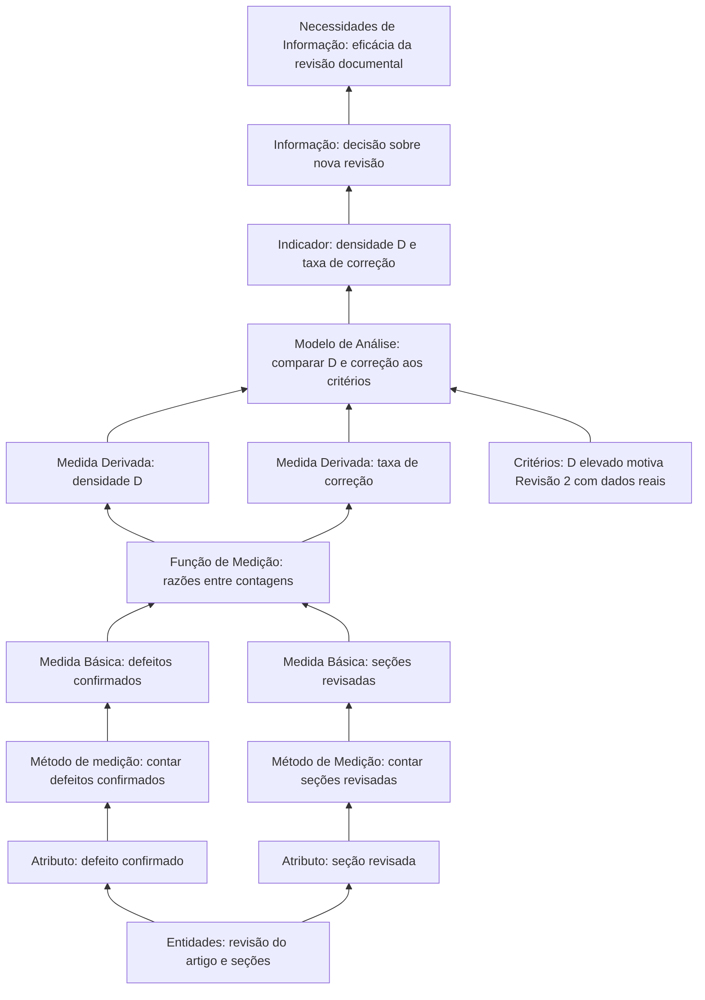
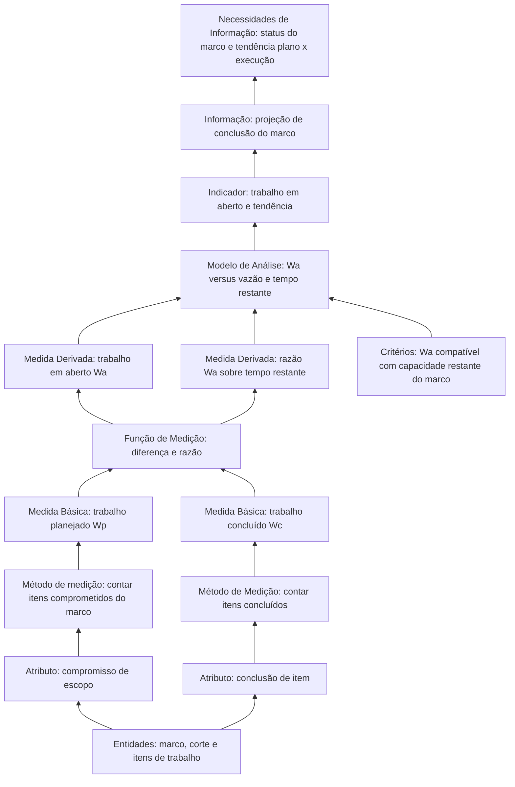

# 3. Desempenho dos processos

**Categoria de informação:** Desempenho dos processos  
**Conceito mensurável:** Eficácia do processo  
**Responsável na Entrega 1:** Dupla B  

Esta página especifica o *measurement construct* da categoria Desempenho dos processos, conforme o modelo de informação do PSM (RAMOS, 2026) e o mapeamento estrutural da equipe (JONES et al., 2021a).

O mapeamento associa a categoria à necessidade de conhecer o status do marco, o trabalho restante comprometido e as tendências de execução em relação ao plano, com as medidas **Trabalho Planejado**, **Trabalho Concluído** e **Trabalho em Aberto**. Na Entrega 1, a equipe operacionalizou a eficácia do processo documental por meio da **densidade de defeitos em revisão** e da **taxa de correção**, alinháveis às especificações de detecção e resolução de defeitos do CID (JONES et al., 2021b). Os dois eixos são complementares: um trata da qualidade do artefato produzido; o outro, da capacidade de cumprir o plano de escopo.

## Necessidade de informação

**Necessidade de informação.** Qual é o status da iteração, do lançamento ou da capacidade? Todo o trabalho restante assumido como compromisso será concluído conforme o planejado? Quais funcionalidades correm risco de atraso? Quais são as tendências de execução em relação ao plano?

## Eixo A: Eficácia do processo de revisão documental (aplicado na Entrega 1)

### Definição operacional

| Elemento | Definição da equipe |
|---|---|
| Defeito | Informação incorreta ou sem fonte; divergência com decisão da equipe; item exigido pela rubrica que está ausente. Conta apenas o defeito **confirmado** pela equipe (inclusive apontamentos com apoio de IA). |
| Fonte | Revisões do artigo; CSV `gestao-psm/desempenho-processos.csv` (e snapshot `2026-11-22_desempenho-processos.csv` no corte E2). |

### Instância do modelo de informação

A Figura 1 particulariza o modelo genérico da Aula 09 para o construto de defeitos aplicado na Entrega 1. Os rótulos dos nós correspondem à instanciação; a topologia é a do Modelo de Informação do PSM (RAMOS, 2026).

*Figura 1. Instância do Modelo de Informação do PSM para densidade de defeitos e taxa de correção (estrutura conforme RAMOS, 2026).*

Para a taxa de correção, a terceira medida básica (defeitos corrigidos) entra na função de medição juntamente com os defeitos confirmados, produzindo a segunda medida derivada do mesmo construto.

### Medidas

\[
D = \frac{N_{\text{defeitos}}}{N_{\text{seções}}}
\]

em que: - \(D\): densidade de defeitos na revisão;
- \(N_{\text{defeitos}}\): quantidade de defeitos confirmados pela equipe;
- \(N_{\text{seções}}\): quantidade de seções (ou unidades) revisadas.

\[
\text{Taxa de correção} = \frac{N_{\text{corrigidos}}}{N_{\text{confirmados}}}
\]

em que: - \(N_{\text{corrigidos}}\): quantidade de defeitos confirmados já corrigidos;
- \(N_{\text{confirmados}}\): quantidade de defeitos confirmados na revisão.

| Elemento | Descrição |
|---|---|
| Coleta | Revisão 1: \(D_1 = 1{,}44\); correção 61,5% (resumo na visão geral). Revisões 2 (E1) e 3 (E2): [`gestao-psm/desempenho-processos.csv`](https://github.com/FCTE-Qualidade-de-Software-1/2026-2_T01_BETTY_SNYDER/blob/main/gestao-psm/desempenho-processos.csv), com campos `identificador`, `revisão`, `seção`, `tipo`, `descrição`, `quem apontou`, `confirmado`, `corrigido`. O corte E2 de 22/11 republica a Revisão 3 em [`gestao-psm/2026-11-22_desempenho-processos.csv`](https://github.com/FCTE-Qualidade-de-Software-1/2026-2_T01_BETTY_SNYDER/blob/main/gestao-psm/2026-11-22_desempenho-processos.csv) (snapshot simétrico aos demais cortes). |
| Análise | Rev. 1 motivou a Revisão 2 com dados reais. A Rev. 2 registrou 10 apontamentos (10/10 corrigidos). Na Entrega 2, a **Revisão 3** (Fase 3, Artigo v2, GitPage e feedback do PC2) avaliou 10 unidades/seções documentais, registrando 8 defeitos confirmados (\(D_3 = 0{,}80\)), todos corrigidos (100%). Status do corte E2: **publicado** em 22/11 (issue `#80`). |
| Limitação | A Revisão 1 (\(D_1 = 1{,}44 \approx 13/9\)) não possui registro de defeitos por item. Na Revisão 2, o CSV registra 10 defeitos em 10 **subseções** distintas (`2.1` a `5.3`), mas não foi anotado o total de subseções inspecionadas (incluindo as sem defeito); usar `10` contaria apenas subseções com defeito e reutilizar `9` (da R1) misturaria granularidade de seções e subseções, razão pela qual \(D_2\) é mantida como **N/D** para não fabricar o denominador. Na Revisão 3 (E2), tanto o numerador (8) quanto o denominador (10 seções/unidades) são rastreados integralmente. |

### Indicadores e decisões

| Corte / revisão | Indicador | Decisão |
|---|---|---|
| Revisão 1 (E1) | \(D_1 = 1{,}44\); correção 61,5% | Conduzir Revisão 2 com dados reais |
| Revisão 2 (E1) | 10 apontamentos; 10 confirmados e 10 corrigidos (100%) | Consolidar correções no artigo e na GitPage da E1 |
| Revisão 3 (E2 / pós-PC2; corte 22/11) | \(D_3 = 0{,}80\) (8 defeitos em 10 seções); correção 100% (8/8) | Feedback do PC2 incorporado; gravações públicas removidas por TCLE; limitações controladas fechadas; Release 2 publicada (tag `Release2`); snapshot em `2026-11-22_desempenho-processos.csv` |

### Gráfico: taxa de correção por revisão { #grafico-taxa-correcao }

<figure class="psm-chart">
<svg viewBox="0 0 760 380" role="img" aria-labelledby="processos-chart-title processos-chart-desc">
  <title id="processos-chart-title">Taxa de correção dos defeitos confirmados por revisão</title>
  <desc id="processos-chart-desc">A taxa de correção foi de 61,5 por cento na Revisão 1, 100 por cento na Revisão 2 (10 de 10) e 100 por cento na Revisão 3 da Entrega 2 (8 de 8).</desc>
  <g class="chart-grid">
    <line x1="100" y1="295" x2="700" y2="295" />
    <line x1="100" y1="238.75" x2="700" y2="238.75" />
    <line x1="100" y1="182.5" x2="700" y2="182.5" />
    <line x1="100" y1="126.25" x2="700" y2="126.25" />
    <line x1="100" y1="70" x2="700" y2="70" />
  </g>
  <g class="chart-axis">
    <line x1="100" y1="70" x2="100" y2="295" />
    <line x1="100" y1="295" x2="700" y2="295" />
  </g>
  <g text-anchor="end">
    <text x="90" y="299">0%</text>
    <text x="90" y="243">25%</text>
    <text x="90" y="187">50%</text>
    <text x="90" y="131">75%</text>
    <text x="90" y="74">100%</text>
  </g>
  <text x="23" y="195" transform="rotate(-90 23 195)">Taxa de correção</text>
  <rect class="bar-rate" x="160" y="156.63" width="90" height="138.37" rx="4" />
  <rect class="bar-rate" x="355" y="70" width="90" height="225" rx="4" />
  <rect class="bar-rate" x="550" y="70" width="90" height="225" rx="4" />
  <g class="chart-value" text-anchor="middle">
    <text x="205" y="148">61,5%</text>
    <text x="400" y="61">100% (10/10)</text>
    <text x="595" y="61">100% (8/8)</text>
  </g>
  <g text-anchor="middle">
    <text x="205" y="321">Revisão 1 (E1)</text>
    <text x="400" y="321">Revisão 2 (E1)</text>
    <text x="595" y="321">Revisão 3 (E2)</text>
  </g>
</svg>
<figcaption>A Revisão 1 é o valor consolidado no resumo histórico; as Revisões 2 (10/10) e 3 (8/8, Entrega 2 / pós-PC2) são calculadas diretamente de <code>gestao-psm/desempenho-processos.csv</code>.</figcaption>
</figure>

### Gráfico: densidade de defeitos { #grafico-densidade }

<figure class="psm-chart">
<svg viewBox="0 0 760 380" role="img" aria-labelledby="densidade-chart-title densidade-chart-desc">
  <title id="densidade-chart-title">Densidade de defeitos por revisão</title>
  <desc id="densidade-chart-desc">A densidade registrada para a Revisão 1 foi 1,44 defeito por seção. A Revisão 2 está N/D por ausência do total de seções. Na Revisão 3 (Entrega 2), a densidade caiu para 0,80 defeito por seção (8 defeitos em 10 seções).</desc>
  <g class="chart-grid">
    <line x1="100" y1="295" x2="700" y2="295" />
    <line x1="100" y1="238.75" x2="700" y2="238.75" />
    <line x1="100" y1="182.5" x2="700" y2="182.5" />
    <line x1="100" y1="126.25" x2="700" y2="126.25" />
    <line x1="100" y1="70" x2="700" y2="70" />
  </g>
  <g class="chart-axis">
    <line x1="100" y1="70" x2="100" y2="295" />
    <line x1="100" y1="295" x2="700" y2="295" />
  </g>
  <g text-anchor="end">
    <text x="90" y="299">0</text>
    <text x="90" y="243">0,5</text>
    <text x="90" y="187">1,0</text>
    <text x="90" y="131">1,5</text>
    <text x="90" y="74">2,0</text>
  </g>
  <text x="23" y="195" transform="rotate(-90 23 195)">Defeitos por seção</text>
  <rect class="bar-rate" x="160" y="133" width="90" height="162" rx="4" />
  <rect class="bar-rate" x="550" y="205" width="90" height="90" rx="4" />
  <g class="chart-value" text-anchor="middle">
    <text x="205" y="124">1,44</text>
    <text x="400" y="160">N/D</text>
    <text x="595" y="196">0,80 (8/10)</text>
  </g>
  <g text-anchor="middle">
    <text x="205" y="321">Revisão 1 (E1)</text>
    <text x="400" y="321">Revisão 2 (E1)</text>
    <text x="595" y="321">Revisão 3 (E2)</text>
  </g>
</svg>
<figcaption>A densidade caiu de D₁ = 1,44 (Revisão 1, 13 defeitos em 9 seções) para D₃ = 0,80 (Revisão 3, 8 defeitos em 10 seções/unidades revisadas da Fase 3, Artigo v2 e GitPage), indicando amadurecimento do processo de revisão. A Revisão 2 permanece como N/D porque o CSV registra 10 apontamentos em subseções distintas sem registrar o total de subseções inspecionadas (incluindo as sem defeito), evitando fabricar o denominador ou misturar granularidades.</figcaption>
</figure>

## Eixo B: Trabalho planejado, concluído e em aberto (mapeamento)

### Instância do modelo de informação

A Figura 2 aplica a mesma topologia do modelo da Aula 09 às medidas de trabalho planejado, concluído e em aberto previstas no mapeamento.

*Figura 2. Instância do Modelo de Informação do PSM para trabalho planejado, concluído e em aberto (estrutura conforme RAMOS, 2026).*

### Medidas

| Medida | Definição | Situação |
|---|---|---|
| Trabalho Planejado \(W_p\) | Quantidade (ou peso) de trabalho comprometido no marco ou corte | Parcial: derivável do CSV de calendário e dos milestones |
| Trabalho Concluído \(W_c\) | Quantidade concluída na mesma unidade | Parcial: `status = concluida` / issues fechadas |
| Trabalho em Aberto \(W_a\) | \(W_a = W_p - W_c\) | Sem série formal publicada nesta categoria |

\[
W_a = W_p - W_c
\]

em que: - \(W_a\): trabalho em aberto (restante comprometido e ainda não concluído);
- \(W_p\): trabalho planejado (comprometido no marco ou corte);
- \(W_c\): trabalho concluído na mesma unidade e no mesmo recorte.

A análise pretendida confronta a tendência de \(W_a\) com a vazão e o tempo restante do marco. O procedimento mínimo consiste em publicar, em cada corte, a trinca \(W_p\), \(W_c\), \(W_a\) e a projeção de conclusão.

### Distinção em relação a Calendário e progresso

As entidades (itens de trabalho) são compartilhadas. A interpretação difere:

- **Calendário e progresso:** prazo, conformidade (ICP) e fluxo (estados, vazão, WIP).
- **Desempenho dos processos:** eficácia do processo (defeitos; tendência de \(W_a\) frente ao plano).

## Fontes no repositório

| Artefato | Papel |
|---|---|
| `gestao-psm/desempenho-processos.csv` | Defeitos da Revisão 2 (E1) e da Revisão 3 (E2 / pós-PC2) |
| `gestao-psm/2026-11-22_desempenho-processos.csv` | Snapshot datado do corte E2 (Revisão 3) |
| `gestao-psm/calendario-progresso.csv` | Proxy para \(W_p\) e \(W_c\) |
| Plano da Fase 2 (pasta `PSM/` do projeto acadêmico) | Definição de defeito e escolha da medida |

## Referências

JONES, Cheryl L. et al. (ed.). **Practical software and systems measurement continuous iterative development measurement framework**: part 1: concepts, definitions, principles, and measures. Version 2.1. [S. l.]: Practical Software & Systems Measurement; National Defense Industrial Association; International Council on Systems Engineering, 15 abr. 2021a. Product No. PSM-2021-03-001; INCOSE-TP-2020-001-06.

JONES, Cheryl L. et al. (ed.). **Practical software and systems measurement continuous iterative development measurement framework**: part 2: measurement specifications and enterprise measures. Version 2.1. [S. l.]: Practical Software & Systems Measurement; National Defense Industrial Association; International Council on Systems Engineering, 15 abr. 2021b. Product No. PSM-2021-03-001; INCOSE-TP-2020-001-06.

RAMOS, Cristiane Soares. **Medição prática de software e sistemas**: PSM: Practical Software and System Measurement. Notas de aula. Brasília: Faculdade do Gama, Universidade de Brasília, 2026. Material didático da disciplina Qualidade de Software 1 (FGA0315).

Voltar à [visão geral do PSM](../gestao-psm.md).
