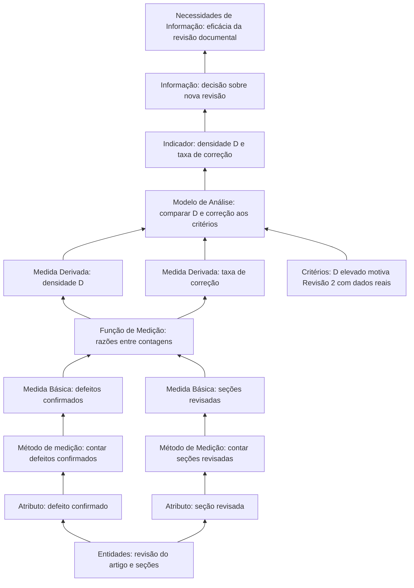
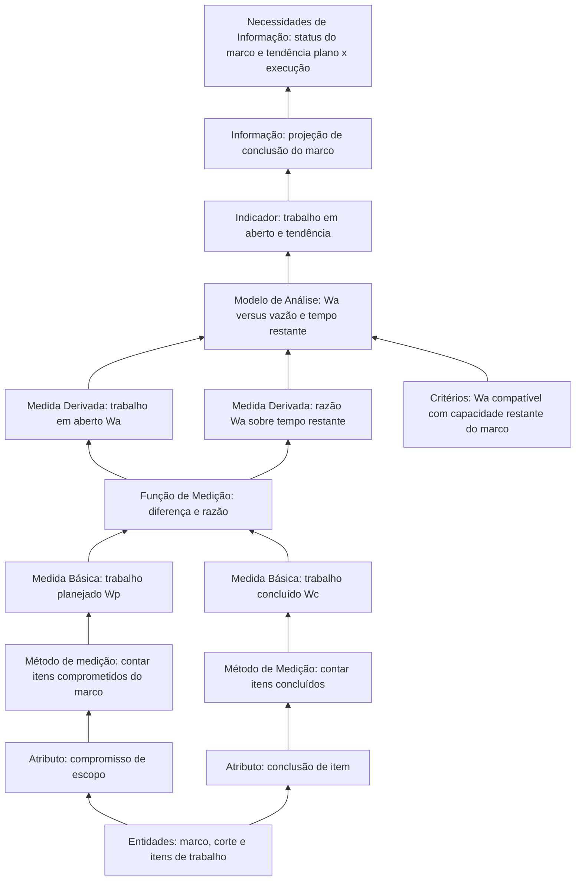

# 3. Desempenho dos processos

**Categoria de informação:** Desempenho dos processos  
**Conceito mensurável:** Eficácia do processo  
**Responsável na Entrega 1:** Dupla B  

Esta página especifica o *measurement construct* da categoria Desempenho dos processos, conforme o modelo de informação do PSM (RAMOS, 2026) e o mapeamento estrutural da equipe (JONES et al., 2021a).

O mapeamento associa a categoria à necessidade de conhecer o status do marco, o trabalho restante comprometido e as tendências de execução em relação ao plano, com as medidas **Trabalho Planejado**, **Trabalho Concluído** e **Trabalho em Aberto**. Na Entrega 1, a equipe operacionalizou a eficácia do processo documental por meio da **densidade de defeitos em revisão** e da **taxa de correção**, alinháveis às especificações de detecção e resolução de defeitos do CID (JONES et al., 2021b). Os dois eixos são complementares: um trata da qualidade do artefato produzido; o outro, da capacidade de cumprir o plano de escopo.

## Necessidade de informação

**Necessidade de informação.** Qual é o status da iteração, do lançamento ou da capacidade? Todo o trabalho restante assumido como compromisso será concluído conforme o planejado? Quais funcionalidades correm risco de atraso? Quais são as tendências de execução em relação ao plano?

## Eixo A: Eficácia do processo de revisão documental (aplicado na Entrega 1)

### Definição operacional

| Elemento | Definição da equipe |
|---|---|
| Defeito | Informação incorreta ou sem fonte; divergência com decisão da equipe; item exigido pela rubrica que está ausente. Conta apenas o defeito **confirmado** pela equipe (inclusive apontamentos com apoio de IA). |
| Fonte | Revisões do artigo; CSV `gestao-psm/desempenho-processos.csv`. |

### Instância do modelo de informação

A Figura 1 particulariza o modelo genérico da Aula 09 para o construto de defeitos aplicado na Entrega 1. Os rótulos dos nós correspondem à instanciação; a topologia é a do Modelo de Informação do PSM (RAMOS, 2026).

*Figura 1. Instância do Modelo de Informação do PSM para densidade de defeitos e taxa de correção (estrutura conforme RAMOS, 2026).*

Para a taxa de correção, a terceira medida básica (defeitos corrigidos) entra na função de medição juntamente com os defeitos confirmados, produzindo a segunda medida derivada do mesmo construto.

### Medidas

\[
D = \frac{N_{\text{defeitos}}}{N_{\text{seções}}}
\]

em que:

- \(D\): densidade de defeitos na revisão;
- \(N_{\text{defeitos}}\): quantidade de defeitos confirmados pela equipe;
- \(N_{\text{seções}}\): quantidade de seções (ou unidades) revisadas.

\[
\text{Taxa de correção} = \frac{N_{\text{corrigidos}}}{N_{\text{confirmados}}}
\]

em que:

- \(N_{\text{corrigidos}}\): quantidade de defeitos confirmados já corrigidos;
- \(N_{\text{confirmados}}\): quantidade de defeitos confirmados na revisão.

| Elemento | Descrição |
|---|---|
| Coleta | Revisão 1: \(D_1 = 1{,}44\); correção 61,5% (resumo na visão geral). Revisão 2: [`gestao-psm/desempenho-processos.csv`](https://github.com/FCTE-Qualidade-de-Software-1/2026-2_T01_BETTY_SNYDER/blob/main/gestao-psm/desempenho-processos.csv), com campos `identificador`, `revisão`, `seção`, `tipo`, `descrição`, `quem apontou`, `confirmado`, `corrigido`. |
| Análise | Rev. 1 motivou a Revisão 2 com dados reais. A Rev. 2 registrou 11 apontamentos, majoritariamente confirmados e corrigidos. |
| Limitação | A Revisão 1 não possui CSV versionado equivalente; `docs/gestao-psm/defeitos.csv` contém apenas o cabeçalho. |

### Indicadores e decisões

| Corte / revisão | Indicador | Decisão |
|---|---|---|
| Revisão 1 | \(D_1 = 1{,}44\); correção 61,5% | Conduzir Revisão 2 com dados reais |
| Revisão 2 | 11 apontamentos; correções em `corrigido` | Consolidar correções no artigo e na GitPage |

## Eixo B: Trabalho planejado, concluído e em aberto (mapeamento)

### Instância do modelo de informação

A Figura 2 aplica a mesma topologia do modelo da Aula 09 às medidas de trabalho planejado, concluído e em aberto previstas no mapeamento.

*Figura 2. Instância do Modelo de Informação do PSM para trabalho planejado, concluído e em aberto (estrutura conforme RAMOS, 2026).*

### Medidas

| Medida | Definição | Situação |
|---|---|---|
| Trabalho Planejado \(W_p\) | Quantidade (ou peso) de trabalho comprometido no marco ou corte | Parcial: derivável do CSV de calendário e dos milestones |
| Trabalho Concluído \(W_c\) | Quantidade concluída na mesma unidade | Parcial: `status = concluida` / issues fechadas |
| Trabalho em Aberto \(W_a\) | \(W_a = W_p - W_c\) | Sem série formal publicada nesta categoria |

\[
W_a = W_p - W_c
\]

em que:

- \(W_a\): trabalho em aberto (restante comprometido e ainda não concluído);
- \(W_p\): trabalho planejado (comprometido no marco ou corte);
- \(W_c\): trabalho concluído na mesma unidade e no mesmo recorte.

A análise pretendida confronta a tendência de \(W_a\) com a vazão e o tempo restante do marco. O procedimento mínimo consiste em publicar, em cada corte, a trinca \(W_p\), \(W_c\), \(W_a\) e a projeção de conclusão.

### Distinção em relação a Calendário e progresso

As entidades (itens de trabalho) são compartilhadas. A interpretação difere:

- **Calendário e progresso:** prazo, conformidade (ICP) e fluxo (estados, vazão, WIP).
- **Desempenho dos processos:** eficácia do processo (defeitos; tendência de \(W_a\) frente ao plano).

## Fontes no repositório

| Artefato | Papel |
|---|---|
| `gestao-psm/desempenho-processos.csv` | Defeitos da Revisão 2 |
| `gestao-psm/calendario-progresso.csv` | Proxy para \(W_p\) e \(W_c\) |
| Plano da Fase 2 (pasta `PSM/` do projeto acadêmico) | Definição de defeito e escolha da medida |

## Referências

JONES, Cheryl L. et al. (ed.). **Practical software and systems measurement continuous iterative development measurement framework**: part 1: concepts, definitions, principles, and measures. Version 2.1. [S. l.]: Practical Software & Systems Measurement; National Defense Industrial Association; International Council on Systems Engineering, 15 abr. 2021a. Product No. PSM-2021-03-001; INCOSE-TP-2020-001-06.

JONES, Cheryl L. et al. (ed.). **Practical software and systems measurement continuous iterative development measurement framework**: part 2: measurement specifications and enterprise measures. Version 2.1. [S. l.]: Practical Software & Systems Measurement; National Defense Industrial Association; International Council on Systems Engineering, 15 abr. 2021b. Product No. PSM-2021-03-001; INCOSE-TP-2020-001-06.

RAMOS, Cristiane Soares. **Medição prática de software e sistemas**: PSM: Practical Software and System Measurement. Notas de aula. Brasília: Faculdade do Gama, Universidade de Brasília, 2026. Material didático da disciplina Qualidade de Software 1 (FGA0315).

Voltar à [visão geral do PSM](../gestao-psm.md).
