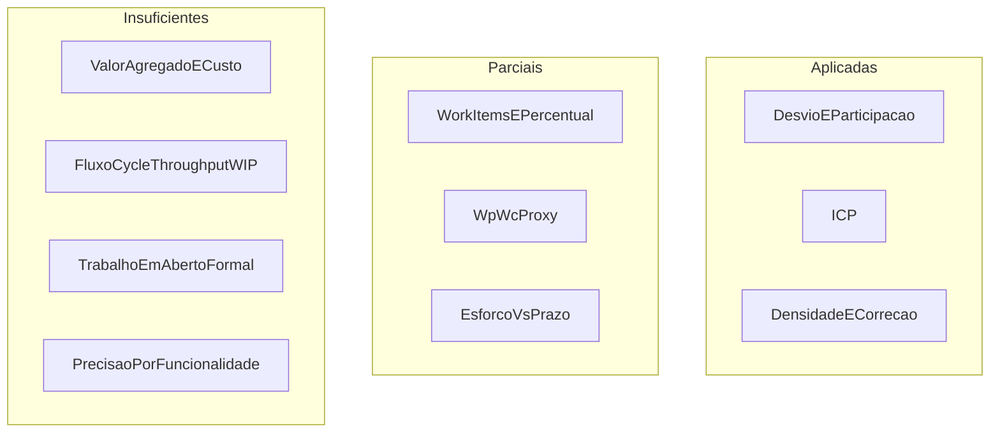

# Procedimentos e lacunas

Esta página sintetiza, para cada métrica do mapeamento estrutural PSM da equipe, o estado dos procedimentos de **coleta**, **cálculo** e **análise**, com referência aos artefatos do repositório. O objetivo é tornar explícito o que já sustenta decisões gerenciais e o que ainda não atende ao modelo de informação (RAMOS, 2026) nem às especificações do *Continuous Iterative Development Measurement Framework* (JONES et al., 2021a; JONES et al., 2021b).

## Critérios de seleção e priorização

Conforme Ramos (2026), a escolha e a manutenção de medidas devem considerar, entre outros: relevância à necessidade de informação; viabilidade da coleta; grau de intrusão no trabalho; facilidade de interpretação; adequação à fase do ciclo de vida; custo de coleta e análise. A Parte 1 do CID orienta a seleção a partir das necessidades e da tabela ICM (JONES et al., 2021a); a Parte 2 detalha como operacionalizar coleta, cálculo e análise (JONES et al., 2021b). As recomendações da coluna “Próximo procedimento mínimo” abaixo privileiam medidas de **alta relevância** e **baixa intrusão**, encaixadas no processo já existente (planilha, CSV, issues).

## Legenda de status

| Status | Significado |
|---|---|
| Aplicada | Coleta, cálculo e análise já ocorreram em pelo menos um corte documentado |
| Parcial | Há dados ou proxy no repositório, mas o procedimento PSM está incompleto |
| Insuficiente | Ausência material de coleta e/ou de função de medição operacional |

## Síntese por métrica

*Tabela I. Estado dos procedimentos PSM frente ao mapeamento estrutural*

| Categoria | Métrica | Status | Coleta | Cálculo | Análise | Artefato de referência | Próximo procedimento mínimo |
|---|---|---|---|---|---|---|---|
| Recursos e custos | Horas planejadas / reais | Aplicada | Planilha → CSV por corte | Campos `horas_planejadas`, `horas_reais` | Base dos indicadores de esforço | `gestao-psm/*recursos-custos.csv` | Manter cortes semanais; vincular horas a `tarefa_id`/issue |
| Recursos e custos | Desvio percentual (estimativa vs. esforço real) | Aplicada | Idem | `(Hr − Hp) / Hp × 100` | Cortes 11/10, 18/10, 25/10; decisões de carga | idem | Explicitar limiar numérico de desvio da equipe (além de participação) |
| Recursos e custos | Participação percentual | Aplicada | Idem | `Hr_i / Hr_equipe × 100` | Limiar &lt; 10% (retrospectiva) | idem; [retrospectiva-e1.md](../retrospectiva-e1.md) | Seguir monitoramento nas ações C2 |
| Recursos e custos | Estimativa vs. custo monetário | Insuficiente | Inexistente | — | — | Campos Cost previstos só no Project | Definir convenção de custo ou ativar campos BRL no Project |
| Recursos e custos | Estimativa vs. cronograma real | Parcial | Prazos no calendário | ICP em outra categoria | Cruzamento informal | `calendario-progresso.csv` | Indicador conjunto esforço–prazo por item |
| Recursos e custos | Comprometido vs. concluído (por funcionalidade) | Parcial | Tarefas/issues | Contagem por `status` | Não consolidado em Recursos | CSV + issues | Esforço estimado por issue no planejamento |
| Recursos e custos | Precisão da estimativa | Insuficiente | Sem erro por item | — | — | — | MAPE/viés após vínculo hora–tarefa |
| Recursos e custos | Valor agregado (EV) | Insuficiente | Sem PV/EV/AC | — | — | — | Pesos por item do marco; EV no corte |
| Calendário e progresso | \(T_p\), \(T_c\) e ICP | Aplicada | CSV de tarefas com prazo | `ICP = Tc / Tp` | Três cortes; limiar &lt; 70% | `gestao-psm/calendario-progresso.csv` | Atualizar CSV a partir do estado das issues |
| Calendário e progresso | Work Items committed/completed (iteração/release) | Parcial | Cortes e milestones | Contagem possível, não padronizada | Absorvida pelo ICP | CSV; milestones F1/F2/E2 | Marcar conjunto comprometido do corte; contar por milestone |
| Calendário e progresso | Percent Work Items Completed | Parcial | `status` no CSV | Razão concluída/total | Pouco publicada | CSV | Publicar ao lado do ICP em cada corte |
| Calendário e progresso | Contagem por estado de fluxo (To Do / In Progress / Done) | Insuficiente | Sem timestamps de estado | — | — | Project V2 pendente | Estados no Project; snapshot semanal |
| Calendário e progresso | Tempo de ciclo (*Cycle Time*) | Insuficiente | Sem duração por item | — | — | — | Datas de início e conclusão por issue |
| Calendário e progresso | Vazão (*Throughput*) | Insuficiente | Só conclusões pontuais | — | — | — | Itens concluídos / semana |
| Calendário e progresso | WIP médio | Insuficiente | Sem série Em Andamento | — | — | — | Média diária de itens In Progress |
| Desempenho dos processos | Densidade de defeitos \(D\) | Aplicada | Revisões do artigo | Defeitos / seções | Rev. 1 e decisão de Rev. 2 | Resumo GitPage; `desempenho-processos.csv` | Versionar Rev. 1 em CSV; preencher `docs/gestao-psm/defeitos.csv` |
| Desempenho dos processos | Taxa de correção | Aplicada | Campo `corrigido` | Corrigidos / confirmados | Rev. 1 (61,5%); Rev. 2 no CSV | `desempenho-processos.csv` | Fixar limiar de decisão para novas revisões |
| Desempenho dos processos | Trabalho Planejado \(W_p\) | Parcial | Compromisso do corte/marco | Contagem de itens | Usado indiretamente no calendário | `calendario-progresso.csv` | Publicar \(W_p\) como indicador desta categoria |
| Desempenho dos processos | Trabalho Concluído \(W_c\) | Parcial | `status = concluida` | Contagem | Idem | CSV / issues fechadas | Publicar \(W_c\) no mesmo corte |
| Desempenho dos processos | Trabalho em Aberto \(W_a = W_p - W_c\) | Insuficiente | Pendências conhecidas qualitativamente | Não formalizado | Sem tendência nem projeção de marco | — | Série \(W_a\) + confronto com vazão restante |

## Visão agregada

*Figura 1. Panorama do grau de operacionalização das métricas do mapeamento.*

## Separação de preocupações

| Domínio | O que medir | Onde não misturar |
|---|---|---|
| PSM (este conjunto de páginas) | Projeto da equipe: esforço, prazos, fluxo, eficácia do processo documental | Não usar o template `02 - Registro de Medição` (métricas GQM do Anki) como fonte PSM |
| GQM / Fase 2 | Qualidade do produto Anki | Não contabilizar observações de produto como densidade de defeitos do processo da equipe |

## Encaminhamento metodológico

1. **Preservar** as três famílias já aplicadas (desvio/participação; ICP; densidade/correção), com cortes regulares e CSV versionados.
2. **Completar** as parciais de baixo custo: percentual concluído ao lado do ICP; trinca \(W_p\), \(W_c\), \(W_a\); vínculo hora–tarefa.
3. **Introduzir** fluxo (estados, *Cycle Time*, *Throughput*, WIP) somente após o Project V2 ou um registro equivalente de transições — evitando inventar valores.
4. **Diferir** Valor Agregado monetário enquanto não houver convenção de custo ou campos BRL.

Detalhamentos por categoria: [Recursos e custos](recursos-e-custos.md), [Calendário e progresso](calendario-e-progresso.md), [Desempenho dos processos](desempenho-dos-processos.md). Visão geral: [Gestão do projeto (PSM)](../gestao-psm.md).

## Referências

JONES, Cheryl L. et al. (ed.). **Practical software and systems measurement continuous iterative development measurement framework**: part 1: concepts, definitions, principles, and measures. Version 2.1. [S. l.]: Practical Software & Systems Measurement; National Defense Industrial Association; International Council on Systems Engineering, 15 abr. 2021a. Product No. PSM-2021-03-001; INCOSE-TP-2020-001-06.

JONES, Cheryl L. et al. (ed.). **Practical software and systems measurement continuous iterative development measurement framework**: part 2: measurement specifications and enterprise measures. Version 2.1. [S. l.]: Practical Software & Systems Measurement; National Defense Industrial Association; International Council on Systems Engineering, 15 abr. 2021b. Product No. PSM-2021-03-001; INCOSE-TP-2020-001-06.

RAMOS, Cristiane Soares. **Medição prática de software e sistemas**: PSM – Practical Software and System Measurement. Notas de aula. Brasília: Faculdade do Gama, Universidade de Brasília, 2026. Material didático da disciplina Qualidade de Software 1 (FGA0315).
