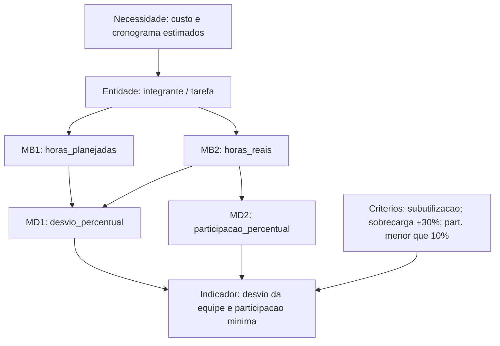
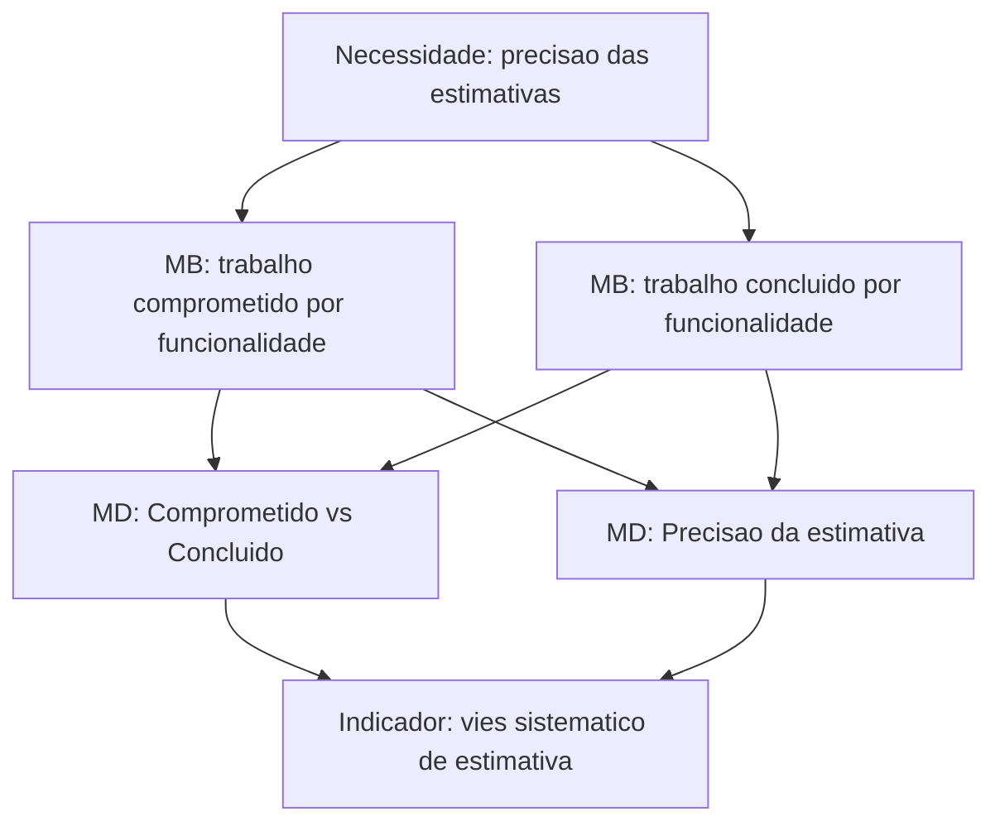

# 1. Recursos e custos

**Categoria de informação:** Recursos e custos  
**Conceito mensurável:** Desempenho financeiro (operacionalizado como esforço da equipe em horas)  
**Responsável na Entrega 1:** Dupla A  

Esta página instancia o modelo de informação do PSM para a categoria Recursos e custos (RAMOS, 2026), a partir do mapeamento estrutural da equipe e das medidas candidatas do *framework* CID (JONES et al., 2021a; JONES et al., 2021b). O objeto de medição é o esforço dos integrantes no projeto acadêmico. Não há, na configuração atual, registro sistemático de custo monetário (BRL); os campos *Estimated/Actual Cost* previstos para o Project GitHub ainda não estão ativos.

## Necessidade 1 — Custo e cronograma estimados por funcionalidade ou capacidade

**Necessidade de informação.** Qual é o custo e o cronograma estimados por funcionalidade ou capacidade?

No contexto desta equipe, a “funcionalidade” corresponde às frentes de trabalho das duplas e às tarefas comprometidas em cada corte semanal; o “custo” é representado pelo esforço em horas, na ausência de orçamento financeiro formal.

### Construto de medição

A Figura 1 apresenta o construto aplicado (e as extensões ainda não operacionalizadas) para esta necessidade.

*Figura 1. Construto PSM de Recursos e custos — esforço planejado versus real.*

### Medidas básicas

#### Horas planejadas (\(H_p\))

| Elemento | Descrição |
|---|---|
| Definição | Esforço estimado do integrante (ou da equipe) no intervalo acumulado até o corte, em horas. |
| Escala | Razão (número real ≥ 0). |
| Coleta aplicada | Extração da planilha de horas / planejamento; persistência no campo `horas_planejadas` dos CSV em `gestao-psm/` (`2026-10-11_recursos-custos.csv`, `2026-10-18_recursos-custos.csv`, `2026-10-25_recursos-custos.csv`, `recursos-custos.csv`). |
| Cálculo aplicado | Valor direto por integrante; linha `Equipe` soma o acumulado. |
| Análise aplicada | Base para o desvio e para julgamento de subutilização ou sobrecarga. |
| Insuficiências | Não há vínculo explícito *hora planejada ↔ funcionalidade/capacidade* (apenas por integrante/dupla). Cronograma estimado por item de trabalho não consta nestes CSV. |

#### Horas reais (\(H_r\))

| Elemento | Descrição |
|---|---|
| Definição | Esforço efetivamente registrado até a data do corte, em horas. |
| Escala | Razão (número real ≥ 0). |
| Coleta aplicada | Registro contínuo na planilha de horas; consolidação no campo `horas_reais`. No corte de 25/10, notas de conferência (`nota_conferencia`) registram checagens pontuais (ex.: distinção de registros de reunião e GitPage). |
| Cálculo aplicado | Soma dos registros até a data de corte (ex.: acumulado das semanas 05/10, 12/10 e 19/10 no corte de 25/10). |
| Análise aplicada | Comparação com \(H_p\); cálculo da participação relativa. |
| Insuficiências | Dependência de disciplina de preenchimento; ausência de automação a partir de issues ou de *time tracking* no GitHub. |

### Medidas derivadas

#### Estimativa versus esforço real (desvio percentual)

\[
\text{desvio\_percentual} = \frac{H_r - H_p}{H_p} \times 100
\]

| Elemento | Descrição |
|---|---|
| Status | **Aplicada** nos três cortes. |
| Coleta / cálculo | Campo `desvio_percentual` nos CSV; linha da equipe no corte 25/10: \(H_p = 78{,}10\), \(H_r = 42{,}17\), desvio −46,0%. |
| Análise | Cortes 11/10 (−42,0%), 18/10 (−20,0%) e 25/10 (−46,0%). Interpretação de *performance*: esforço realizado abaixo do planejado, com decisão de acompanhar subutilização e evitar sobrecarga pontual (+30%). |
| Critérios de decisão | A retrospectiva associa participação mínima inferior a 10% a ação corretiva; o corte de 25/10 fixou acompanhamento de subutilização sem redistribuir por sobrecarga da equipe. |

#### Estimativa versus custo/esforço real (extensão financeira)

| Elemento | Descrição |
|---|---|
| Status | **Insuficiente.** |
| Situação no repositório | Os CSV de recursos não possuem colunas de custo monetário. A [organização GitHub](../github-organizacao.md) prevê campos *Estimated/Actual Cost (BRL)* no Project V2, ainda não criado. |
| Procedimento mínimo viável | Definir taxa horária convencional (ou custo unitário acadêmico) e derivar custo estimado/real a partir de \(H_p\) e \(H_r\), ou ativar os campos de custo no Project quando a autorização OAuth estiver disponível. |

#### Estimativa versus cronograma real

| Elemento | Descrição |
|---|---|
| Status | **Parcial.** |
| Situação | O atraso de tarefas é medido na categoria Calendário e progresso (ICP e flag `concluida_no_prazo`). Não há, em Recursos e custos, medida derivada que combine esforço e prazo por funcionalidade. |
| Procedimento mínimo viável | Cruzar, por `tarefa_id` / issue, o esforço real com o cumprimento de prazo, produzindo um indicador conjunto de viabilidade esforço–calendário. |

#### Valor agregado (*Earned Value*)

| Elemento | Descrição |
|---|---|
| Status | **Insuficiente.** |
| Situação | Ausência de baseline de valor planejado (PV), valor agregado (EV) e custo real (AC) por entrega, previstos no mapeamento e nas especificações CID de valor de produto / progresso (JONES et al., 2021a; JONES et al., 2021b). |
| Procedimento mínimo viável | Atribuir peso (horas ou pontos) a cada item comprometido no marco; calcular EV como soma dos pesos dos itens concluídos e confrontar com PV e AC no corte. |

### Indicadores e decisões (Necessidade 1)

| Corte | Indicador | Decisão |
|---|---|---|
| 11/10 | Desvio −42,0%; participação mínima 2,8% | Redistribuir (participação); julgamento retrospectivo |
| 18/10 | Desvio −20,0%; participação mínima 11,0% | Manter carga; acompanhar desvios individuais |
| 25/10 | Desvio −46,0%; participação mínima 10,3% | Sem sobrecarga da equipe (+30%); acompanhar subutilização |

## Necessidade 2 — Precisão e viabilidade das estimativas em nível de funcionalidade

**Necessidade de informação.** As estimativas em nível de funcionalidade são precisas e viáveis?

### Construto pretendido

*Figura 2. Construto pretendido para precisão de estimativas (ainda não operacionalizado por funcionalidade).*

### Medidas

#### Participação percentual (proxy de equilíbrio de esforço)

\[
\text{participacao\_percentual} = \frac{H_r^{\text{integrante}}}{H_r^{\text{equipe}}} \times 100
\]

| Elemento | Descrição |
|---|---|
| Status | **Aplicada** (proxy de distribuição de esforço; não substitui precisão por funcionalidade). |
| Coleta / cálculo | Campo `participacao_percentual` nos CSV de recursos. |
| Análise | Limiar da retrospectiva: participação inferior a 10% dispara acompanhamento (ação C2). No corte 25/10, a mínima foi 10,3% (Bryan). |
| Insuficiências | Não responde se a estimativa de uma *funcionalidade* foi precisa; apenas se o esforço está concentrado ou diluído entre pessoas. |

#### Comprometido versus concluído

| Elemento | Descrição |
|---|---|
| Status | **Parcial / insuficiente no nível de funcionalidade.** |
| Situação | Contagens de tarefas comprometidas e concluídas existem em `calendario-progresso.csv` (`status`, cortes por `data_corte`), mas sem estimativa de esforço *por tarefa* alinhada a `horas_planejadas`. |
| Procedimento mínimo viável | Incluir, no planejamento, esforço estimado por issue/tarefa e comparar, no fechamento do marco, comprometido × concluído em horas ou em pontos. |

#### Precisão da estimativa

| Elemento | Descrição |
|---|---|
| Status | **Insuficiente.** |
| Situação | Não há série histórica de magnitude do erro de estimativa por item (\(H_r - H_p\) por tarefa). O desvio atual é agregado por integrante. |
| Procedimento mínimo viável | Após vincular horas a tarefas, calcular MAPE ou viés médio por corte e por dupla. |

## Fontes no repositório

| Artefato | Papel |
|---|---|
| `gestao-psm/2026-10-*_recursos-custos.csv` | Cortes oficiais de medição |
| `gestao-psm/recursos-custos.csv` | Consolidado do último corte |
| Planilha de horas (`gestao-psm/2026-10-20_planilha-de-horas.xlsx` e exportações em `PSM/`) | Coleta bruta de \(H_r\) e planejamento de \(H_p\) |
| [Retrospectiva E1](../retrospectiva-e1.md) | Critérios de decisão (participação &lt; 10%) |

## Referências

JONES, Cheryl L. et al. (ed.). **Practical software and systems measurement continuous iterative development measurement framework**: part 1: concepts, definitions, principles, and measures. Version 2.1. [S. l.]: Practical Software & Systems Measurement; National Defense Industrial Association; International Council on Systems Engineering, 15 abr. 2021a. Product No. PSM-2021-03-001; INCOSE-TP-2020-001-06.

JONES, Cheryl L. et al. (ed.). **Practical software and systems measurement continuous iterative development measurement framework**: part 2: measurement specifications and enterprise measures. Version 2.1. [S. l.]: Practical Software & Systems Measurement; National Defense Industrial Association; International Council on Systems Engineering, 15 abr. 2021b. Product No. PSM-2021-03-001; INCOSE-TP-2020-001-06.

RAMOS, Cristiane Soares. **Medição prática de software e sistemas**: PSM – Practical Software and System Measurement. Notas de aula. Brasília: Faculdade do Gama, Universidade de Brasília, 2026. Material didático da disciplina Qualidade de Software 1 (FGA0315).

Voltar à [visão geral do PSM](../gestao-psm.md).
