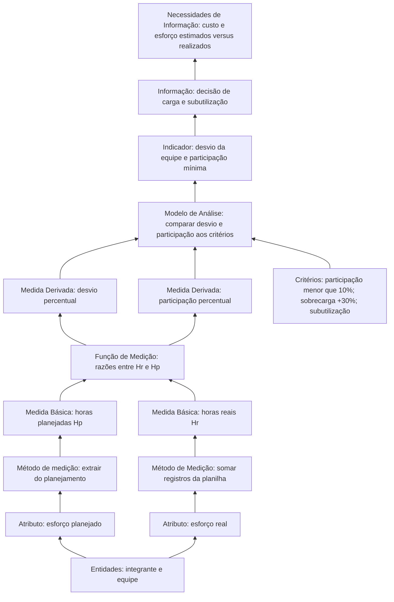
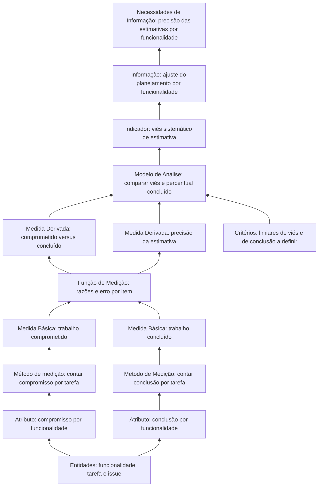

# 1. Recursos e custos

**Categoria de informação:** Recursos e custos  
**Conceito mensurável:** Desempenho financeiro, operacionalizado como esforço da equipe em horas  
**Responsável na Entrega 1:** Dupla A  

Esta página especifica o *measurement construct* da categoria Recursos e custos, conforme o modelo de informação do PSM (RAMOS, 2026) e o mapeamento estrutural da equipe, com apoio das medidas candidatas do *Continuous Iterative Development Measurement Framework* (JONES et al., 2021a; JONES et al., 2021b).

O objeto de medição é o **esforço** dos integrantes no projeto final da disciplina e o respectivo **custo**, obtido automaticamente pela convenção da equipe:

\[
C = H \times 35
\]

em que:

- \(C\): custo em reais (R$);
- \(H\): esforço em horas (\(H_p\) para custo estimado; \(H_r\) para custo real);
- \(35\): taxa horária convencional fixada em R$ 35,00 por hora.

Assim, custo planejado \(= H_p \times 35\) e custo real \(= H_r \times 35\). No Project GitHub `BETTY SNYDER`, os campos padrão **Esforço planejado (horas)** e **Esforço real (horas)** registram os valores de esforço; os custos são derivados a posteriori pela mesma taxa, não sendo campos padrão do Project. A série histórica da Entrega 1 permanece nos CSV de `gestao-psm/` (horas).

## Necessidade 1: Custo e cronograma estimados por funcionalidade ou capacidade

**Necessidade de informação.** Qual é o custo e o cronograma estimados por funcionalidade ou capacidade?

No escopo desta equipe, “funcionalidade” ou “capacidade” corresponde às frentes das duplas e ao conjunto de tarefas comprometidas em cada corte semanal. A necessidade motiva a comparação entre o esforço planejado e o esforço realizado, como análise de desempenho (*performance*) no sentido do PSM (RAMOS, 2026).

### Instância do modelo de informação

A Figura 1 particulariza o modelo genérico da Aula 09 para o construto aplicado na Entrega 1. Mantém-se a mesma cadeia: entidades e atributos, métodos de medição, medidas básicas, função de medição, medidas derivadas, modelo de análise com critérios, indicador e informação que responde à necessidade.

*Figura 1. Instância do Modelo de Informação do PSM para Recursos e custos: esforço planejado versus real (estrutura conforme RAMOS, 2026).*

### Medidas básicas

#### Horas planejadas (\(H_p\))

| Elemento | Descrição |
|---|---|
| Definição | Esforço estimado do integrante ou da equipe no intervalo acumulado até o corte, em horas. |
| Escala | Razão (número real ≥ 0). |
| Coleta | Extração da planilha de horas e do planejamento; persistência no campo `horas_planejadas` dos arquivos `gestao-psm/2026-10-11_recursos-custos.csv`, `2026-10-18_recursos-custos.csv`, `2026-10-25_recursos-custos.csv` e `recursos-custos.csv`. O arquivo `2026-10-26_recursos-custos.xlsx` registra o corte mais recente. |
| Cálculo | Valor por integrante; a linha `Equipe` corresponde à soma do acumulado. |
| Análise | Base do desvio e do julgamento de subutilização ou sobrecarga. |
| Limitação observada | O vínculo explícito entre hora planejada e funcionalidade ou capacidade individual ainda não está sistematizado nos CSV (agregação por integrante/dupla). |

#### Horas reais (\(H_r\))

| Elemento | Descrição |
|---|---|
| Definição | Esforço efetivamente registrado até a data do corte, em horas. |
| Escala | Razão (número real ≥ 0). |
| Coleta | Registro contínuo na planilha de horas; consolidação no campo `horas_reais`. No corte de 25/10, o campo `nota_conferencia` documenta checagens pontuais. |
| Cálculo | Soma dos registros até a data de corte (ex.: semanas 05/10, 12/10 e 19/10 no corte de 25/10). |
| Análise | Comparação com \(H_p\) e cálculo da participação relativa. |
| Limitação observada | A qualidade do dado depende da disciplina de preenchimento; não há automação de *time tracking* a partir das issues. |

### Medidas derivadas

#### Estimativa versus esforço real (desvio percentual)

\[
\text{Desvio percentual} = \frac{H_r - H_p}{H_p} \times 100
\]

em que:

- \(H_r\): esforço real do integrante ou da equipe, em horas, acumulado até a data do corte;
- \(H_p\): esforço planejado correspondente, em horas.

| Elemento | Descrição |
|---|---|
| Status | Aplicada nos cortes de 11/10, 18/10, 25/10 e 26/10. |
| Coleta e cálculo | Campo `desvio_percentual` nos CSV até 25/10. No corte de 26/10, a planilha registra \(H_p = 90{,}766\) h e \(H_r = 63{,}0366\) h (desvio −30,6%). |
| Análise | Cortes 11/10 (−42,0%), 18/10 (−20,0%), 25/10 (−46,0%) e 26/10 (−30,6%). O esforço real acumulado permaneceu abaixo do planejado; acompanhar a subutilização e evitar sobrecarga pontual (+30%). |

#### Participação percentual

\[
\text{Participação percentual} = \frac{H_r^{\text{integrante}}}{H_r^{\text{equipe}}} \times 100
\]

em que:

- \(H_r^{\text{integrante}}\): esforço real do integrante, em horas, no intervalo do corte;
- \(H_r^{\text{equipe}}\): esforço real total da equipe no mesmo intervalo.

| Elemento | Descrição |
|---|---|
| Status | Aplicada. |
| Critério | Participação inferior a 10% dispara acompanhamento (Retrospectiva E1, ação C2). No corte de 25/10, a participação mínima foi 10,3%. |
| Escopo interpretativo | Mede equilíbrio de esforço entre pessoas; não substitui a precisão da estimativa por funcionalidade. |

#### Extensões do mapeamento ainda não operacionalizadas na série E1

| Medida do mapeamento | Situação | Encaminhamento |
|---|---|---|
| Estimativa versus custo monetário | Convenção: R$ 35,00/h; \(C_p = H_p \times 35\), \(C_r = H_r \times 35\); CSV da E1 só com horas | Registrar \(C_p\) e \(C_r\) nos campos BRL do Project a cada corte |
| Estimativa versus cronograma real | Tratada em Calendário e progresso (ICP) | Cruzar esforço e prazo por `tarefa_id` / issue |
| Valor agregado (*Earned Value*) | Sem baseline PV, EV e AC por entrega | Atribuir peso aos itens do marco e calcular EV no corte |

### Indicadores e decisões

| Corte | Indicador | Decisão |
|---|---|---|
| 11/10 | Desvio −42,0%; participação mínima 2,8% | Redistribuir (participação); julgamento retrospectivo |
| 18/10 | Desvio −20,0%; participação mínima 11,0% | Manter carga; acompanhar desvios individuais |
| 25/10 | Desvio −46,0%; participação mínima 10,3% | Sem sobrecarga da equipe (+30%); acompanhar subutilização |
| 26/10 | Desvio −30,6%; participação mínima 10,04% | Acompanhar; esforço real acumulado abaixo do planejado |

### Gráfico: esforço acumulado por recorte { #grafico-esforco-acumulado }

<figure class="psm-chart">
<svg viewBox="0 0 800 400" role="img" aria-labelledby="recursos-chart-title recursos-chart-desc">
  <title id="recursos-chart-title">Esforço planejado e real acumulado por recorte</title>
  <desc id="recursos-chart-desc">Gráfico de barras comparando horas planejadas e reais em 11, 18 e 25 de outubro, e 26 de outubro. Os totais são, respectivamente, 20,67 e 11,98; 49,37 e 39,50; 78,10 e 42,17; 90,77 e 63,04 horas.</desc>
  <g class="chart-grid">
    <line x1="90" y1="300" x2="760" y2="300" />
    <line x1="90" y1="258" x2="760" y2="258" />
    <line x1="90" y1="216" x2="760" y2="216" />
    <line x1="90" y1="174" x2="760" y2="174" />
    <line x1="90" y1="132" x2="760" y2="132" />
    <line x1="90" y1="90" x2="760" y2="90" />
  </g>
  <g class="chart-axis">
    <line x1="90" y1="90" x2="90" y2="300" />
    <line x1="90" y1="300" x2="760" y2="300" />
  </g>
  <g text-anchor="end">
    <text x="80" y="304">0</text>
    <text x="80" y="262">20</text>
    <text x="80" y="220">40</text>
    <text x="80" y="178">60</text>
    <text x="80" y="136">80</text>
    <text x="80" y="94">100</text>
  </g>
  <text x="18" y="195" transform="rotate(-90 18 195)">Horas acumuladas</text>
  <g>
    <rect class="bar-planned" x="110" y="256.59" width="40" height="43.41" rx="3" />
    <rect class="bar-actual" x="160" y="274.84" width="40" height="25.16" rx="3" />
    <text class="chart-value" x="130" y="249" text-anchor="middle">20,67</text>
    <text class="chart-value" x="180" y="267" text-anchor="middle">11,98</text>

    <rect class="bar-planned" x="280" y="196.32" width="40" height="103.68" rx="3" />
    <rect class="bar-actual" x="330" y="217.05" width="40" height="82.95" rx="3" />
    <text class="chart-value" x="300" y="189" text-anchor="middle">49,37</text>
    <text class="chart-value" x="350" y="210" text-anchor="middle">39,50</text>

    <rect class="bar-planned" x="450" y="135.99" width="40" height="164.01" rx="3" />
    <rect class="bar-actual" x="500" y="211.44" width="40" height="88.56" rx="3" />
    <text class="chart-value" x="470" y="128" text-anchor="middle">78,10</text>
    <text class="chart-value" x="520" y="204" text-anchor="middle">42,17</text>

    <rect class="bar-planned" x="620" y="109.39" width="40" height="190.61" rx="3" />
    <rect class="bar-actual" x="670" y="167.62" width="40" height="132.38" rx="3" />
    <text class="chart-value" x="640" y="102" text-anchor="middle">90,77</text>
    <text class="chart-value" x="690" y="160" text-anchor="middle">63,04</text>
  </g>
  <g text-anchor="middle">
    <text x="155" y="326">11/10</text>
    <text x="325" y="326">18/10</text>
    <text x="495" y="326">25/10</text>
    <text x="665" y="326">26/10</text>
  </g>
  <g>
    <rect class="bar-planned" x="260" y="355" width="14" height="14" rx="2" />
    <text x="280" y="367">Planejado</text>
    <rect class="bar-actual" x="405" y="355" width="14" height="14" rx="2" />
    <text x="425" y="367">Real</text>
  </g>
</svg>
<figcaption>Esforço acumulado da equipe em cada corte. Os valores de 11/10, 18/10 e 25/10 vêm dos CSV; 26/10 vem da planilha de horas. Fontes: <code>gestao-psm/*_recursos-custos.csv</code> e <code>gestao-psm/2026-10-26_recursos-custos.xlsx</code>.</figcaption>
</figure>

<figure id="grafico-desvio-participacao" class="psm-chart">
<svg viewBox="0 0 800 400" role="img" aria-labelledby="recursos-indicadores-title recursos-indicadores-desc">
  <title id="recursos-indicadores-title">Desvio do esforço e participação mínima por recorte</title>
  <desc id="recursos-indicadores-desc">O desvio percentual foi menos 42,0%, menos 20,0%, menos 46,0% e menos 30,6% nos recortes de 11, 18, 25 e 26 de outubro. A participação mínima foi 2,8%, 11,0%, 10,3% e 10,04%, respectivamente.</desc>
  <g class="chart-grid">
    <line x1="90" y1="90" x2="760" y2="90" />
    <line x1="90" y1="150" x2="760" y2="150" />
    <line x1="90" y1="210" x2="760" y2="210" />
    <line x1="90" y1="270" x2="760" y2="270" />
    <line x1="90" y1="300" x2="760" y2="300" />
  </g>
  <g class="chart-axis">
    <line x1="90" y1="90" x2="90" y2="300" />
    <line x1="90" y1="150" x2="760" y2="150" />
    <line x1="90" y1="300" x2="760" y2="300" />
  </g>
  <g text-anchor="end">
    <text x="80" y="94">20%</text>
    <text x="80" y="154">0%</text>
    <text x="80" y="214">−20%</text>
    <text x="80" y="274">−40%</text>
    <text x="80" y="304">−50%</text>
  </g>
  <text x="18" y="205" transform="rotate(-90 18 205)">Percentual</text>
  <path class="line-deviation" d="M 155 276 L 325 210 L 495 288 L 665 241.8" />
  <path class="line-participation" d="M 155 141.6 L 325 117 L 495 119.1 L 665 119.88" />
  <g>
    <circle class="point-deviation" cx="155" cy="276" r="6" />
    <circle class="point-deviation" cx="325" cy="210" r="6" />
    <circle class="point-deviation" cx="495" cy="288" r="6" />
    <circle class="point-deviation" cx="665" cy="241.8" r="6" />
    <circle class="point-participation" cx="155" cy="141.6" r="6" />
    <circle class="point-participation" cx="325" cy="117" r="6" />
    <circle class="point-participation" cx="495" cy="119.1" r="6" />
    <circle class="point-participation" cx="665" cy="119.88" r="6" />
  </g>
  <g class="chart-value" text-anchor="middle">
    <text x="155" y="263">−42,0%</text>
    <text x="325" y="197">−20,0%</text>
    <text x="495" y="282">−46,0%</text>
    <text x="665" y="255">−30,6%</text>
    <text x="155" y="129">2,8%</text>
    <text x="325" y="105">11,0%</text>
    <text x="495" y="107">10,3%</text>
    <text x="665" y="108">10,04%</text>
  </g>
  <g text-anchor="middle">
    <text x="155" y="326">11/10</text>
    <text x="325" y="326">18/10</text>
    <text x="495" y="326">25/10</text>
    <text x="665" y="326">26/10</text>
  </g>
  <g>
    <line class="line-deviation" x1="225" y1="363" x2="255" y2="363" />
    <text x="263" y="368">Desvio</text>
    <line class="line-participation" x1="395" y1="363" x2="425" y2="363" />
    <text x="433" y="368">Participação mínima</text>
  </g>
</svg>
<figcaption>As duas séries estão em percentual: o desvio compara esforço real e planejado; a participação mínima é a menor parcela individual do esforço real da equipe. No corte de 26/10, os valores foram calculados do resumo da planilha <code>2026-10-26_recursos-custos.xlsx</code>.</figcaption>
</figure>

## Necessidade 2: Precisão e viabilidade das estimativas em nível de funcionalidade

**Necessidade de informação.** As estimativas em nível de funcionalidade são precisas e viáveis?

### Instância do modelo de informação (construto-alvo)

A Figura 2 mantém a topologia do modelo genérico da Aula 09, com atributos e medidas voltados à precisão por funcionalidade. Na Entrega 1, esse construto não foi plenamente operacionalizado; a participação percentual funciona apenas como *proxy* de distribuição de esforço.

*Figura 2. Instância do Modelo de Informação do PSM para precisão de estimativas por funcionalidade (estrutura conforme RAMOS, 2026).*

## Fontes no repositório

| Artefato | Papel |
|---|---|
| `gestao-psm/2026-10-*_recursos-custos.csv` | Cortes oficiais de medição |
| `gestao-psm/recursos-custos.csv` | Consolidado do último corte |
| Planilha de horas | Coleta bruta de \(H_r\) e planejamento de \(H_p\) |
| [Organização no GitHub](github-organizacao.md) | Campos de esforço e custo no Project |
| [Retrospectiva E1](../retrospectiva-e1.md) | Critério de participação inferior a 10% |

## Referências

JONES, Cheryl L. et al. (ed.). **Practical software and systems measurement continuous iterative development measurement framework**: part 1: concepts, definitions, principles, and measures. Version 2.1. [S. l.]: Practical Software & Systems Measurement; National Defense Industrial Association; International Council on Systems Engineering, 15 abr. 2021a. Product No. PSM-2021-03-001; INCOSE-TP-2020-001-06.

JONES, Cheryl L. et al. (ed.). **Practical software and systems measurement continuous iterative development measurement framework**: part 2: measurement specifications and enterprise measures. Version 2.1. [S. l.]: Practical Software & Systems Measurement; National Defense Industrial Association; International Council on Systems Engineering, 15 abr. 2021b. Product No. PSM-2021-03-001; INCOSE-TP-2020-001-06.

RAMOS, Cristiane Soares. **Medição prática de software e sistemas**: PSM: Practical Software and System Measurement. Notas de aula. Brasília: Faculdade do Gama, Universidade de Brasília, 2026. Material didático da disciplina Qualidade de Software 1 (FGA0315).

Voltar à [visão geral do PSM](../gestao-psm.md).
