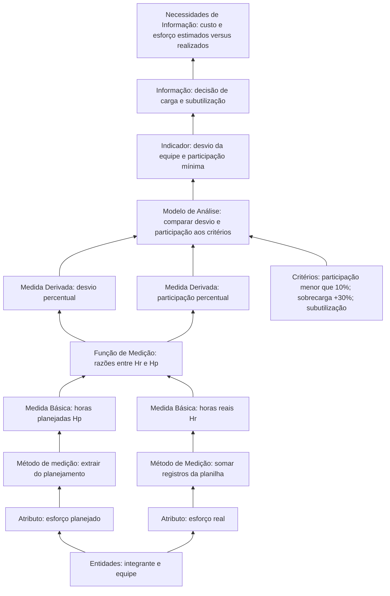
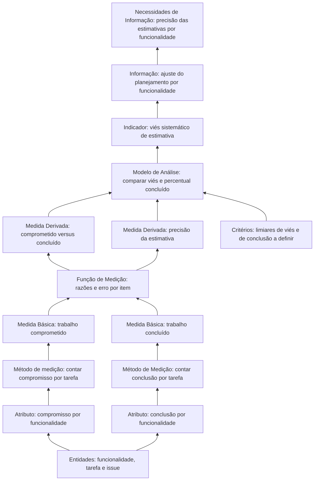

# 1. Recursos e custos

**Categoria de informação:** Recursos e custos  
**Conceito mensurável:** Desempenho financeiro, operacionalizado como esforço da equipe em horas  
**Responsável na Entrega 1:** Dupla A  

Esta página especifica o *measurement construct* da categoria Recursos e custos, conforme o modelo de informação do PSM (RAMOS, 2026) e o mapeamento estrutural da equipe, com apoio das medidas candidatas do *Continuous Iterative Development Measurement Framework* (JONES et al., 2021a; JONES et al., 2021b).

O objeto de medição é o **esforço** dos integrantes no projeto final da disciplina e o respectivo **custo**, obtido automaticamente pela convenção da equipe: \[
C = H \times 35
\]

em que: - \(C\): custo em reais (R$);
- \(H\): esforço em horas (\(H_p\) para custo estimado; \(H_r\) para custo real);
- \(35\): taxa horária convencional fixada em R$ 35,00 por hora.

Assim, custo planejado \(= H_p \times 35\) e custo real \(= H_r \times 35\). No Project GitHub `BETTY SNYDER`, os campos padrão **Esforço planejado (horas)** e **Esforço real (horas)** registram os valores de esforço; os custos são derivados a posteriori pela mesma taxa, não sendo campos padrão do Project. A série histórica da Entrega 1 permanece nos CSV de `gestao-psm/` (horas).

## Necessidade 1: Custo e cronograma estimados por funcionalidade ou capacidade

**Necessidade de informação.** Qual é o custo e o cronograma estimados por funcionalidade ou capacidade?

No escopo desta equipe, “funcionalidade” ou “capacidade” corresponde às frentes das duplas e ao conjunto de tarefas comprometidas em cada corte semanal. A necessidade motiva a comparação entre o esforço planejado e o esforço realizado, como análise de desempenho (*performance*) no sentido do PSM (RAMOS, 2026).

### Instância do modelo de informação

A Figura 1 particulariza o modelo genérico da Aula 09 para o construto aplicado na Entrega 1. Mantém-se a mesma cadeia: entidades e atributos, métodos de medição, medidas básicas, função de medição, medidas derivadas, modelo de análise com critérios, indicador e informação que responde à necessidade.

*Figura 1. Instância do Modelo de Informação do PSM para Recursos e custos: esforço planejado versus real (estrutura conforme RAMOS, 2026).*

### Medidas básicas

#### Horas planejadas (\(H_p\))

| Elemento | Descrição |
|---|---|
| Definição | Esforço estimado do integrante ou da equipe no intervalo acumulado até o corte, em horas. |
| Escala | Razão (número real ≥ 0). |
| Coleta | Extração da planilha de horas, do planejamento E1 e do [Planejamento E2](planejamento-e2.md) (156,5 h nas issues `#48` a `#81`); persistência no campo `horas_planejadas` dos CSV em `gestao-psm/`. Nos cortes de novembro, Hp acumulado = E1 (78,10 h) + milestones E2 vencidos até a data (F3 em 08/11; F3+F2 em 15/11; F3+F2+PC2+E2 em 22/11), com rateio igual entre assignees. O corte mais recente de novembro é 22/11. |
| Cálculo | Valor por integrante; a linha `Equipe` corresponde à soma do acumulado. |
| Análise | Base do desvio e do julgamento de subutilização ou sobrecarga. |
| Limitação observada | O vínculo explícito entre hora planejada e funcionalidade ou capacidade individual ainda não está sistematizado nos CSV (agregação por integrante/dupla). |

#### Horas reais (\(H_r\))

| Elemento | Descrição |
|---|---|
| Definição | Esforço efetivamente registrado até a data do corte, em horas. |
| Escala | Razão (número real ≥ 0). |
| Coleta | Registro contínuo na planilha de horas; consolidação no campo `horas_reais`. No corte de 25/10, o campo `nota_conferencia` documenta checagens pontuais. |
| Cálculo | Soma dos registros até a data de corte (ex.: semanas 05/10, 12/10 e 19/10 no corte de 25/10). |
| Análise | Comparação com \(H_p\) e cálculo da participação relativa. |
| Limitação observada | A qualidade do dado depende da disciplina de preenchimento; não há automação de *time tracking* a partir das issues. |

### Medidas derivadas

#### Estimativa versus esforço real (desvio percentual)

\[
\text{Desvio percentual} = \frac{H_r - H_p}{H_p} \times 100
\]

em que: - \(H_r\): esforço real do integrante ou da equipe, em horas, acumulado até a data do corte;
- \(H_p\): esforço planejado correspondente, em horas.

| Elemento | Descrição |
|---|---|
| Status | Aplicada nos cortes de 11/10, 18/10, 25/10 e 26/10. |
| Coleta e cálculo | Campo `desvio_percentual` nos CSV até 25/10. No corte de 26/10, a planilha registra \(H_p = 90{,}766\) h e \(H_r = 63{,}0366\) h (desvio −30,6%). |
| Análise | Cortes 11/10 (−42,0%), 18/10 (−20,0%), 25/10 (−46,0%) e 26/10 (−30,6%). O esforço real acumulado permaneceu abaixo do planejado; acompanhar a subutilização e evitar sobrecarga pontual (+30%). |

#### Participação percentual

\[
\text{Participação percentual} = \frac{H_r^{\text{integrante}}}{H_r^{\text{equipe}}} \times 100
\]

em que: - \(H_r^{\text{integrante}}\): esforço real do integrante, em horas, no intervalo do corte;
- \(H_r^{\text{equipe}}\): esforço real total da equipe no mesmo intervalo.

| Elemento | Descrição |
|---|---|
| Status | Aplicada. |
| Critério | Participação inferior a 10% dispara acompanhamento (Retrospectiva E1, ação C2). No corte de 25/10, a participação mínima foi 10,3%. |
| Escopo interpretativo | Mede equilíbrio de esforço entre pessoas; não substitui a precisão da estimativa por funcionalidade. |

#### Extensões do mapeamento ainda não operacionalizadas na série E1

| Medida do mapeamento | Situação | Encaminhamento |
|---|---|---|
| Estimativa versus custo monetário | Convenção: R$ 35,00/h; \(C_p = H_p \times 35\), \(C_r = H_r \times 35\); CSV da E1 só com horas | Registrar \(C_p\) e \(C_r\) nos campos BRL do Project a cada corte |
| Estimativa versus cronograma real | Tratada em Calendário e progresso (ICP) | Cruzar esforço e prazo por `tarefa_id` / issue |
| Valor agregado (*Earned Value*) | Sem baseline PV, EV e AC por entrega | Atribuir peso aos itens do marco e calcular EV no corte |

### Indicadores e decisões

| Corte | Indicador | Decisão |
|---|---|---|
| 11/10 | Desvio −42,0%; participação mínima 2,8% | Redistribuir (participação); julgamento retrospectivo |
| 18/10 | Desvio −20,0%; participação mínima 11,0% | Manter carga; acompanhar desvios individuais |
| 25/10 | Desvio −46,0%; participação mínima 10,3% | Sem sobrecarga da equipe (+30%); acompanhar subutilização |
| 26/10 | Desvio −30,6%; participação mínima 10,04% | Acompanhar; esforço real acumulado abaixo do planejado |
| 08/11 | Desvio −46,9%; participação mínima 8,9% (Dante); Hp 133,60 h | Acompanhar Dante (&lt;10%) e subutilização agregada; Hp = E1 (78,10 h) + F3 do [Planejamento E2](planejamento-e2.md) (55,5 h) |
| 15/11 | Desvio −58,3%; participação mínima 8,8% (Dante); Hp 172,60 h | Manter acompanhamento; Hp = E1 + F3 + F2 (94,5 h E2); Hr com último lançamento em 09/11 |
| 22/11 | Desvio −50,0%; participação mínima 5,4% (Dante); Bryan 6,7%; Hp 234,60 h | Acompanhar subutilização agregada e participação da Dupla C; não inventar horas |

### Corte de 22/11 (E2) { #corte-2211-recursos }

Terceiro corte da E2 (issue E2-P1), publicado em **22/11/2026** (corresponde ao “corte 3” previsto como 21/11 no planejamento). Fonte de \(H_r\): [`gestao-psm/2026-11-22_registro-horas.csv`](https://github.com/FCTE-Qualidade-de-Software-1/2026-2_T01_BETTY_SNYDER/blob/main/gestao-psm/2026-11-22_registro-horas.csv). Fonte de \(H_p\): E1 (78,10 h) + Planejamento E2 nos milestones **F3+F2+PC2+E2** (156,5 h), com rateio igual entre assignees das issues `#48` a `#81`. Arquivo: [`gestao-psm/2026-11-22_recursos-custos.csv`](https://github.com/FCTE-Qualidade-de-Software-1/2026-2_T01_BETTY_SNYDER/blob/main/gestao-psm/2026-11-22_recursos-custos.csv).

| Medida | Valor | Como foi obtida |
|---|---|---|
| \(H_p\) equipe | 234,60 h | 78,10 (E1) + 156,5 (Planejamento E2 completo) |
| \(H_r\) equipe | 117,24 h | Soma do registro de horas até 22/11 |
| Desvio | −50,0% | \((H_r - H_p) / H_p\) |
| Participação mínima | 5,4% (Dante); Bryan 6,7% | Ambos abaixo do limiar de 10% |

**Interpretação.** O desvio negativo permanece elevado porque o Hp do corte incorpora todo o esforço planejado da E2, enquanto o registro de horas (117,24 h) cobre só parte do trabalho efetivo lançado. Em relação a 15/11 (−58,3%), o desvio melhora para −50,0% com o aumento de \(H_r\), mas a participação da Dupla C continua abaixo de 10%.

**Decisão de gestão.** Acompanhar a subutilização agregada e a participação de Bryan e Dante. Não inventar horas: a próxima atualização deve vir do preenchimento real do registro, alinhado ao fechamento de `#76` (apresentação final; `#75` já fechada com a Release 2).

### Gráfico: esforço acumulado por recorte { #grafico-esforco-acumulado }

<figure class="psm-chart">
<svg viewBox="0 0 960 400" role="img" aria-labelledby="recursos-chart-title recursos-chart-desc">
  <title id="recursos-chart-title">Esforço planejado e real acumulado por recorte</title>
  <desc id="recursos-chart-desc">Gráfico de barras comparando horas planejadas e reais nos recortes de 11, 18, 25 e 26 de outubro e 08, 15 e 22 de novembro. Totais planejado/real: 20,67/11,98; 49,37/39,50; 78,10/42,17; 90,77/63,04; 133,60/70,94; 172,60/71,94; 234,60/117,24.</desc>
  <g class="chart-grid">
    <line x1="90" y1="300" x2="920" y2="300" />
    <line x1="90" y1="258" x2="920" y2="258" />
    <line x1="90" y1="216" x2="920" y2="216" />
    <line x1="90" y1="174" x2="920" y2="174" />
    <line x1="90" y1="132" x2="920" y2="132" />
    <line x1="90" y1="90" x2="920" y2="90" />
  </g>
  <g class="chart-axis">
    <line x1="90" y1="90" x2="90" y2="300" />
    <line x1="90" y1="300" x2="920" y2="300" />
  </g>
  <g text-anchor="end">
    <text x="80" y="304">0</text>
    <text x="80" y="262">56</text>
    <text x="80" y="220">112</text>
    <text x="80" y="178">168</text>
    <text x="80" y="136">224</text>
    <text x="80" y="94">280</text>
  </g>
  <text x="18" y="195" transform="rotate(-90 18 195)">Horas acumuladas</text>
  <g>
    <rect class="bar-planned" x="133.29" y="284.50" width="24" height="15.50" rx="3" />
    <rect class="bar-actual" x="161.29" y="291.01" width="24" height="8.99" rx="3" />
    <text class="chart-value" x="145.29" y="277.50" text-anchor="middle">20.67</text>
    <text class="chart-value" x="173.29" y="284.01" text-anchor="middle">11.98</text>
    <rect class="bar-planned" x="251.86" y="262.97" width="24" height="37.03" rx="3" />
    <rect class="bar-actual" x="279.86" y="270.38" width="24" height="29.62" rx="3" />
    <text class="chart-value" x="263.86" y="255.97" text-anchor="middle">49.37</text>
    <text class="chart-value" x="291.86" y="263.38" text-anchor="middle">39.50</text>
    <rect class="bar-planned" x="370.43" y="241.43" width="24" height="58.57" rx="3" />
    <rect class="bar-actual" x="398.43" y="268.37" width="24" height="31.63" rx="3" />
    <text class="chart-value" x="382.43" y="234.43" text-anchor="middle">78.10</text>
    <text class="chart-value" x="410.43" y="261.37" text-anchor="middle">42.17</text>
    <rect class="bar-planned" x="489.00" y="231.92" width="24" height="68.08" rx="3" />
    <rect class="bar-actual" x="517.00" y="252.72" width="24" height="47.28" rx="3" />
    <text class="chart-value" x="501.00" y="224.92" text-anchor="middle">90.77</text>
    <text class="chart-value" x="529.00" y="245.72" text-anchor="middle">63.04</text>
    <rect class="bar-planned" x="607.57" y="199.80" width="24" height="100.20" rx="3" />
    <rect class="bar-actual" x="635.57" y="246.80" width="24" height="53.20" rx="3" />
    <text class="chart-value" x="619.57" y="192.80" text-anchor="middle">133.60</text>
    <text class="chart-value" x="647.57" y="239.80" text-anchor="middle">70.94</text>
    <rect class="bar-planned" x="726.14" y="170.55" width="24" height="129.45" rx="3" />
    <rect class="bar-actual" x="754.14" y="246.05" width="24" height="53.95" rx="3" />
    <text class="chart-value" x="738.14" y="163.55" text-anchor="middle">172.60</text>
    <text class="chart-value" x="766.14" y="239.05" text-anchor="middle">71.94</text>
    <rect class="bar-planned" x="844.71" y="124.05" width="24" height="175.95" rx="3" />
    <rect class="bar-actual" x="872.71" y="212.07" width="24" height="87.93" rx="3" />
    <text class="chart-value" x="856.71" y="117.05" text-anchor="middle">234.60</text>
    <text class="chart-value" x="884.71" y="205.07" text-anchor="middle">117.24</text>
  </g>
  <g text-anchor="middle">
    <text x="149.29" y="326">11/10</text>
    <text x="267.86" y="326">18/10</text>
    <text x="386.43" y="326">25/10</text>
    <text x="505.00" y="326">26/10</text>
    <text x="623.57" y="326">08/11</text>
    <text x="742.14" y="326">15/11</text>
    <text x="860.71" y="326">22/11</text>
  </g>
  <g>
    <rect class="bar-planned" x="320" y="355" width="14" height="14" rx="2" />
    <text x="340" y="367">Planejado</text>
    <rect class="bar-actual" x="465" y="355" width="14" height="14" rx="2" />
    <text x="485" y="367">Real</text>
  </g>
</svg>
<figcaption>Esforço acumulado da equipe em cada corte. Outubro: CSV e planilha E1. Novembro: <code>2026-11-08_recursos-custos.csv</code>, <code>2026-11-15_recursos-custos.csv</code> e <code>2026-11-22_recursos-custos.csv</code> (Hp = E1 78,10 h + Planejamento E2 nos milestones vencidos até o corte). Fonte do registro em 22/11: <code>2026-11-22_registro-horas.csv</code>.</figcaption>
</figure>

<figure id="grafico-desvio-participacao" class="psm-chart">
<svg viewBox="0 0 960 400" role="img" aria-labelledby="recursos-indicadores-title recursos-indicadores-desc">
  <title id="recursos-indicadores-title">Desvio do esforço e participação mínima por recorte</title>
  <desc id="recursos-indicadores-desc">Desvio percentual: −42,0%, −20,0%, −46,0%, −30,6%, −46,9%, −58,3% e −50,0% nos recortes de 11, 18, 25 e 26 de outubro e 08, 15 e 22 de novembro. Participação mínima: 2,8%, 11,0%, 10,3%, 10,04%, 8,9%, 8,8% e 5,4%.</desc>
  <g class="chart-grid">
    <line x1="90" y1="90" x2="920" y2="90" />
    <line x1="90" y1="136.67" x2="920" y2="136.67" />
    <line x1="90" y1="230.00" x2="920" y2="230.00" />
    <line x1="90" y1="300" x2="920" y2="300" />
  </g>
  <g class="chart-axis">
    <line x1="90" y1="90" x2="90" y2="300" />
    <line x1="90" y1="136.67" x2="920" y2="136.67" />
    <line x1="90" y1="300" x2="920" y2="300" />
  </g>
  <g text-anchor="end">
    <text x="80" y="94">20%</text>
    <text x="80" y="140.67">0%</text>
    <text x="80" y="234">−40%</text>
    <text x="80" y="304">−70%</text>
  </g>
  <text x="18" y="205" transform="rotate(-90 18 205)">Percentual</text>
  <path class="line-deviation" d="M 149.29 234.67 L 267.86 183.33 L 386.43 244.00 L 505.00 208.07 L 623.57 246.10 L 742.14 272.70 L 860.71 253.33" />
  <path class="line-participation" d="M 149.29 130.13 L 267.86 111.00 L 386.43 112.63 L 505.00 113.24 L 623.57 115.90 L 742.14 116.13 L 860.71 124.07" />
  <g>
    <circle class="point-deviation" cx="149.29" cy="234.67" r="6" />
    <circle class="point-participation" cx="149.29" cy="130.13" r="6" />
    <circle class="point-deviation" cx="267.86" cy="183.33" r="6" />
    <circle class="point-participation" cx="267.86" cy="111.00" r="6" />
    <circle class="point-deviation" cx="386.43" cy="244.00" r="6" />
    <circle class="point-participation" cx="386.43" cy="112.63" r="6" />
    <circle class="point-deviation" cx="505.00" cy="208.07" r="6" />
    <circle class="point-participation" cx="505.00" cy="113.24" r="6" />
    <circle class="point-deviation" cx="623.57" cy="246.10" r="6" />
    <circle class="point-participation" cx="623.57" cy="115.90" r="6" />
    <circle class="point-deviation" cx="742.14" cy="272.70" r="6" />
    <circle class="point-participation" cx="742.14" cy="116.13" r="6" />
    <circle class="point-deviation" cx="860.71" cy="253.33" r="6" />
    <circle class="point-participation" cx="860.71" cy="124.07" r="6" />
  </g>
  <g class="chart-value" text-anchor="middle">
    <text x="149.29" y="222.67">−42.0%</text>
    <text x="149.29" y="118.13">2.8%</text>
    <text x="267.86" y="171.33">−20.0%</text>
    <text x="267.86" y="99.00">11.0%</text>
    <text x="386.43" y="232.00">−46.0%</text>
    <text x="386.43" y="100.63">10.3%</text>
    <text x="505.00" y="196.07">−30.6%</text>
    <text x="505.00" y="101.24">10.0%</text>
    <text x="623.57" y="234.10">−46.9%</text>
    <text x="623.57" y="103.90">8.9%</text>
    <text x="742.14" y="260.70">−58.3%</text>
    <text x="742.14" y="104.13">8.8%</text>
    <text x="860.71" y="241.33">−50.0%</text>
    <text x="860.71" y="112.07">5.4%</text>
  </g>
  <g text-anchor="middle">
    <text x="149.29" y="326">11/10</text>
    <text x="267.86" y="326">18/10</text>
    <text x="386.43" y="326">25/10</text>
    <text x="505.00" y="326">26/10</text>
    <text x="623.57" y="326">08/11</text>
    <text x="742.14" y="326">15/11</text>
    <text x="860.71" y="326">22/11</text>
  </g>
  <g>
    <line class="line-deviation" x1="280" y1="363" x2="310" y2="363" />
    <text x="318" y="368">Desvio</text>
    <line class="line-participation" x1="450" y1="363" x2="480" y2="363" />
    <text x="488" y="368">Participação mínima</text>
  </g>
</svg>
<figcaption>Desvio = (Hr − Hp) / Hp. Participação mínima = menor parcela individual do esforço real. Em 22/11, Dante fica em 5,4% e Bryan em 6,7% (ambos abaixo de 10%); o desvio da equipe é −50,0% com Hp completo da E2. Fontes: CSV de recursos em <code>gestao-psm/</code>.</figcaption>
</figure>

## Necessidade 2: Precisão e viabilidade das estimativas em nível de funcionalidade

**Necessidade de informação.** As estimativas em nível de funcionalidade são precisas e viáveis?

### Instância do modelo de informação (construto-alvo)

A Figura 2 mantém a topologia do modelo genérico da Aula 09, com atributos e medidas voltados à precisão por funcionalidade. Na Entrega 1, esse construto não foi plenamente operacionalizado; a participação percentual funciona apenas como *proxy* de distribuição de esforço.

*Figura 2. Instância do Modelo de Informação do PSM para precisão de estimativas por funcionalidade (estrutura conforme RAMOS, 2026).*

## Fontes no repositório

| Artefato | Papel |
|---|---|
| `gestao-psm/2026-10-*_recursos-custos.csv` e `2026-11-*_recursos-custos.csv` | Cortes oficiais de medição |
| `gestao-psm/2026-11-22_registro-horas.csv` | Registro bruto de horas (fonte de \(H_r\) no corte de 22/11; cortes anteriores usam o registro disponível na época) |
| `gestao-psm/recursos-custos.csv` | Consolidado do último corte |
| [Planejamento E2](planejamento-e2.md) | Fonte de \(H_p\) da Entrega 2 (156,5 h; R$ 5.477,50 a R$ 35,00/h) |
| Planilha de horas | Coleta bruta de \(H_r\) e planejamento E1 de \(H_p\) |
| [Organização no GitHub](github-organizacao.md) | Campos de esforço e custo no Project |
| [Retrospectiva E1](../retrospectiva-e1.md) | Critério de participação inferior a 10% |

## Referências

JONES, Cheryl L. et al. (ed.). **Practical software and systems measurement continuous iterative development measurement framework**: part 1: concepts, definitions, principles, and measures. Version 2.1. [S. l.]: Practical Software & Systems Measurement; National Defense Industrial Association; International Council on Systems Engineering, 15 abr. 2021a. Product No. PSM-2021-03-001; INCOSE-TP-2020-001-06.

JONES, Cheryl L. et al. (ed.). **Practical software and systems measurement continuous iterative development measurement framework**: part 2: measurement specifications and enterprise measures. Version 2.1. [S. l.]: Practical Software & Systems Measurement; National Defense Industrial Association; International Council on Systems Engineering, 15 abr. 2021b. Product No. PSM-2021-03-001; INCOSE-TP-2020-001-06.

RAMOS, Cristiane Soares. **Medição prática de software e sistemas**: PSM: Practical Software and System Measurement. Notas de aula. Brasília: Faculdade do Gama, Universidade de Brasília, 2026. Material didático da disciplina Qualidade de Software 1 (FGA0315).

Voltar à [visão geral do PSM](../gestao-psm.md).
