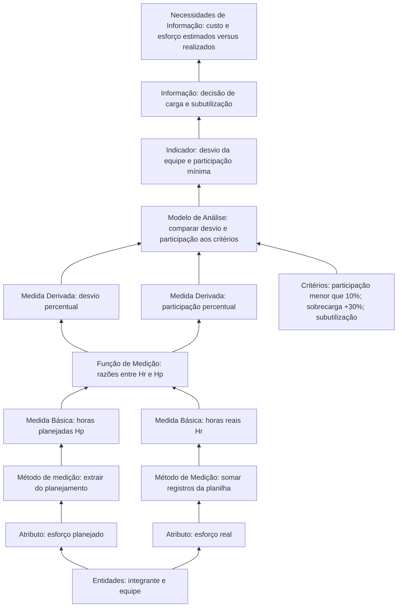
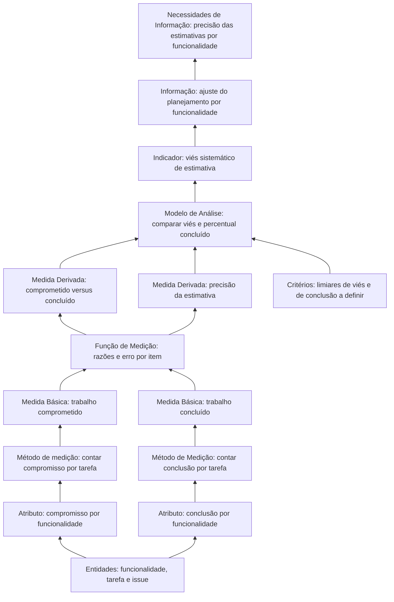

# 1. Recursos e custos

**Categoria de informação:** Recursos e custos  
**Conceito mensurável:** Desempenho financeiro, operacionalizado como esforço da equipe em horas  
**Responsável na Entrega 1:** Dupla A  

Esta página especifica o *measurement construct* da categoria Recursos e custos, conforme o modelo de informação do PSM (RAMOS, 2026) e o mapeamento estrutural da equipe, com apoio das medidas candidatas do *Continuous Iterative Development Measurement Framework* (JONES et al., 2021a; JONES et al., 2021b).

O objeto de medição é o **esforço** dos integrantes no projeto final da disciplina e o respectivo **custo**, obtido automaticamente pela convenção da equipe:

\[
C = H \times 35
\]

em que:

- \(C\): custo em reais (R$);
- \(H\): esforço em horas (\(H_p\) para custo estimado; \(H_r\) para custo real);
- \(35\): taxa horária convencional fixada em R$ 35,00 por hora.

Assim, *Estimated Cost (BRL)* \(= H_p \times 35\) e *Actual Cost (BRL)* \(= H_r \times 35\). Os campos *Planned/Actual Effort (h)* e *Estimated/Actual Cost (BRL)* do Project GitHub devem ser preenchidos de forma consistente com essa regra; a série histórica da Entrega 1 permanece nos CSV de `gestao-psm/` (horas), podendo-se derivar o custo a posteriori pela mesma taxa.

## Necessidade 1: Custo e cronograma estimados por funcionalidade ou capacidade

**Necessidade de informação.** Qual é o custo e o cronograma estimados por funcionalidade ou capacidade?

No escopo desta equipe, “funcionalidade” ou “capacidade” corresponde às frentes das duplas e ao conjunto de tarefas comprometidas em cada corte semanal. A necessidade motiva a comparação entre o esforço planejado e o esforço realizado, como análise de desempenho (*performance*) no sentido do PSM (RAMOS, 2026).

### Instância do modelo de informação

A Figura 1 particulariza o modelo genérico da Aula 09 para o construto aplicado na Entrega 1. Mantém-se a mesma cadeia: entidades e atributos, métodos de medição, medidas básicas, função de medição, medidas derivadas, modelo de análise com critérios, indicador e informação que responde à necessidade.

*Figura 1. Instância do Modelo de Informação do PSM para Recursos e custos: esforço planejado versus real (estrutura conforme RAMOS, 2026).*

### Medidas básicas

#### Horas planejadas (\(H_p\))

| Elemento | Descrição |
|---|---|
| Definição | Esforço estimado do integrante ou da equipe no intervalo acumulado até o corte, em horas. |
| Escala | Razão (número real ≥ 0). |
| Coleta | Extração da planilha de horas e do planejamento; persistência no campo `horas_planejadas` dos arquivos `gestao-psm/2026-10-11_recursos-custos.csv`, `2026-10-18_recursos-custos.csv`, `2026-10-25_recursos-custos.csv` e `recursos-custos.csv`. |
| Cálculo | Valor por integrante; a linha `Equipe` corresponde à soma do acumulado. |
| Análise | Base do desvio e do julgamento de subutilização ou sobrecarga. |
| Limitação observada | O vínculo explícito entre hora planejada e funcionalidade ou capacidade individual ainda não está sistematizado nos CSV (agregação por integrante/dupla). |

#### Horas reais (\(H_r\))

| Elemento | Descrição |
|---|---|
| Definição | Esforço efetivamente registrado até a data do corte, em horas. |
| Escala | Razão (número real ≥ 0). |
| Coleta | Registro contínuo na planilha de horas; consolidação no campo `horas_reais`. No corte de 25/10, o campo `nota_conferencia` documenta checagens pontuais. |
| Cálculo | Soma dos registros até a data de corte (ex.: semanas 05/10, 12/10 e 19/10 no corte de 25/10). |
| Análise | Comparação com \(H_p\) e cálculo da participação relativa. |
| Limitação observada | A qualidade do dado depende da disciplina de preenchimento; não há automação de *time tracking* a partir das issues. |

### Medidas derivadas

#### Estimativa versus esforço real (desvio percentual)

\[
\text{Desvio percentual} = \frac{H_r - H_p}{H_p} \times 100
\]

em que:

- \(H_r\): esforço real do integrante ou da equipe, em horas, acumulado até a data do corte;
- \(H_p\): esforço planejado correspondente, em horas.

| Elemento | Descrição |
|---|---|
| Status | Aplicada nos cortes de 11/10, 18/10 e 25/10. |
| Coleta e cálculo | Campo `desvio_percentual` nos CSV. No corte de 25/10, para a equipe: \(H_p = 78{,}10\), \(H_r = 42{,}17\), desvio −46,0%. |
| Análise | Cortes 11/10 (−42,0%), 18/10 (−20,0%) e 25/10 (−46,0%). Interpretação de desempenho: esforço realizado inferior ao planejado; decisão de acompanhar subutilização e evitar sobrecarga pontual (+30%). |

#### Participação percentual

\[
\text{Participação percentual} = \frac{H_r^{\text{integrante}}}{H_r^{\text{equipe}}} \times 100
\]

em que:

- \(H_r^{\text{integrante}}\): esforço real do integrante, em horas, no intervalo do corte;
- \(H_r^{\text{equipe}}\): esforço real total da equipe no mesmo intervalo.

| Elemento | Descrição |
|---|---|
| Status | Aplicada. |
| Critério | Participação inferior a 10% dispara acompanhamento (Retrospectiva E1, ação C2). No corte de 25/10, a participação mínima foi 10,3%. |
| Escopo interpretativo | Mede equilíbrio de esforço entre pessoas; não substitui a precisão da estimativa por funcionalidade. |

#### Extensões do mapeamento ainda não operacionalizadas na série E1

| Medida do mapeamento | Situação | Encaminhamento |
|---|---|---|
| Estimativa versus custo monetário | Convenção: R$ 35,00/h; \(C_p = H_p \times 35\), \(C_r = H_r \times 35\); CSV da E1 só com horas | Registrar \(C_p\) e \(C_r\) nos campos BRL do Project a cada corte |
| Estimativa versus cronograma real | Tratada em Calendário e progresso (ICP) | Cruzar esforço e prazo por `tarefa_id` / issue |
| Valor agregado (*Earned Value*) | Sem baseline PV, EV e AC por entrega | Atribuir peso aos itens do marco e calcular EV no corte |

### Indicadores e decisões

| Corte | Indicador | Decisão |
|---|---|---|
| 11/10 | Desvio −42,0%; participação mínima 2,8% | Redistribuir (participação); julgamento retrospectivo |
| 18/10 | Desvio −20,0%; participação mínima 11,0% | Manter carga; acompanhar desvios individuais |
| 25/10 | Desvio −46,0%; participação mínima 10,3% | Sem sobrecarga da equipe (+30%); acompanhar subutilização |

## Necessidade 2: Precisão e viabilidade das estimativas em nível de funcionalidade

**Necessidade de informação.** As estimativas em nível de funcionalidade são precisas e viáveis?

### Instância do modelo de informação (construto-alvo)

A Figura 2 mantém a topologia do modelo genérico da Aula 09, com atributos e medidas voltados à precisão por funcionalidade. Na Entrega 1, esse construto não foi plenamente operacionalizado; a participação percentual funciona apenas como *proxy* de distribuição de esforço.

*Figura 2. Instância do Modelo de Informação do PSM para precisão de estimativas por funcionalidade (estrutura conforme RAMOS, 2026).*

## Fontes no repositório

| Artefato | Papel |
|---|---|
| `gestao-psm/2026-10-*_recursos-custos.csv` | Cortes oficiais de medição |
| `gestao-psm/recursos-custos.csv` | Consolidado do último corte |
| Planilha de horas | Coleta bruta de \(H_r\) e planejamento de \(H_p\) |
| [Organização no GitHub](github-organizacao.md) | Campos de esforço e custo no Project |
| [Retrospectiva E1](../retrospectiva-e1.md) | Critério de participação inferior a 10% |

## Referências

JONES, Cheryl L. et al. (ed.). **Practical software and systems measurement continuous iterative development measurement framework**: part 1: concepts, definitions, principles, and measures. Version 2.1. [S. l.]: Practical Software & Systems Measurement; National Defense Industrial Association; International Council on Systems Engineering, 15 abr. 2021a. Product No. PSM-2021-03-001; INCOSE-TP-2020-001-06.

JONES, Cheryl L. et al. (ed.). **Practical software and systems measurement continuous iterative development measurement framework**: part 2: measurement specifications and enterprise measures. Version 2.1. [S. l.]: Practical Software & Systems Measurement; National Defense Industrial Association; International Council on Systems Engineering, 15 abr. 2021b. Product No. PSM-2021-03-001; INCOSE-TP-2020-001-06.

RAMOS, Cristiane Soares. **Medição prática de software e sistemas**: PSM: Practical Software and System Measurement. Notas de aula. Brasília: Faculdade do Gama, Universidade de Brasília, 2026. Material didático da disciplina Qualidade de Software 1 (FGA0315).

Voltar à [visão geral do PSM](../gestao-psm.md).
